# 2025

## Potilaalla kuumetta ja yskää. Thx-kuva ja kysymyksenä onko pneumoniaa

Ei esimerkkikuvaa, kannattaa opetella thx-kuvan tulkinta pneumonioiden suhteen

## Mihin kohtaan niveltä nivelreuma vaikuttaa {#Mihin-kohtaan-nivelta-nivelreuma}

Ei vaihtoehtoja, mutta koita vastata ilman apuja. 

  <button class="solution-button"
          data-label="Vastaus"
          data-hide-label="Piilota vastaus">
    Vastaus
  </button>
  

      
Nivelkalvo eli synovia on nivelreumassa vaurioituva nivelen osa ja nivelturvotus onkin yksi ensimmäisiä löydöksiä. Vaikuttaa kylläkin luuhunkin, mutta ensimmäiseksi nivelkalvoon. 

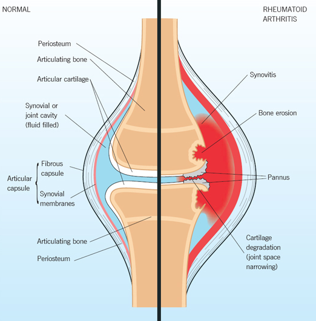
  

## Mitä optimointi tarkoittaa säteilytutkimuksissa? {#Optimointi}

Ei vaihtoehtoja, koita vastata ilman apuja. 

  <button class="solution-button"
          data-label="Vastaus"
          data-hide-label="Piilota vastaus">
    Vastaus
  </button>
  

      
Optimointi = tutkimukseen käytettävä säteilyannos pidetään mahdollisimman pienenä (ALARA, as low as reasonably possible). 

---

Radiologisten tutkimusten periaatteet = **oikeutusperiaate** (ionisoivan säteilyn käyttöön perustuvasta radiologisesta tutkimuksesta saatavan hyödyn tulee olla suurempi kuin haitta), **optimointiperiaate** (ALARA) ja **yksilönsuojaperiaate** (säteilyaltistusta aiheuttava toiminta on järjestettävä ja toteutettava niin että säteilylle altistuvan henkilön – tässä yhteydessä työntekijän – altistus ei ylitä annosrajoja). 

  

## Missä suurin säderasitus {#Missa-suurin-rasitus}

- a. lantion rtg
- b. lantion tt
- c. lannerangan rtg
- d. sinus tt

  <button class="solution-button"
          data-label="Vastaus"
          data-hide-label="Piilota vastaus">
    Vastaus
  </button>
  

      b
      
TT:n säderasitus on huomattavasti suurempi kuin natiiviröntgenin. Sinus-TT:n (nenän sivuonteloiden tietokonetomografia) annos on pienempi kuin lantion alueen TT-kuvantaminen, koska alue on pieni ja siinä käytetään yleensä kartiokeila-TT-kuvantamista (KKTT)-> vielä normaaliakin matalampi annos. 

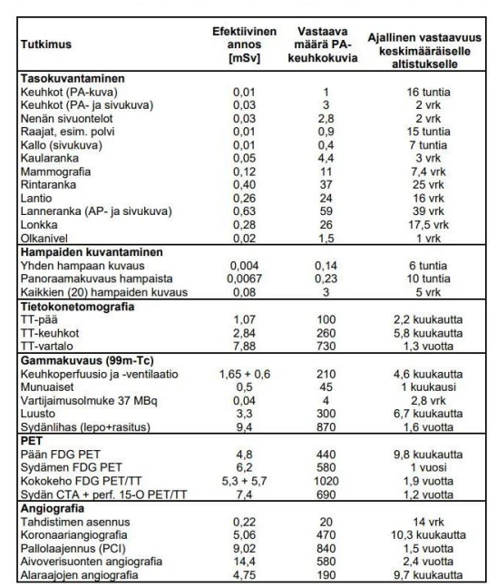
  

## Mikä näkyy kirkkaana T2-kuvassa {#Mika-kirkkaana} 

- a. rasva
- b. neste
- c. luu
- d. ilma

  <button class="solution-button"
          data-label="Vastaus"
          data-hide-label="Piilota vastaus">
    Vastaus
  </button>
  

      b
      
Rasva kirkkaan harmaata (ei siis yhtä kirkas kuin neste), luu (kortikaalinen) tummaam, ilma tummaa, lihas tummaa

T1-kuvassa neste taas olisi tummaa. 

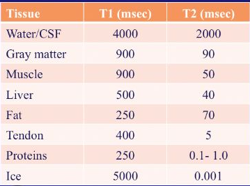
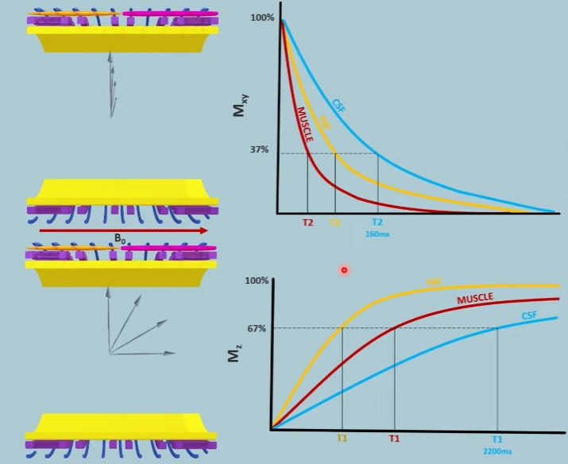
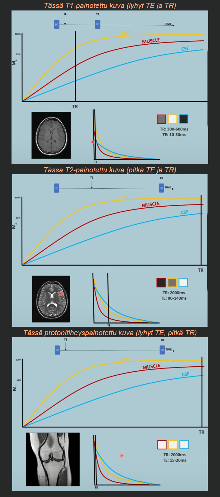

  

## Olkapäässä luksaatiovamma 25v:lla n. 1v sitten, edelleen kipuilee, millä kuvataan {#Luksaatiovamma-taustalla}

- a. UÄ
- b. MRI
- c. TT 
- d. rtg

  <button class="solution-button"
          data-label="Vastaus"
          data-hide-label="Piilota vastaus">
    Vastaus
  </button>
  

      b
      
MRI, koska todnäk jokin pehmytkudosvaurio taustalla. Nuorella potilaalla olkapään sijoiltaanmenon jälkeinen pitkittynyt kipu viittaa mm. labrumin vaurioon (Bankart), kierinkalvosimen vammaan tai epästabiiliuteen. MRI kuvaa pehmytkudokset parhaiten. MR-artrografia (nivelensisäinen varjoaine) on vielä tarkempi nivelhuulen vaurioiden havaitsemisessa.

  

## Mitä vatsan matala-annos TT:lla kuvataan {#Mita-vatsan-ttlla}

Ei vaihtoehtoja. Vähän kaikkea, pääasiassa varmaan haetaan vastauksena **virtsatiekiviä,** jos tarkoitetaan _matala-annos-TT:tä ilman varjoainetta._ **Varjoaineen kanssa mm. aikuisten akuutissa vatsassa pääasiallinen kuvantamiskeino.**

## Nilkan/jalkapöydän luiden nimeäminen {#Nilkan-luut-nimea}

Ei tarkemmin tärpissä. Tässä kuvat, joista voi harjoitella. Ainakin yhden kerätyn tärpin mukaan pyydetty tunnistamaan mediaalinen cuneiforme AP-kuvasta.

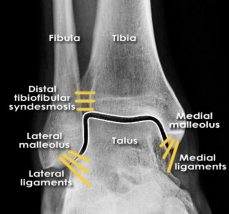
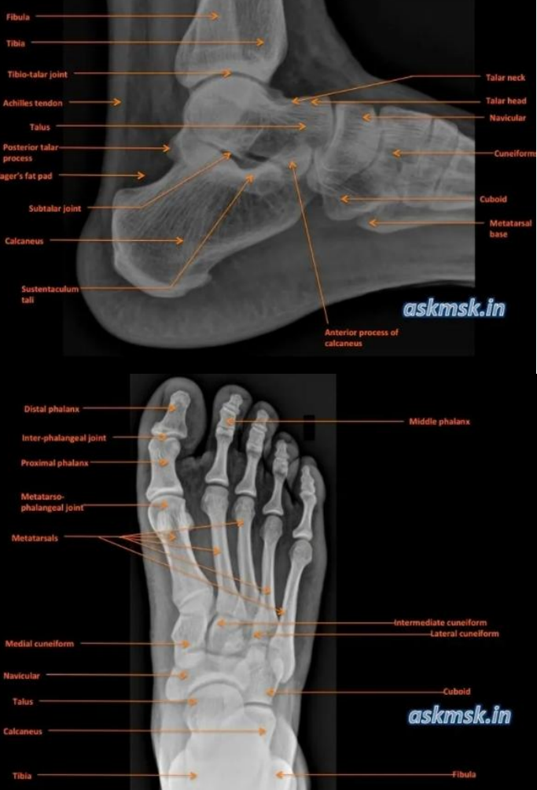

## Polveen kiertovamma, vetolaatikko eteen ++, millä kuvataan ja miksi {#Polveen-kiertovamma}

Ei vaihtoehtoja, koita vastata ilman apuja. 

  <button class="solution-button"
          data-label="Vastaus"
          data-hide-label="Piilota vastaus">
    Vastaus
  </button>
  

      
      
RTG heti (aina herkästi vammoissa ja varsinkin veripolvitilanteissa -> voidaan arvioida kongurenssia ja murtumia) ja MRI (voidaan arvioida nivelsidevaurioita tarkasti; positiivinen vetilaatikko eteen viittaa erityisesti ACL-repeämään) seuraavaksi kiireellisesti (1-2vk). 

Mikäli nivelet paikoillaan ja murtumia ei näy niin ei päivystyksellistä tarvetta jatkohoidolle tai kuvantamiselle.

---

Myös TT voisi auttaa ACL:n arvioimisessa, mutta ei tehdä tyypillisesti. Jos rtg-kuvassa niveleen ulottuva murtuma, tehdään TT. 
  

## Missä suurin efektiivinen annos {#Suurin-eff}

- a. thx-rtg
- b. molempien polvien rtg
- c. ei muistettu 

  <button class="solution-button"
          data-label="Vastaus"
          data-hide-label="Piilota vastaus">
    Vastaus
  </button>
  

      
THX-rtg:ssa aika samanlainen kuin polvien rtg:ssa. Jos otetaan molempien polvien, niin siinä on isompi rasitus kuin yhdessä AP-thx-kuvassa.     

  

## Tuumorin halkaisija aluksi 18mm, kontrolloituna 27mm, kuinka paljon massa on kasvanut? 

- a. 50%
- b. 150%
- c. 250%
- d. 5-kertaistunut

  <button class="solution-button"
          data-label="Vastaus"
          data-hide-label="Piilota vastaus">
    Vastaus
  </button>
  

      c
      
Ajatellaan tuumori palloksi, jolloin massa kasvaa suoraan verrannollisesti halkaisijan kuutioon; tässä tapauksessa 27/18 potenssiin 3 -> 3.375 -> kasvu on prosentteina
237.5% eli vastaus on 250%. 
  

## Mihin alkuaineeseen MRI perustuu: 

- a. jodi
- b. vety
- c. gadolinium
- d. happi

  <button class="solution-button"
          data-label="Vastaus"
          data-hide-label="Piilota vastaus">
    Vastaus
  </button>
  

      b
      
Tarkastellaan vety-ytimien eli protonien käyttäytymistä ulkoisessa magneettikentässä

---

MRI-kuvantamisessa tietyn vokselin nettomagnetoituma osoittaa aluksi ulkoisen magneettikentän suuntaan, mutta tätä muutetaan virittävän radiotaajuisen (radio frequency, RF) säteilypulssin avulla 

Kun virittävä RF-pulssi päättyy, pyrkii systeemi palautumaan perustilaansa eli minimoimaan sisäisen energiansa. Ytimet alkavat siirtyä suuremmasta energiatilasta takaisin pienempään, ja systeemistä poistuva energia vapautuu sähkömagneettisena säteilynä, jonka taajuus on edelleen ytimien pyörimistaajuus. Tätä ilmiötä kutsutaan relaksaatioksi.

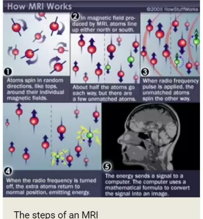
  

## MRI edut Uä nähden {#MRIedut}

- a. ei ionisoivaa säteilyä
- b. parempi paikkatunnistuskyky
- c. pystyy tunnistamaan pienempiä rakenteita

  <button class="solution-button"
          data-label="Vastaus"
          data-hide-label="Piilota vastaus">
    Vastaus
  </button>
  

      b

MRI 3D-kuvantamisena mahdollistaa sen, että itse rakenteen lokaatio on paremmin tunnistettavissa -> paikkatunnistuskyky parempi. Kuva ei myöskään ole tutkijariippuvainen, ja siinä kuvautuvat myös kaasun taakse jäävät rakenteet, joihin ultraääni ei yllä.

---

a: Molemmat ovat ionisoimattomia tutkimuksia

c: Ultraäänellä on parempi paikanerotuskyky (paikkaresoluutio) eli kykenee erottamaan kaksi vierekkäistä kohdetta pienemmällä etäisyydellä kuin MRI -> UÄ:llä pystytään tunnistamaan pienempiä rakenteita

  

## HRTT:ssä hunajakennokuvioitus, mistä kertoo? {#HRTT-hunaja}

Ei vaihtoehtoja, koita vastata ilman apuja

  <button class="solution-button"
          data-label="Vastaus"
          data-hide-label="Piilota vastaus">
    Vastaus
  </button>
  

      
Tyypillistä keuhkofibroosille (klassisesti idiopaattisen keuhkofibroosin myöhäinen muuto; ns. UIP-kuvio)

Hunajakennokuvio (honeycombing) tarkoittaa pieniä, paksuseinäisiä, ilmaa sisältäviä kystia, jotka sijaitsevat tyypillisesti keuhkojen reuna-alueilla ja alaosissa (subpleuraalisesti ja basaalisesti). Se kertoo keuhkorakenteen palautumattomasta tuhoutumisesta ja arpikudoksen muodostumisesta.

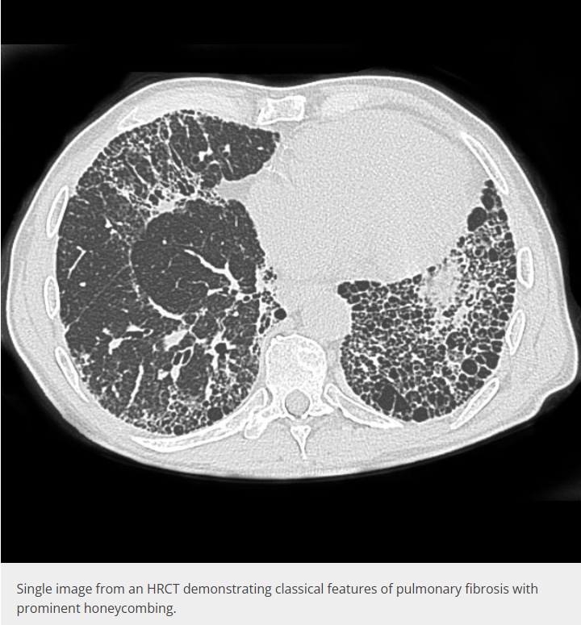
  

## Mikä läpäisee parhaiten röntgensäteilyä? {#Lapaisee-parhaiten}

- a. ilma
- b. rasva
- c. vesi
- d. luu

  <button class="solution-button"
          data-label="Vastaus"
          data-hide-label="Piilota vastaus">
    Vastaus
  </button>
  

      a

Tämän takia ilma on mustaa natiiviröntgenissä.

---

Vaimennus kasvaa tiheyden ja atomiluvun mukana: ilma < rasva < vesi/pehmytkudos < luu.
  

## Vatsan TT ei saatavilla. Mitä vatsan röntgenkuvalla voidaan havaita? {#Vatsan-rtg}

- a. perforaatio
- b. okkluusio
- c. ei kumpikaan
- d. molemmat

  <button class="solution-button"
          data-label="Vastaus"
          data-hide-label="Piilota vastaus">
    Vastaus
  </button>
  

      d

Vatsan natiiviröntgeniä ei käytetä enää kovinkaan paljoa, mutta sillä voidaan periaatteessa havaita sekä:

<li>perforaatio: vapaa ilma vatsaontelossa (pallean alla pystykuvassa tai vasemmassa kylkiasennossa) että</li>
<li>okkluusio (suolitukos): laajentuneet suolenlenkit ja nestevaakapinnat</li>

---

Myös vierasesineet ovat hyvin näkyvissä ja natiivikuvantaminen onkin tyypillisin kuvantaminen, kun halutaan selvittää esim. lapsella nielaistun vierasesineen lokaatio (onko vielä ruokatorvessa/vatsalaukussa/onko jo suolessa)
  

## Millä kuvantamismenetelmällä Alzheimerin taudin muutoksia hippokampuksessa voidaan havaita? {#Hippokampus}

- a. TT ja MRI
- b. TT mutta ei MRI
- c. MRI mutta ei TT
- d. PET

  <button class="solution-button"
          data-label="Vastaus"
          data-hide-label="Piilota vastaus">
    Vastaus
  </button>
  

      a

Hippokampuksen surkastuminen (atrofia) ja ohimolohkon mediaalisten osien muutokset voidaan havaita sekä TT:llä että MRI:llä. TT:ssä käytetään ohuita koronaalisia rekonstruktioita. MRI on kuitenkin herkempi ja tarkempi, ja se on ensisijainen menetelmä hippokampuksen arvioinnissa, jos kuvataan elektiivisesti (usein vanhuksilla kuvataan TT akuutti-indikaatiossa esim. vamman yhteydessä ja siinä voidaan nähdä Alzheimerlöydöksiäkin samalla (pyydetään usein jälkilausunto)).

---

d: PET (FDG- tai amyloidi-PET) kuvaa aineenvaihduntaa ja amyloidikertymiä, ei ensisijaisesti hippokampuksen rakennetta.
  

## Miten tuore veri näkyy pään TT:ssä?

- a. ei juuri näy
- b. vaaleana
- c. tummana
- d. samanvärisenä kuin muukin aivokudos

  <button class="solution-button"
          data-label="Vastaus"
          data-hide-label="Piilota vastaus">
    Vastaus
  </button>
  

      b

TT-arvot laskevat n. 1,5HU päivässä ja vanha veri on jo tummaa (tällä välillä on jossain kohtaa samanvärinen kuin muukin aivokudos)

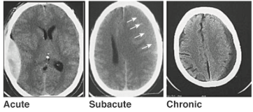

  

## Mistä rasvapatjojen näkyminen kertoo? {#Rasvapatjat}

- a. nestettä nivelraossa
- b. nestettä rasvapatjassa
- c. ei muistettu

  <button class="solution-button"
          data-label="Vastaus"
          data-hide-label="Piilota vastaus">
    Vastaus
  </button>
  

      a

Jos näkyy rasvapatjoja trauman yhteydessä -> ajattele intra-artikulaarista murtumaa (voi kuitenkin johtua muustakin nivelen hydropsia aiheuttavasta tilasta). 

---

Rasvapatja on nivelkapselin ja luun välissä olevaa rasvakudosta, joka täyttää nivelen ympärillä olevia kuoppia; esim. kyynärnivelessä olekranon-, koronoidi- ja radiaalikuoppa. Röntgenkuvassa rasva näkyy tummempana kuin ympäröivä pehmytkudos.

Normaalisti esim. kyynärnivelen lateraali-rtg:ssä on anteriorinen ja posteriorinen rasvapatja. Anteriorinen voi olla nähtävissä, posteriorinen ei normaalisti koskaan.

Kun nivelessä on nestettä, kapseli pullistuu ja nostaa rasvapatjat näkyviin: etummainen patja nousee purjemaiseksi (sail sign) ja takimmainen tulee näkyviin. Takimmaisen rasvapatjan näkyminen on erityisen merkittävä löydös.

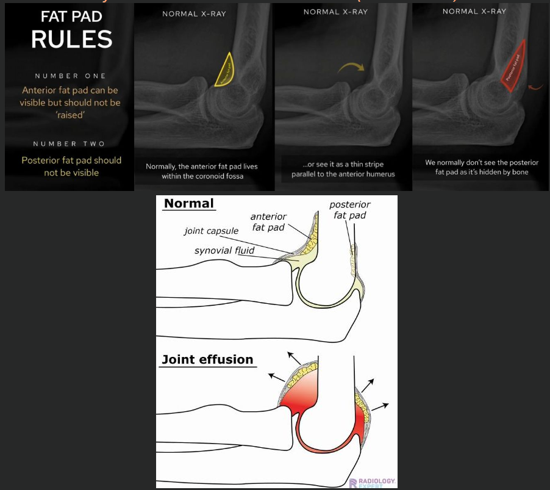
  

## Kilpirauhasessa niukkakaikuinen leesio, mikä on paras tapa paikantaa punktion yhteydessä? {#Kilpirauhanen-niukkakaikuinen-leesio}

- a. uä
- b. palpointi
- c. tt
- d. mri

  <button class="solution-button"
          data-label="Vastaus"
          data-hide-label="Piilota vastaus">
    Vastaus
  </button>
  

      a

Kilpirauhasen biopsiat tehdään UÄ-ohjauksella tehdään kilpirauhasen biopsiat; UÄ on muutenkin kilpirauhasen paras kuvantamismenetelmä. 
  

## Minkä läpi UÄ ei voi kuvantaa? {#Minka-lapi-ei-ua}

- a. kaasu
- b. rasva
- c. vesi
- d. joku

  <button class="solution-button"
          data-label="Vastaus"
          data-hide-label="Piilota vastaus">
    Vastaus
  </button>
  

      a

UÄ ei kulje hyvin ilmassa ja siroaa nopeasti
  

## Miten sappirakon kuvaus parhaiten onnistuu?

- a. paasto 1h ennen tmp
- b. runsaan veden juominen ennen tmp
- c. varjoaineella iv
- d. kaasua suolistossa

  <button class="solution-button"
          data-label="Vastaus"
          data-hide-label="Piilota vastaus">
    Vastaus
  </button>
  

      a

Sappirakon kuvantaminen tehdään ensisijaisesti UÄ:llä ja parhaiten se näkyy potilaan paastottua hetken (kaasua tai massaa ei ole niin paljoa suolessa häiritsemässä näkyvyyttä). Paastotessa myös sappirakko täyttyy sapella ja laajenee, jolloin sen seinämä, sisältö ja sappikivet erottuvat selvästi.

Usein suositellaan jopa hieman pidempää paastoa kuin 1h, mutta vaihtoehto a on silti paras näistä. 

---

b: Veden juominen ja täysi virtsarakko ei auta sappirakon kuvantamista 

c: Suonensisäinen varjoaine ei kuulu sappirakon UÄ-tutkimukseen

d: Suoliston kaasu heikentää ultraäänen kulkua ja huonontaa kuvanlaatua

  

## 40v potilas vuosi sitten kaatunut ranteen päälle, rtg:ssä ei murtumaa. Nyt kuormituksessa alkanut tuntua ikävää naksahtelua, miten kuvannat? {#40v-naksahtelua}

Ei vaihtoehtoja, koita vastata ilman apuja.

  <button class="solution-button"
          data-label="Vastaus"
          data-hide-label="Piilota vastaus">
    Vastaus
  </button>
  

      a

Vuoden takainen kaatuminen ja nyt kuormituksessa ilmenevä naksahtelu viittaavat ranteen sidekudosvaurioon, jota natiiviröntgen ei näytä. Tällaisessa tilanteessa MRI on paras, koska se kuvaa pehmytkudokset, siteet ja rustot parhaiten. Ei myöskään ole päivystyksellinen tilanne -> MRI hyvä

  

## Potilaalla viikon ripulia, kuvannatko ja jos niin miten?

Ei vaihtoehtoja, koita vastata ilman apuja. 

  <button class="solution-button"
          data-label="Vastaus"
          data-hide-label="Piilota vastaus">
    Vastaus
  </button>
  

      
Ei, jos vain tyypillistä ripulia. Viikon kestänyt ripuli on useimmiten infektio (virus tai bakteeri), jonka diagnoosi perustuu esitietoihin, kliiniseen tutkimukseen ja tarvittaessa ulostenäytteisiin (bakteeriviljely, Clostridioides difficile-toksiinit, mahdollisesti loiset). Kuvantaminen ei muuta hoitoa.

Ripulissa kolonoskopia on muutenkin ensisijainen kuvantamismenetelmä, mutta yleensä indikoitu vasta, kun pitkittynyt ripuli (kesto>4vk). 

Akuutimmassa tilanteessa, jos on hälytysoireita akuutista vatsasta/epäilyä komplikaatioista, niin silloin vatsan varjoaine-TT olisi yleensä ensisijainen. 
  

## Iskiastyyppisen kivun kuvantaminen

Ei vaihtoehtoja. Mikä on ensisijainen kuvantamiskeino? Milloin kuvataan? 

  <button class="solution-button"
          data-label="Vastaus"
          data-hide-label="Piilota vastaus">
    Vastaus
  </button>
  

      
MRI (lannerangan) ensisijainen. Kuvannetaan tyypillisesti vasta 6-8vk jälkeen, jos oireet eivät lievity ja harkitaan operatiivista hoitoa.

Tietysti, jos jotain selkäkivun punaisen lipun oireita (esim. cauda-oireet), niin päivystyksellinen kuvantaminen.  
  

## Onko polvessa selvät artroosimuutokset vai ei {#Selvat-vai-ei}

Ei esimerkkikuvaa tärpeissä. Käy läpi tyypilliset rtg-kuvassa mahdollisesti nähtävät artroosiin viittavat löydökset

  <button class="solution-button"
          data-label="Vastaus"
          data-hide-label="Piilota vastaus">
    Vastaus
  </button>
  

      
Muutoksia ovat LOSS (Loss of joint space, osteophytes, subchondral sclerosis, subchondral cysts). Nivelrikkomuutokset luokitellaan vaikeusasteisin Kellgren-Lawrencen mukaan.

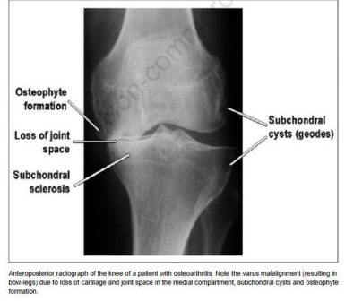
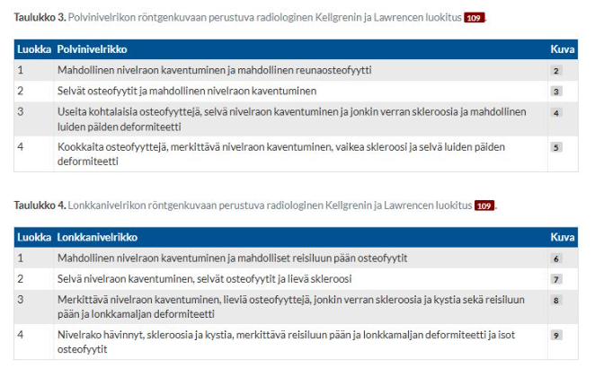
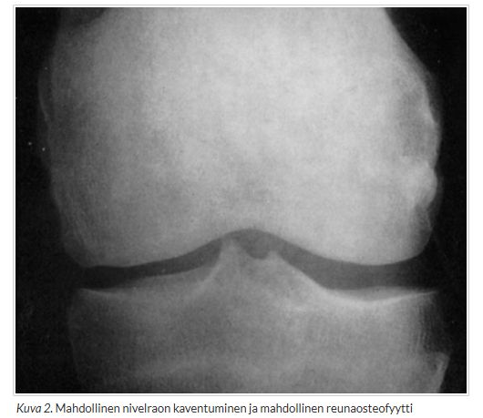
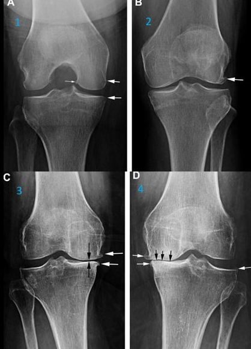
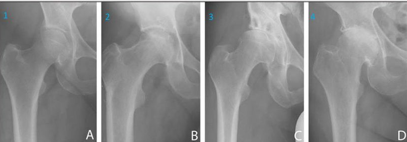

  

## Miliäärinen tuberkuloosi onko? {#Miliaarinen-tuberkuloosi}

Ei esimerkkikuvaa. Millainen olisi tyypillinen löydös thx-rtg:ssa? 

  <button class="solution-button"
          data-label="Vastaus"
          data-hide-label="Piilota vastaus">
    Vastaus
  </button>
  

      
Tyypillistä on hienojakoinen laajalle nevinnyt nodulaarinen tiiviys; yksittäiset leesiot ovat tyypillisesti pieniä (1-3mm; ylälohkoissa voi olla jopa 6mm). 

Erotusddx: sarkoidoosin keuhkomuutokset paikantuvat usein ylälohkoihin ja hilumien ympärille ja yksittäiset leesiot ovat hieman kookkaampia kuin miliaarisessa tuberkuloosissa

---

Primaarinen tuberkuloosi voi edetä miliaariseksi tuberkuloosiksi, mikä tarkoittaa TB:n systeemistä leviämistä. Nimi tulee tyypillisestä keuhkokuvasta: diffuuseja pieniä hirssisiemenmäisiä (millet seeds) pisteitä

Johtaa granuloomien muodostumiseen ympäri kehoa (mm. perna, maksa, lisämunuaiset, aivokalvot -> meningiitti). 

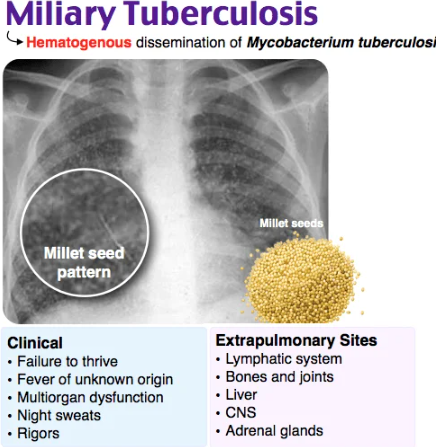
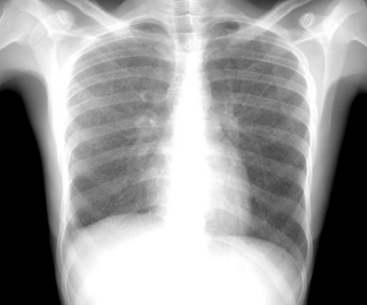
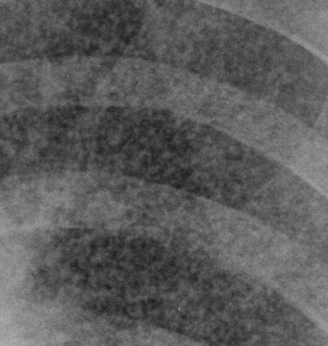

  

## Pikseli ja vokseli, erot/yhtäläisyydet {#Vokselitpikselit}

Ei vaihtoehtoja tärpeissä. Koita keksiä aivan perusteellisin ero näiden välillä. 

  <button class="solution-button"
          data-label="Vastaus"
          data-hide-label="Piilota vastaus">
    Vastaus
  </button>
  

Ero: Pikseli 2D-kuvassa, Vokseli 3D-kuvassa (esim. TT, MRI)

Molemmat ovat kuvan pienimpiä yksiköitä ja kuvaavat sijaintia ja arvoa (sävy, tiheys, signaali) siinä lokaatiossa. 

  

## Röntgensäteilyn tuotto {#rtg-tuotto}

Ei tarkempaa kysymyksenasettelua tärpeissä. Koita miettiä, miten röntgensäteilyä tuotetaan. 

  <button class="solution-button"
          data-label="Vastaus"
          data-hide-label="Piilota vastaus">
    Vastaus
  </button>
  

Syntyy, kun röntgenputkessa nopeutetaan elektroneja ja ne törmäävät putken anodissa olevaan kohteeseen; rtg-generaattorilla tuotetaan suurjännite, jolla elektronit kiihdytetään röntgenputkessa

Elektronien törmääminen anodiin tuottaa rtg-säteilyä kahdella tavalla: jarrutussäteily (jatkumolla) ja ominaissäteily (elektronikuorille karakteristinen säteilyenergia).

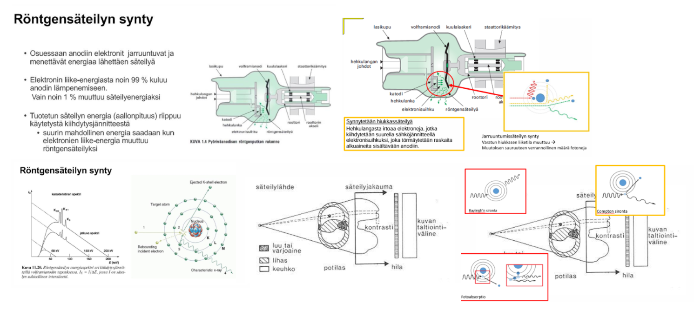
  

## Testin sensitiivisyys

Ei tarkempaa kysymyksenasettelua. Mitä tarkoitetaan testin sensitiivisyydellä? 

  <button class="solution-button"
          data-label="Vastaus"
          data-hide-label="Piilota vastaus">
    Vastaus
  </button>
  

Tarkoittaa sairaan potilaan todennäköisyyttä saada positiivinen testitulos -> korkea herkkyys on hyvä, jos halutaan poissulkea tauteja (nappaa hyvin positiiviset, mutta kääntöpuolella voi antaa helposti vääriä positiivisia, jos tarkkuus ei ole korkea. 

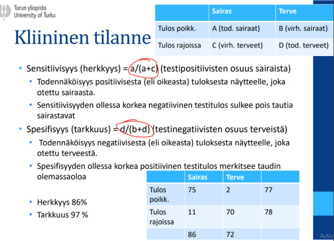

  

## Maksan yleisimmät fokaaliset muutokset {#Maksan-yleisimmat-fokaalimuutokset}

Ei tarkempaa kysymyksenasettelua. Mitkä ovat top 3 yleisintä fokaalimuutosta maksassa

  <button class="solution-button"
          data-label="Vastaus"
          data-hide-label="Piilota vastaus">
    Vastaus
  </button>
  

Kysta (nro 1), hemangiooma (nro 2), fokaalinen nodulaarinen hyperplasia (FNH) (nro 3)

---

Maksan yksinkertaiset kystat ovat yleisiä. Niitä löytyy ultraäänitutkimuksissa noin 6 %:lta ja tietokonekerroskuvauksissa (TT) jopa 15 %:lta. Eivät vaadi hoitoa tai seurantaa (Toimenpideindikaatio on lähinnä suurten (> 10 cm) kystien aiheuttamat paineoireet) 

Hemangiooma on synnynnäinen laskimokehityspoikkeama, joka on yleensä oireeton. Ei vaadi hoitoa tai seurantaa. Aikuisväestössä hemagioomia esiintyy 0,7–7,3 %:lla

Fokaalinen nodulaarinen hyperplasia (FNH) on maksasolujen paikallinen kyhmyinen liikakasvu, jonka syynä katsotaan olevan vaskulaarinen kehityspoikkeama. Maksasolut kasvavat poikkeavasti tämän kehityspoikkeaman ympärille ja muodostavat pesäkkeitä, joista 60 %:ssa on keskusarpi. Ei vaadi hoitoa tai seurantaa. FNH-pesäkkeitä esiintyy noin 0,9 %:lla.

---

**Maksan hyvänlaatuiset muutokset ovat selvästi yleisempiä kuin pahanlaatuiset** (Vaikka potilaalla olisi taustalla syöpä, on yli 90 %:n todennäköisyys, että maksan paikallismuutos on hyvänlaatuinen). Yli 90 % maksan maligneista kasvaimista on metastaaseja; yleisin primaarinen syöpä on hepatosellulaarinen karsinooma (HCC). Lasten primaarisista maksasyövistä yleisin on hepatoblastooma. 

Hepatosellulaarinen adenooma on melko harvinainen maksakasvain-
  

## Miltä kysta näyttää maksan uä:ssä? Onko kaiuton ja tekeekö kaikukatveen vai kaikuvahvistuman? {#Milta-kysta-nauttaa}

  <button class="solution-button"
          data-label="Vastaus"
          data-hide-label="Piilota vastaus">
    Vastaus
  </button>
  

Kaiuton (nestetäytteinen; tosin kystan seinämä voi olla muuta maksaa tiivimpi) ja tekee kaikuvahvistuman

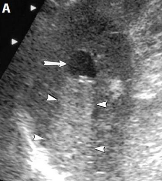
  

## Näkyykö akuutti aivoinfarkti TT:ssä? {#Nakyyko-akuutti-aivoinfarkti-ttssa}

Ei vaihtoehtoja, koita vastata ilman apuja. 

  <button class="solution-button"
          data-label="Vastaus"
          data-hide-label="Piilota vastaus">
    Vastaus
  </button>
  

Aivan akuutti ei -> akuutissa aivoinfarktiepäilyssä TT voi olla ja onkin usein normaali. TT kuitenkin otetaan, koska **tulee poissulkea verenvuoto** aivoverenkiertohäiriön taustalla, jotta voidaan antaa liuotushoito.

TT näyttää infarktin ensimmäiset merkit 1-2 tunnin kuluttua oireiden alusta; MRI jopa 3-30 minuutissa (MRI:tä ei kuitenkaan yleensä tehdä ennen TT-kuvantamista). 

  

## Onko UÄ vai MRI parempi pneumothoraxin diagnoosiin? {#UA-vs-MRI-pneumothorax}

  <button class="solution-button"
          data-label="Vastaus"
          data-hide-label="Piilota vastaus">
    Vastaus
  </button>
  

UÄ on parempi; se on nopea, herkkä ja luotettava. MRI ei ole hyvä kuvantamaan ilmatäytteisiä kudoksia. 

---

UÄ:tä käytetään esimerkiksi traumapotilaan eFAST-tutkimuksessa ja samalla voidaan verikertymien lisäksi etsiä pneumothoraxia. Tyypillisiä löydöksiä ovat pleuran liukumisen (sliding) puuttuminen (näkyy barcode-signina seashoren sijaan M-moodissa) ja B-viivojen puuttuminen. 

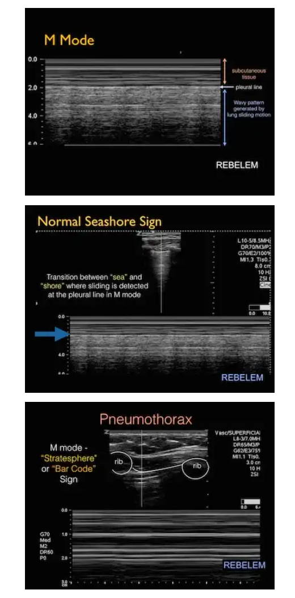
  

## Minkä tyyppinen weber murtuma, A vai B {#Mika-weber}

Ei esimerkkikuvaa tärpissä. Mieti, millainen on Weber A, B ja C.

Oli myös toinen tärppi, jossa oli kaksi eri nilkka-rtg:tä ja kysyttiin onko molemmilla weber a, molemmilla weber b yms (vastauksena oli toisella weber a, toisella weber b).

  <button class="solution-button"
          data-label="Vastaus"
          data-hide-label="Piilota vastaus">
    Vastaus
  </button>
  

Weber A = fibulamurtuma niveltason eli syndesmoositason alapuolella

B-murtumassa syndesmoositasolla

C- murtumassa yläpuolella

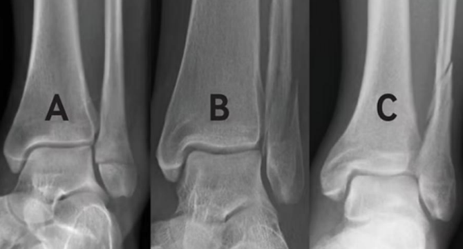
  

## Mitä meinaa tt:ssä monileiketekniikka {#TT-monileike}

Ei vaihtoehtoja tärpissä. Mieti ilman apuja. 

  <button class="solution-button"
          data-label="Vastaus"
          data-hide-label="Piilota vastaus">
    Vastaus
  </button>
  

Kuvattavasta kohteesta saadaan yhtäaikaisesti useampia leikkeitä, koska laite sisältää monta vierekkäistä ilmaisinta. Kuvaustekniikka on nopea ja sillä saadaan otettua entistäkin ohuempia leikkeitä. Kuvaa voidaan myös käsitellä monipuolisesti jälkikäteen. Haittapuolina on potilaan kasvanut säteilyannos sekä tulkittavien kuvien valtava määrä

---

Taas spiraalikuvaus on useimmissa laitteissa käytössä ja siinä tutkimuspöytä liikkuu automaattisesti tasaista nopeutta kuvausaukon läpi röntgenlähteen ja detektorien pyöriessä sen ympärillä. Tuloksena saadaan yhtenäinen spiraalimainen projektiodata, josta voidaan valita halutut leikkeet. 

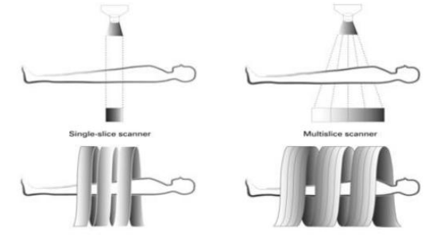
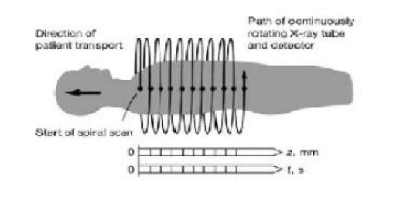

  

## Voiko UÄ:llä poissulkea appendisiittiä? {#UA-poissulkea}

- a. Kyllä
- b. Ei

  <button class="solution-button"
          data-label="Vastaus"
          data-hide-label="Piilota vastaus">
    Vastaus
  </button>
  

      Ei

TT tarvitaan poissulkemiseen

---

UÄ on kuitenkin usein **ensisijainen kuvantaminen lapsilla ja raskaana olevilla** appendisiitin suhteen; tarvittaessa MRI (se on TT:n veroinen, mutta hidas ja pääasiassa käytössä vain tarvittaessa lapsilla ja raskaana olevilla). 
  

## Miltä askites näyttää kuvissa {#Milta-askites}

Ei vaihtoehtoja tärpissä. Millaista UÄ:ssä, millaista TT:ssä? 

  <button class="solution-button"
          data-label="Vastaus"
          data-hide-label="Piilota vastaus">
    Vastaus
  </button>
  

      

Kaiuttomalta eli mustalta UÄ:ssä (on nestettä ja neste on kaiutonta UÄ:ssä), TT:ssä tyypillisen veden sävyistä tai hieman tiheämpää (n. 0-20 HU). Neste on tummempaa kuin parenkyymielimet (maksa, perna).

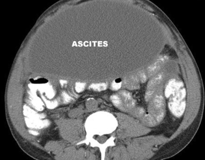
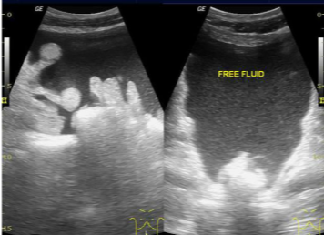

  

## Mitä varjoainetta käytetään ensisijaisesti MRI-kuvantamisessa? {#Mri-varjoaine}

Ei vaihtoehtoja, koita ilman apuja. 

  <button class="solution-button"
          data-label="Vastaus"
          data-hide-label="Piilota vastaus">
    Vastaus
  </button>
  

      
Ensisijaisesti gadolinium (TT-kuvantamisessa jodi ensisijainen)

  

## Mikä totta röntgenkuvantamisesta? {#totta-rtgsta}

- a. Rasva vaimentaa enemmän kuin neste
- b. Ilma vaimentaa enemmän kuin neste
- c. Luu vaimentaa enemmän kuin neste

  <button class="solution-button"
          data-label="Vastaus"
          data-hide-label="Piilota vastaus">
    Vastaus
  </button>
  

      c

Luu on tiheää ja vaimentaa röntgensäteilyä selvästi enemmän kuin neste (vesi) -> näkyy rtg:ssa kirkkaana 

---

a: Rasva vaimentaa vähemmän kuin neste (rasvan tiheys on pienempi)

b: Ilma vaimentaa vähiten kaikista, joten se näkyy mustana
  

## Mikä on totta artroosista? {#Totta-artr}

Ei vaihtoehtoja tärpissä, mutta vastaus ilmeisesti: "Vaikka nivelrikolle on tyypillistä ruston vaurioituminen, ei rustoa voi nähdä natiiviröntgenissä."

## Polvi kipeä ja lonkan liikerajoitus. Mitkä kuvantamiset? {#Polvi-kipea-ja-lonkan-liikerajoitus}

- a. Lonkan MRI ja polven rtg 
- b. Lonkan rtg, polven rtg 
- c. Muita samanlaisia vaihtoehtoja (ei muistettu) 

  <button class="solution-button"
          data-label="Vastaus"
          data-hide-label="Piilota vastaus">
    Vastaus
  </button>
  

      b

Lonkan liikerajoitus ja polvikipu on hyvin yleistä samaan aikaan ja kipu voi hyvinkin olla lonkasta heijastuvaa. Syynä voi olla lapsella tai nuorella reisiluun pään epifyysin liukuma (SCFE) tai Perthesin tauti, aikuisella lonkan nivelrikko. Tietysti voi olla ihan molempienkin nivelien erillinen ongelma.

Ensivaiheen kuvantaminen on natiiviröntgen kummastakin nivelestä. MRI harkitaan vasta, jos röntgen ei selitä oireita (esim. piilomurtuma, nekroosi tai pehmytkudosvaurio)
  

## Toteat potilaalla kylkiluumurtuman statuslöydöksenä. Miksi otat thx-rtg:nin? {#Miksi-rtg-kylkiluumurtumassa}

- a. Haluat vakuuttaa potilaan taidoistasi 
- b. Haluat varmistaa dg ennen hoidon aloittamista 
- c. Haluat poissulkea pneumothx ja hemothx

  <button class="solution-button"
          data-label="Vastaus"
          data-hide-label="Piilota vastaus">
    Vastaus
  </button>
  

      c

Kylkiluumurtuman diagnoosi tehdään kliinisesti, ja murtuma näkyy röntgenkuvassa usein huonosti, eikä hoito (kipulääkitys, hengitysharjoitukset) muutu murtuman varmistamisesta. Kuvantamisen tärkein tarkoitus on löytää komplikaatiot: ilmarinta tai veririnta (tai keuhkokontuusio). 
  

## Mikä on distaalisen radiusmurtuman ensimmäisen rtg-kontrollin tarkoitus? {#Dist-rad-ktrl-tarkoitus}

- a. Luutumisen varmistaminen 
- b. Varmistaminen ettei asento ole pettänyt

  <button class="solution-button"
          data-label="Vastaus"
          data-hide-label="Piilota vastaus">
    Vastaus
  </button>
  

      b

Distaalisen radiuksen tyyppimurtuman rtg-kontrolloimisaikataulun ohjeet eroavat lähteiden välillä, mutta Käypä Hoidossa ohjeistus on 1vk+2vk+5vk suositus. Monissa ohjeissa vain 1-2krt 10-14vrk sisällä ja vain harkinnan mukaan kipsin poiston yhteydessä 5vk kohdalla

Ensimmäisen kuvantamisen yhteydessä ei vielä ole luutumista ehtinyt tapahtumaan; tarkoitus on varmistaa, että asento ei ole pettänyt hyväksyttävän asennon ulkopuolelle. Kirurgista hoitoa harkitaan, jos murtuman asento ei ole hyväksyttävä reduktion jälkeen tai se huononee 1–2 viikon seurantakuvissa. Näissä tapauksissa konsultoidaan käsikirurgia tai ortopedia. Uudelleen tehtyä sulkeista reduktiota 1–2 viikon kohdalla ei suositella

Jos onnistuneen hoidon kriteeriksi on annettu hyväksyttävä asento seurantakuvauksissa, asennon suhteen pätevät samat radiologiset kriteerit kuin primaarivaiheessa. 

*Ikääntyneillä värttinäluun alaosan tyyppimurtumien rutiinimaisesta seurannasta natiiviröntgenkuvin ei kuitenkaan liene hyötyä, mikäli jaetun päätöksenteon periaatteita noudattaen päädytään konservatiiviseen hoitoon
  

## Kahden eri potilaan käden rtg-kuvat. {#Kaksi-eri-rtg}

Ei esimerkkikuvaa, mutta tässä vaihtoehdot ja vastaus oli kerättyjen tärppien mukaan ilmeisesti "molemmilla oli murtuma"; toisella tosin oli selkeämpi, toisella vähemmän selkeä

- a. Molemmilla sormimurtuma
- b. Molemmilla MCP-1:n luksaatio
- c. Vain toisella murtuma
- d. Ei kummallakaan murtumaa

## Potilaalle ollaan tekemässä MRI-enterografia. Mikä väittämä on totta? {#Entero-tot}

- a. Potilas juo varjoaineen
- b. Potilaalle annetaan varjoaine nml kautta
- c. jotain muita vaihtoehtoja 

  <button class="solution-button"
          data-label="Vastaus"
          data-hide-label="Piilota vastaus">
    Vastaus
  </button>
  

      a

Potilaalle juotetaan (jos kyseessä olisi enteroklyysi, niin varjoaine annettaisiin nasojejunaaliletkun kautta) **suolivarjoainetta** (ei ole gadoliniumia kuten i.v-annostelussa; käytetään yleensä niin sanottuja **bifaasisia varjoaineita,** jotka näkyvät T1- gradienttikaikusekvensseissä niukkasignaalisina ja T2-painotteisissa sekvensseissä runsassignaalisina)

---

Voidaan antaa myös samalla i.v.-varjoainetta, jotta suolen seinämä ja sen muutokset näkyisivät paremmin

Tutkimuksen aikana suoli lamataan spasmolyytilla liikkeen aiheuttamien artefaktien välttämiseksi

  

## Haiman kuvantamisesta väitteitä, mikä on totta? {#haima-totta}

- a. Ultraäänellä on vaikea nähdä pseudokystia
- b. Paras kuvantaminen haiman kudoksen vitaliteetin arvioimisessa on varjoaine-TT
- c. Nekrotisoitunut haimakudos vahvistuu arteriavaiheessa 
- d. joku 

  <button class="solution-button"
          data-label="Vastaus"
          data-hide-label="Piilota vastaus">
    Vastaus
  </button>
  

      b

Varjoaine-TT erottaa elinkykyisen, varjoainetta ottavan haimakudoksen kuolleesta (nekroottisesta) kudoksesta, joka ei vahvistu. Siksi sitä käytetään akuutin haimatulehduksen nekroosin ja komplikaatioiden arviointiin. 

---

Akuutti haimatulehdus kylläkin saadaan usein diagnosoitua ilman kuvantamistakin. Akuutin haimatulehduksen toteamiseksi vaaditaan, että vähintään kaksi seuraavista kolmesta diagnostisesta kriteeristä täyttyy: 1) tyypillinen kliininen kuva, 2) seerumin amylaasi- tai lipaasiarvo yli kolminkertainen normaaliin ylärajaan verrattuna, ja 3) akuuttiin pankreatiittiin sopivat kuvantamislöydökset.

Ensisijainen kuvantamismenetelmä, jos pankreatiitti on jo labrojen ja taudinkuvan mukaan selvä on vatsan UÄ -> etsitään sappikiviä; tarvittaessa MRCP kun halutaan varmistaa sappitiekivien olemassaolo 

---

a: Pseudokysta on nestepitoinen ja näkyy UÄ:ssa hyvin kaiuttomana rakenteena. UÄ:n ongelma on haiman itsensä huono näkyvyys suolikaasun vuoksi

c: Nekrotisoitunut haimakudos ei vahvistu varjoaineella lainkaan (se jää tummaksi), eikä sen vahvistuminen arteriavaiheessa ole mahdollista
  

## Nilkasta kuva ja mitattu kuvaan jokin etäisyys (6mm). Kysymyksenä: Minkä rakenteen vaurioon mitta liittyy? {#Mihin-mitta-liittyy}

Ei esimerkkikuvaa tärpissä, poimittu netistä tämä sopiva kuva.

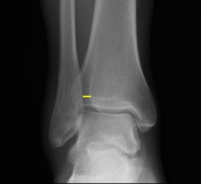

  <button class="solution-button"
          data-label="Vastaus"
          data-hide-label="Piilota vastaus">
    Vastaus
  </button>
  

      
Kuvassa tibiofibular clear space mitattuna -> rakenteena on siis syndesmoosi, koska mitta leviää syndesmoosivammassa. 

Normaali syndesmoosirako on 5mm tai vähemmän mortise-projektiosta mitattuna. Katsotaan n. 1cm nilkkaniveltasosta ylöspäin. 

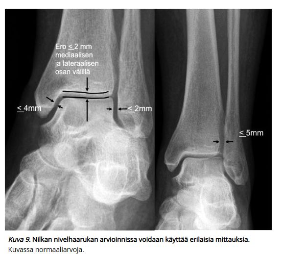
  

## Thx-kuva potilaasta. Kysymyksenä: Mikä syy on sille, että potilaan vasemmat ja oikeat alaosat ovat eri tiheyksisiä? {#Miksi-eri-tiheys}

Ei esimerkkikuvaa tärpissä, tässä sopiva kuva poimittuna. 

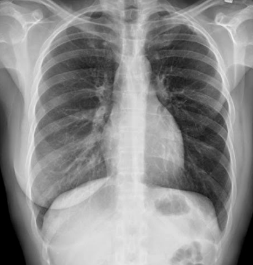

  <button class="solution-button"
          data-label="Vastaus"
          data-hide-label="Piilota vastaus">
    Vastaus
  </button>
  

Potilaan vasen rinta poistettu   
  

## TT-kuvantamisen etu MRI:hin verrattuna 

- a. Voi ottaa useita varjoainetehosteisia kuvantamisjaksoja
- b. Parempi paikanerotuskyky
- c. Ei säteilyä

  <button class="solution-button"
          data-label="Vastaus"
          data-hide-label="Piilota vastaus">
    Vastaus
  </button>
  

      b

TT:llä on MRI:tä parempi spatiaalinen resoluutio (hyvin ohuet leikkeet, alle 1 mm, ja isotrooppiset kuvapisteet), joten se kuvaa pienet rakenteet, luut, kalkit ja keuhkot tarkasti. MRI:n vahvuus on pehmytkudoskontrasti.

---

a: Useat varjoainetehosteiset vaiheet (valtimo-, laskimo- ja myöhäisvaihe) onnistuvat sekä TT:llä että MRI:llä, joten tämä ei ole TT:n erityisetu.

c: TT käyttää ionisoivaa säteilyä, kun taas MRI ei

  

