# 2024 

## Mikä luu murtuu orbitan blow out murtumassa? {#Blow-out}

  <button class="solution-button"
          data-label="Vastaus"
          data-hide-label="Piilota vastaus">
    Vastaus
  </button>
  

**Orbitan pohja; yleensä maxilla.** 

Myös periaatteessa jokin muu seinämä voi pettää. Blow out -murtuma siis tarkoittaa, että silmään osunut isku aiheuttaa orbitansisäisen paineen nousun ja silmäkuopan seinämän murtumisen. Yleisimmin murtuu pohja, toiseksi yleisimmin mediaaliseinämä. 

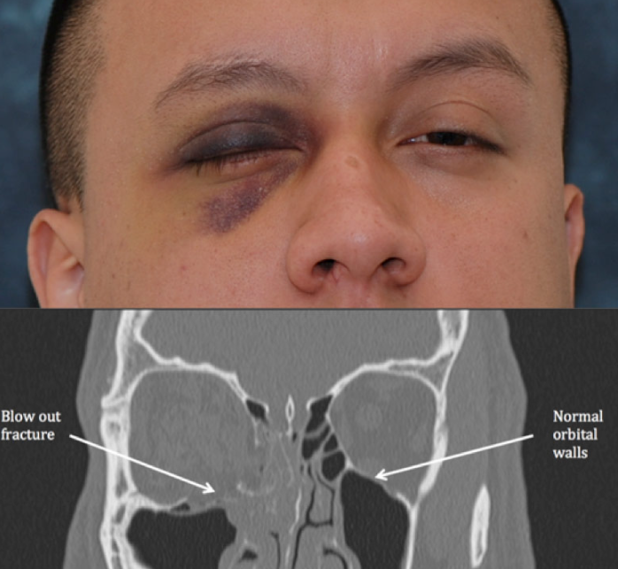
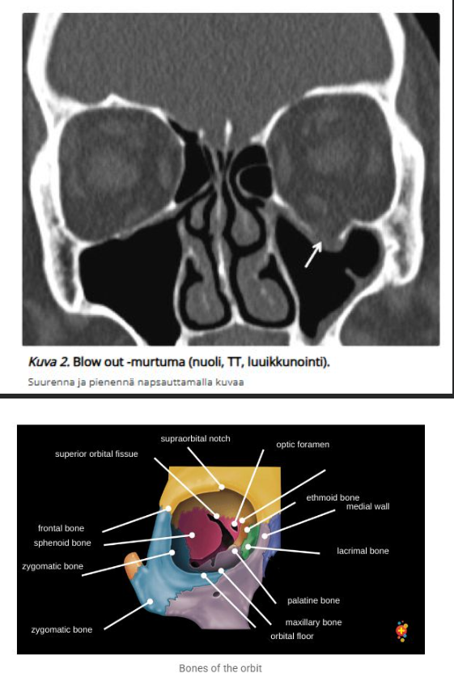

  

## Mitä HU-yksikkö kuvaa? {#HU}

  <button class="solution-button"
          data-label="Vastaus"
          data-hide-label="Piilota vastaus">
    Vastaus
  </button>
  

Kudoksen tiheyttä TT-kuvassa. Tämä TT-luku siis ilmoitetaan HU-yksiköissä eli Hounsfield Unit:eissa.

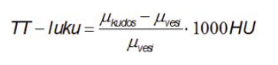
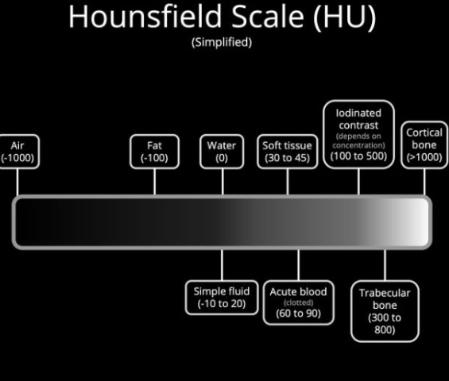
  

## Miksi TT:ssä potilas saa liikkua vaikka MRI ei? {#TT-liikkua}

  <button class="solution-button"
          data-label="Vastaus"
          data-hide-label="Piilota vastaus">
    Vastaus
  </button>
  

TT on nopea -> liikkuminen ei ehdi vaikuttamaan merkittävästi

Magneettikuva on hidas ja siinä liikkuminen myös häiritsee koko kehon magneettikenttää -> koko kuva häiriintyy (vrt. TT, jossa liikkuminen vaikuttaa vain kuvattavaan tasoon) 
  

## UÄ-tutkimuksen edut MRI verrattuna? {#UAVSMRI}

- a. ei ionisoivaa säteilyä
- b. potilas voi liikkua
- c. parempi pehmytkudoskontrasti
- d. joku

  <button class="solution-button"
          data-label="Vastaus"
          data-hide-label="Piilota vastaus">
    Vastaus
  </button>
  

      b

a: Molemmat ovat ei-ionisoivia tutkimuksia 

c: MRI:ssä on kuvantamismenetelmistä paras pehmytkudoskontrasti
  

## Minkä elimen repeämä on vaikea havaita TT:llä? {#Repeama}

  <button class="solution-button"
          data-label="Vastaus"
          data-hide-label="Piilota vastaus">
    Vastaus
  </button>
  

      

Vaikeita ovat mm. haima (yleensä vaikein parenkyymielimistä), suolisto, pallea, rakko

Taas esim. pernan repeämä useimpien lähteiden mukaan taas helppo nähdä
  

## Minkä luun luutumista TT kuvaa parhaiten?

  <button class="solution-button"
          data-label="Vastaus"
          data-hide-label="Piilota vastaus">
    Vastaus
  </button>
  

      
Jos vaihtoehdoissa on **telaluu (talus),** niin se on todennäköisesti vastaus (TT-kuva on hyvä sen (rasitus)murtumien seurannassa). Yleisesti TT hyvä kortikaalisen luun seurannassa (kuoriluu on tiheää ja sen katkeaminen näkyy selvästi TT:ssä). TT on myös usein käytetty esim. **veneluun** murtuman paranemisen seurannassa.

MK taas hyvä esim. rangan rasitusmurtumien seurannassa
  

## Mihin luuhun Böhlerin kulma liittyy? {#Bohler}

  <button class="solution-button"
          data-label="Vastaus"
          data-hide-label="Piilota vastaus">
    Vastaus
  </button>
  

**Kantaluuhun (calcaneus);** käytetään intra-artikulaaristen kalkaneus-murtumien arvioimisessa.

Normaalisti Böhlerin kulma on 25-40 astetta; pieni kulma liittyy dislokoituneisiin murtumiin. 

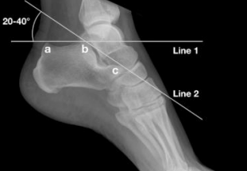
  

## Mitä tapahtuu torusmurtumassa? {#Torus}

  <button class="solution-button"
          data-label="Vastaus"
          data-hide-label="Piilota vastaus">
    Vastaus
  </button>
  

Luu taipuu ja **ääriviivaan tulee ryppy** ("vekki", torus) koveralle puolelle. Kohtisuora voima voi aiheuttaa myös pienen kasaan painumisen. 

Lapsille tyypillinen murtuma, ei tarvitse reponoida tai kontrolloida kuvantamalla. Usein esim. ranteen torusmurtumissa hoidoksi riittää kivunhoidoksi 1-3 viikon tarrakiinnitteinen ortoosi tai dorsaalinen kipsilasta. 

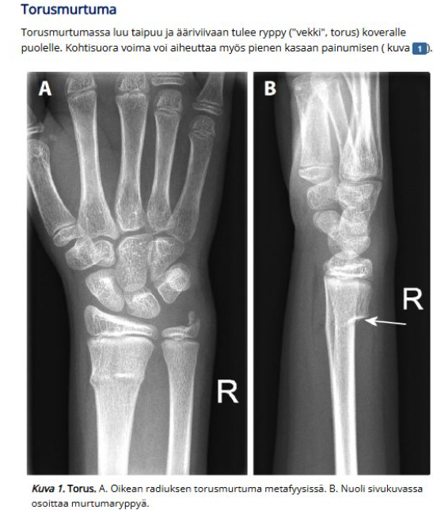
  

## Mikä on pajunvitsamurtuma? {#Pajunvitsa}

  <button class="solution-button"
          data-label="Vastaus"
          data-hide-label="Piilota vastaus">
    Vastaus
  </button>
  

**Luu taipuu ja kuperalle puolelle tulee korteksin katkeama (greenstick).** Lapsille tyypillinen murtuma periostin vahvuuden takia. 

Pajunvitsamurtuma samoin kuin poikkimurtumakin voi vaatia asennon korjaamista (vrt. torus), jos spontaani korjautuminen eli remodellaatio ei todennäköisesti tulisi korjaamaan virheasentoa. 

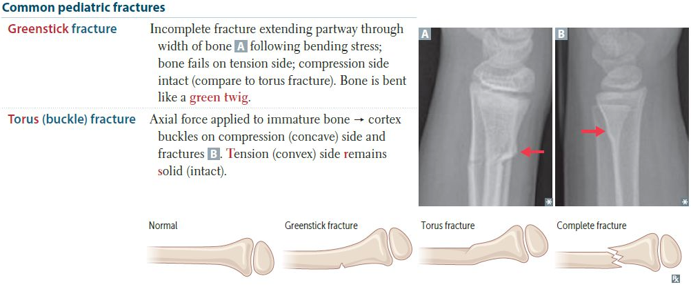
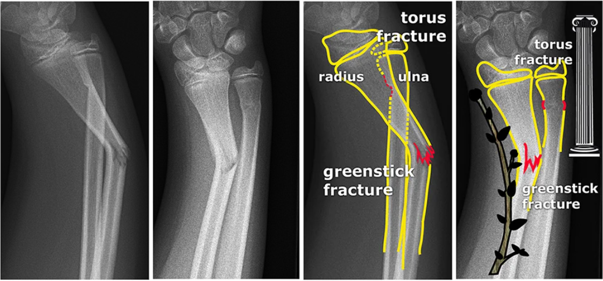
  

## Kummassa UÄ kulkee nopeammin, ilmassa vai kudoksessa? {#UAILMAVSKUDOS}

  <button class="solution-button"
          data-label="Vastaus"
          data-hide-label="Piilota vastaus">
    Vastaus
  </button>
  

**Kudoksessa** (ääni kulkee sitä nopeammin, mitä tiheämpi kudos, koska värähtelyt siirtyvät nopeammin atomien välillä)

Kudoksessa tarkemmin ottaen n. 1540 m/s, ilmassa 340 m/s
  

## Mikä kudos on herkin säteilylle? {#Herkin}

  <button class="solution-button"
          data-label="Vastaus"
          data-hide-label="Piilota vastaus">
    Vastaus
  </button>
  

Herkimpiä: **keuhkot, luuydin, mahalaukku, paksusuoli, rinnat (herkkyyskerroin 0,12) ja sukupuolirauhaset (herkkyyskerroin 0,08).** Yleisesti ottaen jakautuva solukko on herkkää säteilylle. 

  

## Hevonen astunut jalan päälle, turvotusta. mikä kuvantamistutkimus ensisijainen? {#Hevonen}

  <button class="solution-button"
          data-label="Vastaus"
          data-hide-label="Piilota vastaus">
    Vastaus
  </button>
  

      RTG

Voi periaatteessa olla TT, mutta RTG on yleensä ensisijainen kaikissa raajojen traumaattisissa murtumaepäilyssä. Vaikka voisi sinänsä korkean Lisfrancin vamman kliinisen epäilyn takia ottaa suoraan TT:n niin **yleensä kuitenkin otetaan RTG sitä ennen,** jotta voidaan nopeasti nähdä muitakin vammoja ja saadaan baseline-natiivirtg myös otettua. Vaikka rtg:ssä ei todettaisikaan murtumaa, niin TT otetaan silti, koska Lisfrancin vamman epäily niin korkea. 

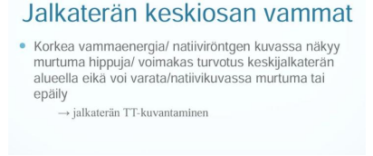
  

## Epäilet L4-5 nikamamurtumaa. Mikä kuvantamistutkimus? {#L4-5}

  <button class="solution-button"
          data-label="Vastaus"
          data-hide-label="Piilota vastaus">
    Vastaus
  </button>
  

      RTG

Todennäköisesti kyseessä **matalaenerginen murtuma -> lannerangan natiivirtg** ensisijainen (ensisijainen osteoporoottisten murtumien tutkimisessa; TT antaa harvoin lisäinfoa, jos murtuma havaittavissa)

_Jos korkeaenerginen vamma tai monivammapotilas -> TT-kuva._
  

## Mikä thx-rtg:n kuvalöydös on tyypillisin asbestialtistuksessa? {#Asbestithx}

  <button class="solution-button"
          data-label="Vastaus"
          data-hide-label="Piilota vastaus">
    Vastaus
  </button>
  

Tavallisin yksittäinen löydös on **parietaalipleuran plakit.** Ei kuitenkaan ole mitään patognomonisia radiologisia piirteitä asbestoosille eikä esim. plakkien puuttuminen sulje pois asbestoosin mahdollisuutta.

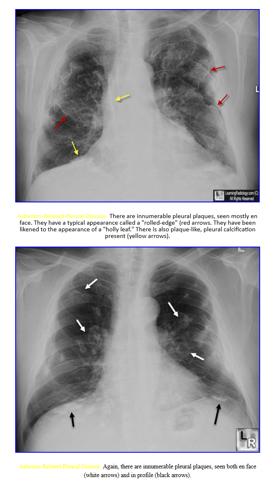
  

## Mitä asbesti aiheuttaa? {#Asbestipneu}

- a. ilmatilapneumonian
- b. keuhkofibroosin
- c. aspiraatiopneumonian 
- d. alveolaarisen pneumonian

  <button class="solution-button"
          data-label="Vastaus"
          data-hide-label="Piilota vastaus">
    Vastaus
  </button>
  

      b

Asbestoosi tarkoittaa keuhkojen **diffuusia interstitiaalista fibroosia** (natiivikuvantamisessa näkyisi mm. hienoja retikulaarisia opasiteetteja). Aiheuttajana on kohtalainen tai runsas asbestialtistus. Muutoksia on yleensä subpleuraali- ja basaalialueilla. HRTT:llä saadaan yleensä selville fibroosin aste. Muut syyt kuin asbesti tulee sulkea pois fibroosin aiheuttajana. 

Asbestipöly voi siis hengitettynä aiheuttaa asbestoosia, parietaalipleuran plakkeja (paksuuntumia), viskeraalipleuran fibroosia ja pleuriitteja. Asbestialtistus lisää myös vaaraa sairastua keuhkosyöpään ja mesotelioomaan. Asbestisairauksilla on pitkä latenssiaika, 20–40 vuotta. 

  

## Missä tutkimuksessa on suurin säteilyannos? {#Sateilyannos}

Ei vaihtoehtoja annettu, mutta tässä esimerkkilista yleisistä tutkimuksista:

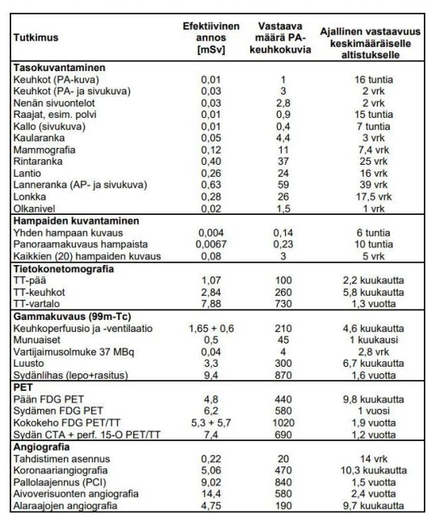

## Kuvia, mm. onko potilaalla lymfangitis carcinomatosa?

Ei kuvia tarjolla. Mitä lymfangitis carcinomatosa tarkoittaa? 

  <button class="solution-button"
          data-label="Vastaus"
          data-hide-label="Piilota vastaus">
    Vastaus
  </button>
  

      b

Lymphangitis carcinomatosa tarkoittaa **tuumorin leviämistä keuhkojen imusuonistossa,** mikä voi aiheuttaa keuhkokuvassa interstitiumin korostumista lymfastaasista johtuen. _Muistuttaa kardiogeenistä keuhkopöhöä thx-rtg:ssä._

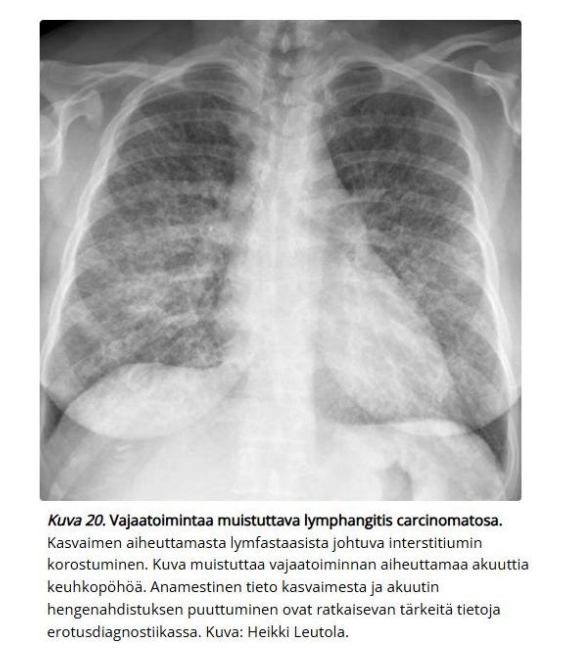

  

## Kuvia: mitä kämmenen luita nuoli osoittaa? {#Kammenen-luut-nuoli}

Ei kerrottu, mitä luuta tarkalleen kysyttiin, mutta tässä rtg-esimerkki. Nimeä luut päässäsi

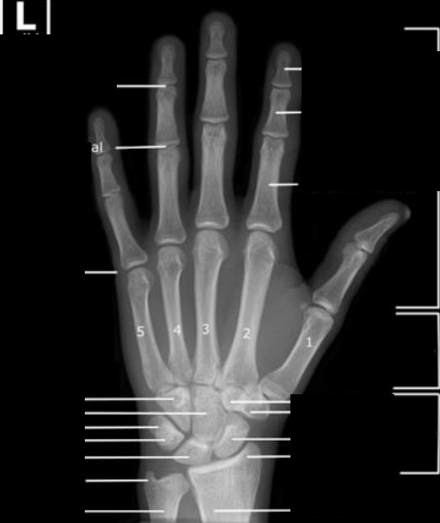

  <button class="solution-button"
          data-label="Vastaus"
          data-hide-label="Piilota vastaus">
    Vastaus
  </button>
  

      

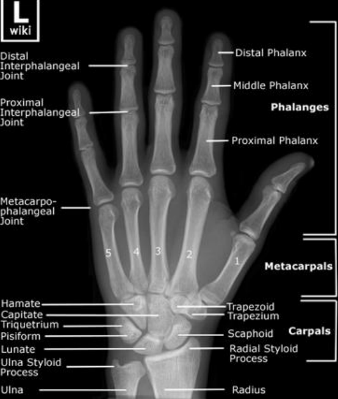

  

## Kuvia: mitä nuoli osoittaa? {#Nuolikyynar}

Ei esimerkkiä wikissä, mutta vastaus annettu ja sen perusteella haettu alla oleva esimerkkikuva. 

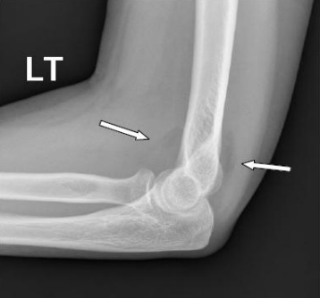

  <button class="solution-button"
          data-label="Vastaus"
          data-hide-label="Piilota vastaus">
    Vastaus
  </button>
  

      Kyynärnivelen hydrops

Esimerkki rasvapatjojen kohoamisesta, mikä viittaa nivelensisäiseen hydropsiin ja traumapotilaalla tulisi herättää epäilyn nivelensisäisestä murtumasta. Mikäli traumapotilaalla on nivelensisäinen hydrops eikä kuvissa kuitenkaan näy murtumaa, kannattaa herkästi ottaa viistokuvat tai ohjata potilas tietokonetomografiaan tai magneettitutkimukseen. Fat padit voivat olla korostuneita myös atraumaattisista syistä, kunhan vain on kyseessä nivelensisäinen effuusio (esim. artriitit)

Kyynärnivelessä on siis anteriorinen ja posteriorinen rasvapatja (fat pad). Normaalitilanteessa anteriorinen voi olla nähtävissä (olisi suora ja anteriorista humerusta myötäilevä), mutta posteriorinen ei normaalisti koskaan.

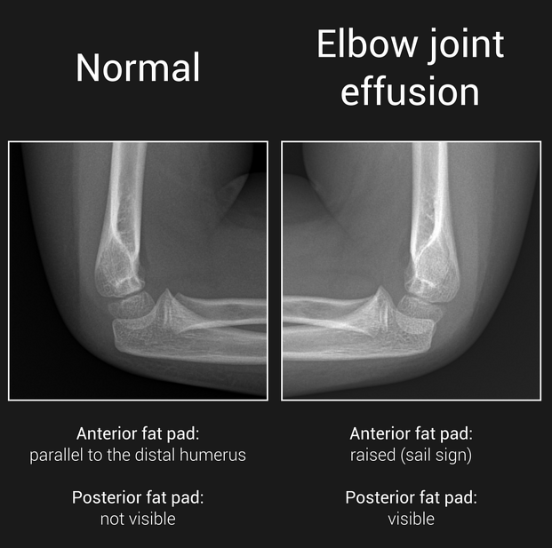
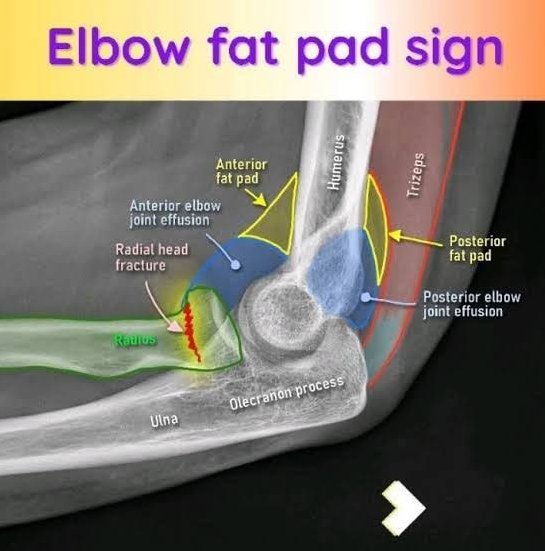

  

## Kuvia: Onko potilaalla pneumonia?

Ei esimerkkikuvaa tärpeissä, kannattaa hieman perehtyä siihen, miltä pneumoniat näyttävät thx-rtg-kuvissa ja miten tunnistaa, missä lohkossa muutos sijaitsee. 

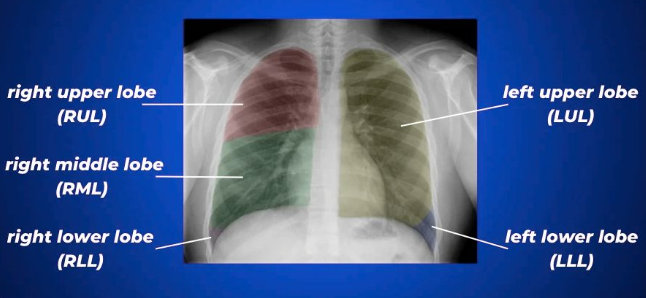
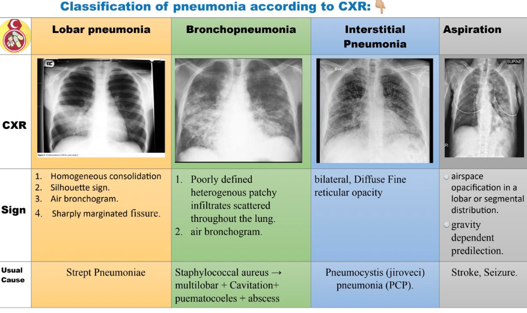

## Kuvia aivoista, piti tunnistaa kallonsisäisiä verenvuotoja ja aivoinfarkti {#Aivokuvat}

Ei esimerkkikuvia, mutta nimeä kuvissa näkyvät löydökset

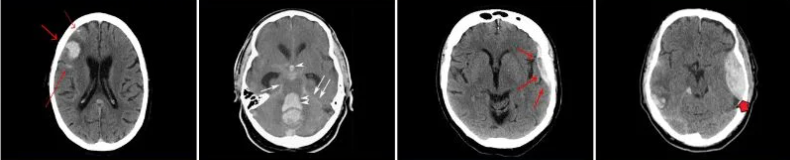

  <button class="solution-button"
          data-label="Vastaus"
          data-hide-label="Piilota vastaus">
    Vastaus
  </button>
  

      

Vasemmalta oikealle: aivoverenvuoto (ICH), subaraknoidaalivuoto (SAV), subduraalivuoto (SDH), epiduraalivuoto. Tunnistaa siitä, että subduraalinen on sirppimäinen, epiduraali linssimäinen, subaraknoidi sulcuksissa ja ICH parenkyymissä. 

Iskeeminen aivoinfarkti taas olisi hypodensi TT-kuvassa (vuodoissa veri taas on vaaleaa); kts. esim. 2. kuva alempaa, jossa laaja infarktialue. 

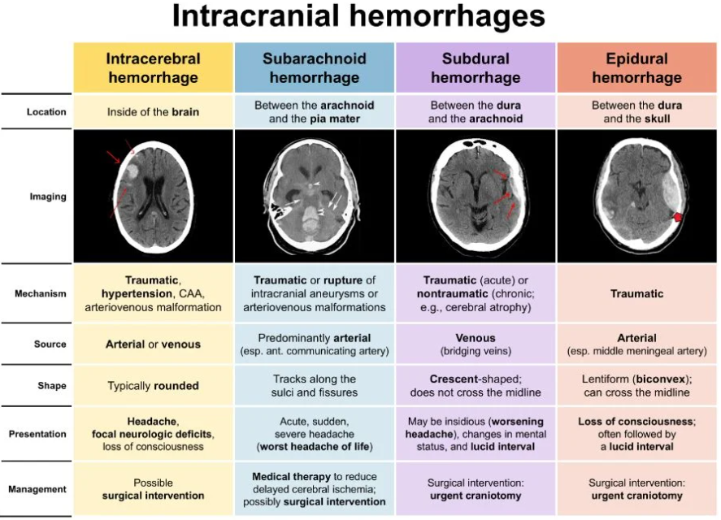
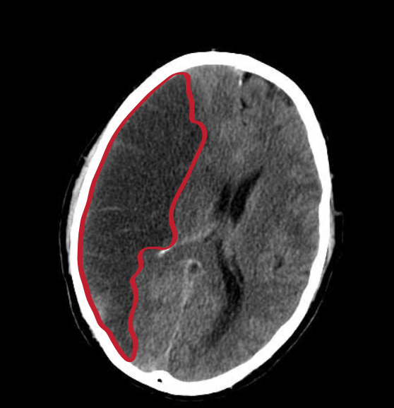

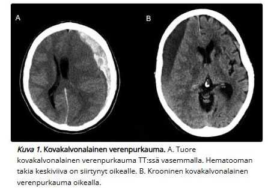
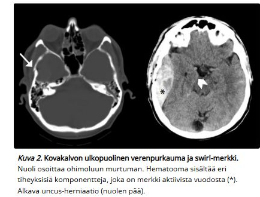
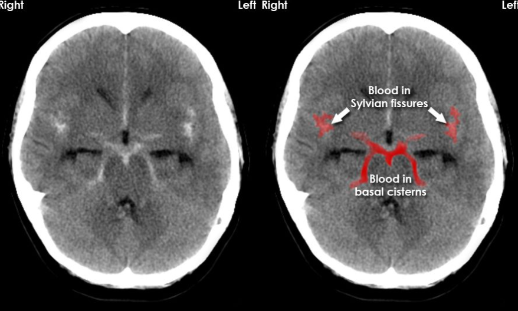
  

## Mihin luihin artroosi aiheuttaa ekana murtumia?

  <button class="solution-button"
          data-label="Vastaus"
          data-hide-label="Piilota vastaus">
    Vastaus
  </button>
  

      
Artroosi (nivelrikko) ei aiheuta suoraan murtumia itsestään.
  

## Miten atelektaasi näkyy keuhkokuvassa? {#Atelektaasi-keuhkokuvassa}

  <button class="solution-button"
          data-label="Vastaus"
          data-hide-label="Piilota vastaus">
    Vastaus
  </button>
  

      

Näkyy yleensä keuhkoalueen tiivistymäjuosteena (levyatelektaasit)

Lohkorajat voivat vetäytyä kohti atelektaasia

Isompana voi näkyä **vaaleana alueena** keuhkon ollessa kasassa/työntynyt pois siltä
alueelta

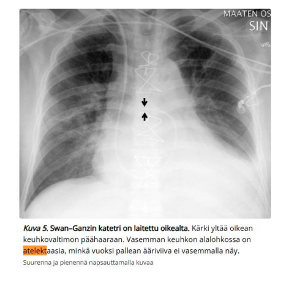
  

## Salter-harris luokitus

Ei tarkempaa kysymyksenasettelua wikissä. Selitä mikä on ja käy läpi eri luokat päässäsi.

  <button class="solution-button"
          data-label="Vastaus"
          data-hide-label="Piilota vastaus">
    Vastaus
  </button>
  

      
Lasten kasvulevyä affisioivien murtumien luokittelutapa, joka perustuu murtuman morfologiasta suhteessa kasvulevyyn. 

On myös Petersonin luokitus, joka on tarkempi ja on käytössä mm. Helsingissä enemmän; muuten maailmalla SH-luokitus on yleisemmin käytössä.

<li>SH1 = Murtuma on pelkästään kasvulevyn hypertrofisessa vyöhykkeessä; epifyysi erkanee metafyysistä</li>
<li>SH2 = Murtuma kulkee kasvulevyn halki metafyysiin; yleisin tyyppi</li>
<li>SH3 = Murtuma kulkee kasvulevyn kautta epifyysin läpi nivelpintaan</li>
<li>SH4 = Murtuma kulkee metafyysin, kasvulevyn ja epifyysin läpi nivelpintaan</li>
<li>SH5 = Kasvulevyn puristusvamma, jossa kasvulevy murskautuu; ei dislokoitumista tyypillisesti; hyvin harvinainen</li>

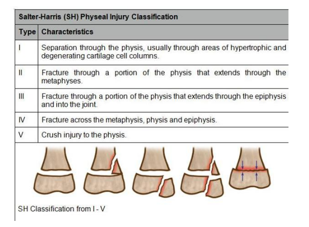
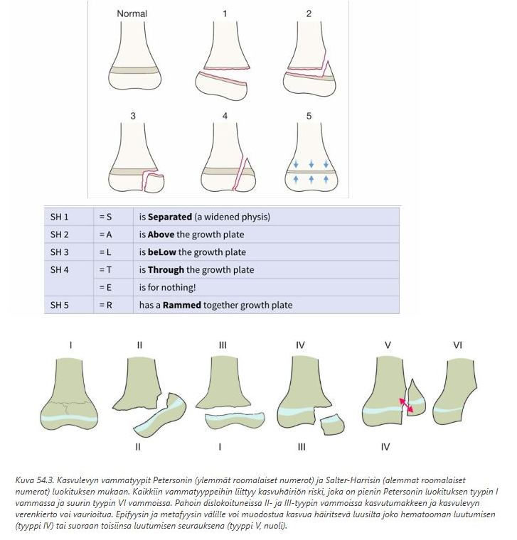
  

## Magneettikuvantamisen T1-relaksaatio

Ei suoraa kysymyksenasettelua. Selitä mitä T1-relaksaatio tarkoittaa ja järjestä neste, rasva ja lihas järjestykseen T1-relaksaationopeuden mukaan.

  <button class="solution-button"
          data-label="Vastaus"
          data-hide-label="Piilota vastaus">
    Vastaus
  </button>
  

T1-relaksaatio tarkoittaa sitä aikaa, jossa **longitudinaalinen magnetoituma (nettomagnetoituma) on palautunut 63%:iin alkuperäisestä.**

T1-relaksaationopeuden mukaan kudosten järjestys on seuraava nopeimmasta hitaimpaan: **rasva > lihas > neste* -> tämän takia neste on tummaa T1-kuvassa ja rasva on kirkasta. 

---

Aiheesta:

MRI-kuvantamisessa tietyn vokselin nettomagnetoituma osoittaa aluksi ulkoisen magneettikentän suuntaan, mutta tätä muutetaan virittävän radiotaajuisen (radio frequency, RF) säteilypulssin avulla 

Kun virittävä RF-pulssi päättyy, pyrkii systeemi palautumaan perustilaansa eli minimoimaan sisäisen energiansa

Ytimet alkavat siirtyä suuremmasta energiatilasta takaisin pienempään, ja systeemistä poistuva energia vapautuu sähkömagneettisena säteilynä, jonka taajuus on edelleen ytimien pyörimistaajuus. _Tätä ilmiötä kutsutaan relaksaatioksi._

MRI-signaalin voimakkuus ja kesto riippuvat kudoksen magneettisista ominaisuuksista. Relaksaatio voidaan jakaa kahteen komponenttiin: 

<li>T1-relaksaatio (T1 recovery); määritellään siksi ajaksi, jossa nettomagnetoituma on palautunut 63 %:iin alkuperäisestä</li>
<li>T2-relaksaatio (T2 decay); määritellään ajaksi, jossa poikittainen magnetoituma on vaimennut 63 %:a (37%:iin alkuperäisestä)</li>

---

T1- ja T2-relaksaatiot tapahtuvat samanaikaisesti, mutta toisistaan riippumattomasti ja eri kudoksilla on erilaiset relaksaatioajat. 

Tätä voidaan hyödyntää painottamalla asetuksilla (toistoaika eli TR ja kaikuaika eli TE) eri relaksaatioaikoja -> saadaan parempi kontrasti kuviin sen mukaan mitä halutaan kuvata. 

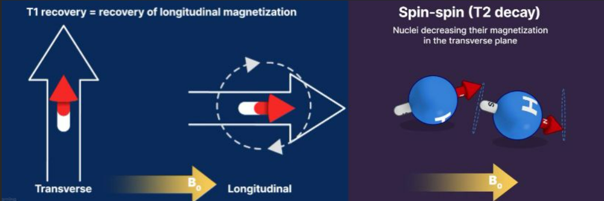
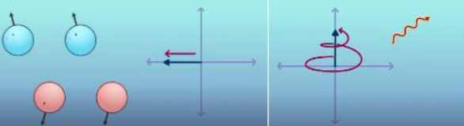
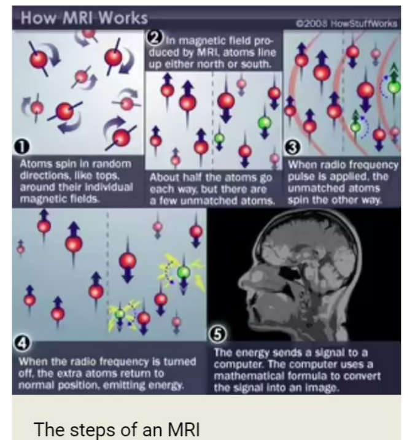
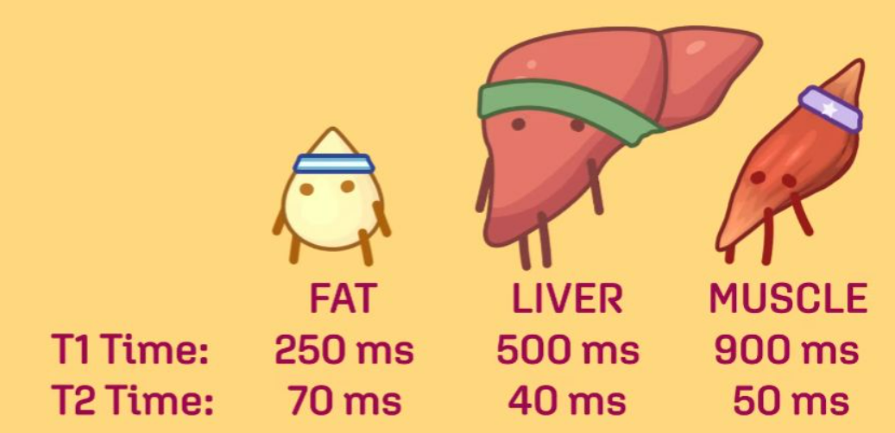
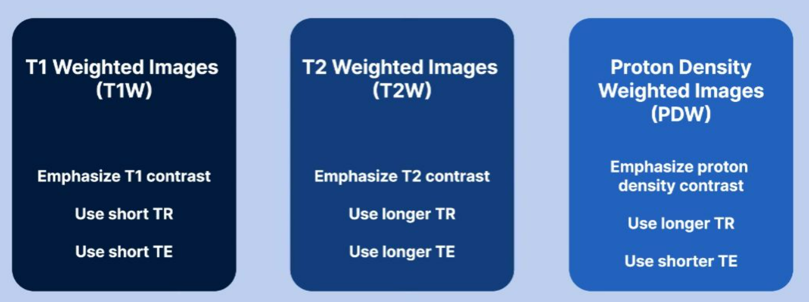
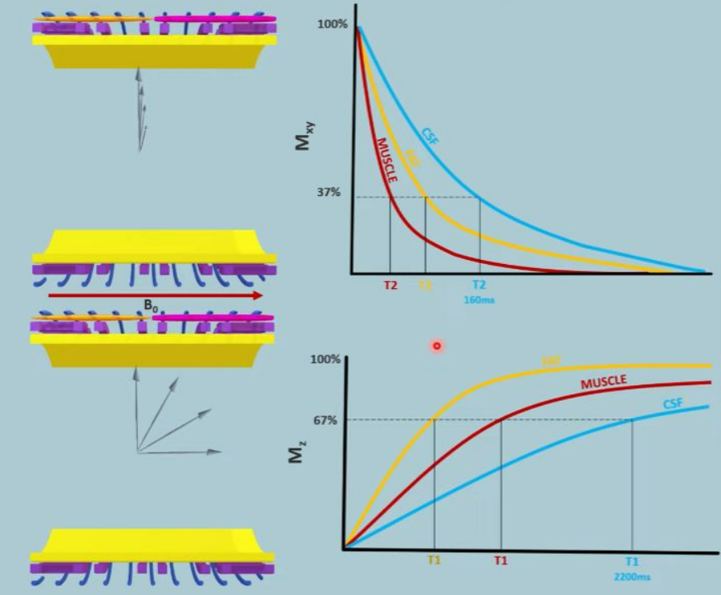

  

## Mikä on tyypillisin osteoporoottinen murtuma? {#Tyypillisin-osteoporoosimurtuma}

  <button class="solution-button"
          data-label="Vastaus"
          data-hide-label="Piilota vastaus">
    Vastaus
  </button>
  

Nikaman kiilamainen kompressiomurtuma on yleisin osteoporoosin aiheuttama murtuma. 

Muita yleisiä ovat mm. lonkkamurtuma, rannemurtuma ja olkamurtuma

---

70 % nikamamurtumista jää diagnosoimatta, suurin osa ohimeneviä keskiselän kipuja

<li>Seurauksia: Pituuden lyhentyminen, ryhdin kumartuminen, krooniset kivut</li>
<li>Useimmilla potilailla toipuminen (kipu vähenee) 1–2 kuukaudessa, mutta osalla vaikea, kroonistunut kipu ja toimintahaitta</li>
<li>Nikamamurtuma lisää riskiä uusille murtumille</li>

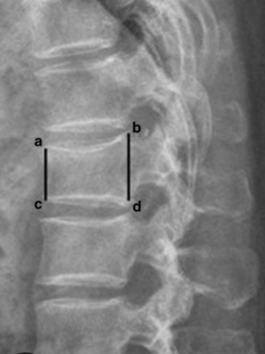
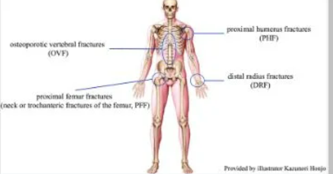

  

## Toiminnallinen MRI-kuvaus

Ei tarkempaa kysymyksenasettelua. Selitä mihin käytetään ja mihin perustuu. 

  <button class="solution-button"
          data-label="Vastaus"
          data-hide-label="Piilota vastaus">
    Vastaus
  </button>
  

Hyödyllistä aivojen kuvantamisessa; perustuu siihen, että aivoalueen aktivoituminen johtaa **oksihemoglobiinin määrän suhteelliseen lisääntymiseen** alueella (oksihemoglobiinilla on erilaiset magneettiset ominaisuudet kuin ei-happea sitovalla hemoglobiinilla) -> aktivoituneelta alueelta saadaan voimakkaampi signaali 

Kuvataan siis epäsuorasti aivojen toimintaa mittaamalla **verenkierron ja veren happipitoisuuden muutosta.** 

**Käytetään useimmiten liikeaivokuoren ja puhealueiden paikantamiseen ja auttaa välttämään kriittisten alueiden leikkausta kasvainten resektiossa.**

Voidaan myös tutkia mm. muistitoimintoja ja aivojen muovautuvuutta aivohalvauksen ja aivovamman jälkeisessä kuntoutuksessa.
  

## Mihin perustuu substraktioangiografiakuvaus?

  <button class="solution-button"
          data-label="Vastaus"
          data-hide-label="Piilota vastaus">
    Vastaus
  </button>
  

Kohteesta kuvataan ensin ns. maskikuva ilman varjoainetta ja varjoaineen ruiskutuksen jälkeen otetaan varjoainekuva. Kuvat vähennetään logaritmisesti, jolloin maskikuvassa esiintyvä muu anatominen tausta poistuu ja jäljelle jää kuva varjoaineesta verisuonissa.

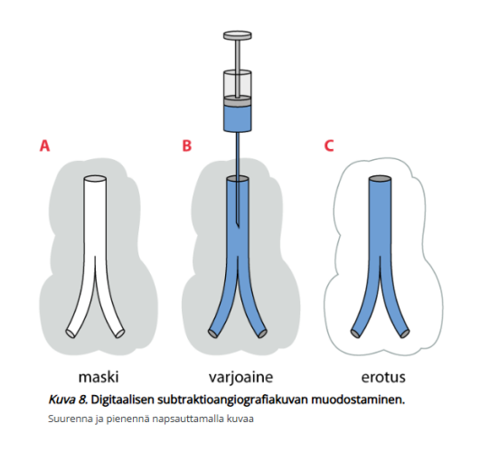
  

##  Miltä näyttää subaraknoidaalivuoto? {#SAV-milta-nayttaa}

  <button class="solution-button"
          data-label="Vastaus"
          data-hide-label="Piilota vastaus">
    Vastaus
  </button>
  

  
SAV näkyy TT-kuvassa aivouurteiden ja basaalisisternojen (interpedunkulaarinen sisterna) hyperdensisenä muutoksena. 

Aivo-selkäydinnesteen virtauksen takia verta kulkeutuu muualle, ja sitä keräytyy painovoiman vaikutuksesta esimerkiksi sulcus Sylviin pohjalle. Verta tuleekin etsiä huolellisesti koko aivojen alueelta. Jos verta vuotaa aivokammioon, voidaan nähdä aivo-selkäydinnesteen ja veren välistä kerrostumista.

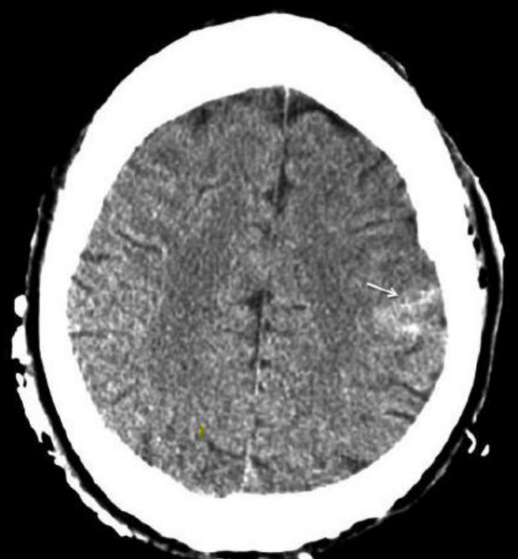
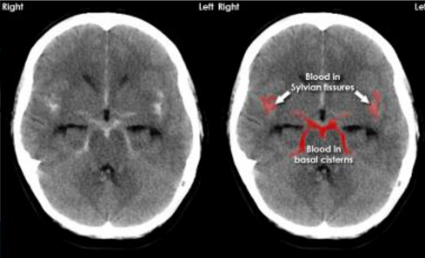
  

## Miten akuutti bronkioliitti näkyy keuhkokuvassa? {#Bronkioliitti-keuhkokuva}

  <button class="solution-button"
          data-label="Vastaus"
          data-hide-label="Piilota vastaus">
    Vastaus
  </button>
  

**Ei oikein näy (voi olla normaali) eikä rtg-kuvaa tarvita bronkioliitin diagnostiikassa rutiinisti.** Bronkioliitin diagnoosi on kliininen ja perustuu oireisiin. Keuhkokuva otetaan, mikäli on kliininen epäily komplikaatiosta, kuten sairaalahoitoa vaativasta bakteerin aiheuttamasta keuhkokuumeesta. 

Mahdollisesti epäspesifisiä löydöksiä, kuten atelektaaseja, epätarkkarajaisia ja suttuisia tiivistymiä ja peribronkiaalista paksuuntumista, hyperinflaatiota... Arviointi olisi periaattessa parasta HRTT:llä (nähtäisiin nestetäytteisiä bronkioleja eli tree in bud ilmiö)

---

_Aiheesta tarkemmin (lisää lastentautien kurssilla):_

**Bronkioliitti = Alle 1-vuotiaan ensimmäinen uloshengitysvaikeus;** klassisesti yleisin aiheuttaja on RSV, tosin sen määrät ovat laskeneet huomattavasti Nirsevimabi-estohoidon tultua käyttöön. Myös esim. rino-, entero-, metapneumo- ja parainfluenssavirukset voivat aiheuttaa samanlaisen taudinkuvan. Yleisin sairastumisikä on 1–6 kuukautta, jolloin RSV on tärkein aiheuttaja. RSV ja rinovirus ovat yhtä yleisiä 6–12 kuukauden iässä (ainakin klassisesti). 

Keskeisin ero rinoviruksen ja RSV:n välillä patogeneettisesti tiivistyy siihen, että rinovirus on pääasiassa sytokineettisesti vaikuttava virus, kun taas RSV on enemmän sytopaattinen. RSV siis aiheuttaa obstruktiota pääasiassa liman ja solutuhon aiheuttaman tukoksen kautta, kun taas rinovirus aiheuttaa tulehduksellisesti bronkuksen sileän lihaksen supistumista. Myöhemmän astman riski on merkittävästi suurempi rinovirusbronkioliittien jälkeen. Bronkioliitin jälkeen astman prevalenssi on noin 10 %, mikäli bronkioliitti on ollut RSV:n aiheuttama, ja 25–50 %, mikäli bronkioliitti on ollut rinoviruksen aiheuttama, kun samanikäisen väestön prevalenssi on noin 5 %.

Obstruktiivinen bronkiitti taas tarkoittaa yli 1-vuotiaan (12-36kk) ensimmäistä uloshengitysvaikeutta tai alle 1-vuotiaalla toistuvaa uloshengitysvaikeutta. Yleisin aiheuttaja on rinovirus. 

---

Bronkioliitti alkaa ylempien hengitysteiden oireilla. Kun infektio leviää alempiin hengitysteihin, esiintyy kuumetta, yskää ja limaisuutta vaihtelevassa määrin.

Tyypillinen bronkioliittipotilas on siis pieni imeväinen, jolla on hengitysvaikeus (voi olla kylkiluuväliretraktioita), ja auskultoiden kuullaan ritinää/rohinaa (ritinät syntyvät, kun kasassa olevat keuhkorakkulat avautuvat sisäänhengityksen aikana, ja kuuluvat parhaiten sisäänhengityksen lopussa) ja mahdollisesti hentoa uloshengityksen vinkunaa. Syöminen on usein vaikeutunut, ja lapsi väsähtää helposti. Auskultaatiolöydös voi olla normaali. Tärkeä oire on lisääntynyt hengitystiheys (> 50/min).

Bronkioliitin diagnoosi on kliininen ja perustuu lapsen ikään, oireisiin ja edellä mainittuihin löydöksiin, kuten tihentyneeseen hengitykseen, auskultaatiossa kuultaviin vinkunoihin tai hienojakoisiin rahinoihin (ritinöihin) ja rintakehällä todettuihin vetäytymiin. Ilmasalpaus on kliinisesti vaikea arvioida, ja hypoksia voidaan todeta vain mittaamalla happisaturaatio. Hengitystyön määrä päätellään kliinisesti hengitystiheydestä, uloshengityksen pituudesta ja vetäytymien asteesta.

Bronkioliittiin ei ole parantavaa lääkehoitoa. Tärkeintä on, että riskipotilaat (taulukko alimmassa kuvassa) tunnistetaan ja lähetetään sairaalaseurantaan.

Bronkioliitin hoidoksi klassisesti suositellaan hapensaannin (lisähappea esimerkiksi suurivirtauksinen nenäkanyylin (optiflow) avulla, jos <92%), nesteytyksen ja ravitsemuksen varmistamista; ns. “minimal handling”-hoitoperiaate eli merkittäviä toimenpiteitä pyritään välttämään. Jos limaa erittyy runsaasti, sen imeminen nenänielusta voi helpottaa hengitystä ja syömistä. Mikäli syöminen onnistuu huonosti, annetaan nesteytystä ja ravitsemusta yleensä nenämahaletkulla tai joskus suonensisäisesti. Käypä hoito- tai kansainväliset bronkioliitin hoitosuositukset eivät suosittele beeta2-agonististia, adrenaliinia, systeemistä tai inhaloitua kortikosteroidia, antibioottia tai antiviraalista lääkitystä bronkioliitin hoitoon.

Lasten astman Käypä hoito -suositus ei kuitenkaan ota kantaa pienen lapsen ensimmäisen rinoviruksen aiheuttaman vinkukohtauksen hoitoon. On kuitenkin esitetty asiantuntijanäkemyksiä hoitolinjoista. Vaikka kontrolloituja tutkimuksia on vielä vähän, on viitteitä, että niiden akuuttiin hoitoon tulee suhtautua eri tavoin. Ensimmäinen rinovirusvinkuna vaikuttaa olevan tällä hetkellä tehokkain aikapiste astman sekundaaripreventioon.

<li>RSV-Bronkioliitti:</li>
  <ul>
    <li>Potilas: Tyypillinen ikä alle 6 kuukautta, osastohoitoa vaativa tauti, runsaasti limaa hengitysteissä, työläs hengitys, ei atooppista ekseemaa, vanhemmilla ei astmaa ja he tupakoivat.</li>
    <li>Hoitolinja: Pidättäydy lääkkeistä. Oireenmukaisena hoitona hapensaannin ja ravitsemuksen turvaaminen. Limaimut vain tarvittaessa.</li>
    <li>Perustelut: Oireiden syynä liman ja solujätteen aiheuttama mekaaninen tukos hengitysteissä, eikä astmariski ole merkittävästi lisääntynyt. Avaavien tai hoitavien lääkkeiden tehosta ei ole näyttöä.</li>
  </ul>
<li>Rinovirusvinkuna:</li>
  <ul>
    <li>Potilas: Tyypillinen ikä yli 6-12 kuukautta, osastohoitoa vaativa tauti, taustalla pitkittynyt yskä, auskultoiden selkeät ekspiratoriset vinkunat molemman puolin, hengitysapulihakset käytössä, atooppista ihottumaa, toisella vanhemmista on allerginen astma, kotona 2 kissaa.</li>
    <li>Hoitolinja: Kokeillaan avaavaa lääkettä (esim. salbutamoli). Jos hyötyy ja vinkuna toistuu, harkitse kolmen päivän systeemistä kortikosteroidikuuria ja määritä pöly- ja ruokaryhmän allergiatestit.</li>
    <li>Perustelut: Astman kaltainen taudinkuva ja merkittävästi lisääntynyt astmariski. Hieman näyttöä sekä avaavan lääkkeen että kortikosteroidin hyödystä tässä potilasryhmässä.</li>
  </ul>

---

Käytännön elämässä virusdiagnostiikkaa tehdään suhteellisen harvoin. Siksi voitaisiin puhua RSV-bronkioliitista, kun RSV-virus on osoitettu tai alle 6 kuukauden ikäinen vauva sairastaa tyypillisen taudinkuvan RSV-epidemian aikana. Tällöin keuhkoputkia avaavaa lääkettä (beeta2-agonistia) ei kannata edes kokeilla. Jos taas ikä on yli 6 kuukautta ja lapsi sairastaa RSV-epidemian ulkopuolella, voitaisiin avaavaa lääkettä kokeilla sitä herkemmin, mitä vaikeampi tauti on, mitä voimakkaammin uloshengitys vinkuu ja mitä enemmän on atopiapiirteitä. Hoitovasteen, riskitekijöiden ja iän (mielellään yli 12 kk) mukaan voidaan harkita 3 päivän systeemistä kortikosteroidikuuria.

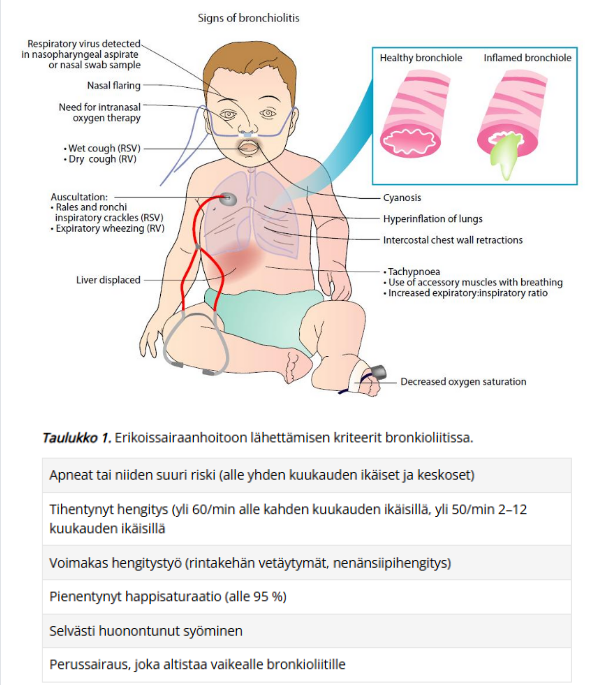
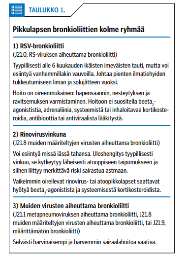
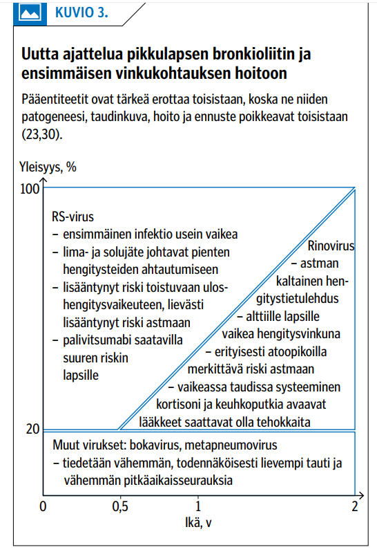

  

## Millä suoli täytetään MR-enterografiassa?

  <button class="solution-button"
          data-label="Vastaus"
          data-hide-label="Piilota vastaus">
    Vastaus
  </button>
  

Potilaalle juotetaan (jos kyseessä olisi enteroklyysi, niin varjoaine annettaisiin nasojejunaaliletkun kautta) **suolivarjoainetta** (ei ole gadoliniumia kuten i.v-annostelussa; käytetään yleensä niin sanottuja **bifaasisia varjoaineita,** jotka näkyvät T1- gradienttikaikusekvensseissä niukkasignaalisina ja T2-painotteisissa sekvensseissä runsassignaalisina)

---

Voidaan antaa myös samalla i.v.-varjoainetta, jotta suolen seinämä ja sen muutokset näkyisivät paremmin

Tutkimuksen aikana suoli lamataan spasmolyytilla liikkeen aiheuttamien artefaktien välttämiseksi

  

## Mihin löydökseen viittaa hunajakennokuvioitus HRTT-kuvassa? {#Hunajakennokuvioitus-HRTT}

  <button class="solution-button"
          data-label="Vastaus"
          data-hide-label="Piilota vastaus">
    Vastaus
  </button>
  

Interstitiaaliseen fibroosiin, yleisin on IPF (idiopaattinen pulmonaalinen fibroosi). 

  

## Mikä on lasten yleisin Salter-Harris-luokituksen mukainen murtuma {#SH-yleisin}

  <button class="solution-button"
          data-label="Vastaus"
          data-hide-label="Piilota vastaus">
    Vastaus
  </button>
  

SH2 (n. 75%) 

---

Salter-Harris-luokitus on lasten kasvulevyä affisioivien murtumien luokittelutapa, joka perustuu murtuman morfologiasta suhteessa kasvulevyyn. 

On myös Petersonin luokitus, joka on tarkempi ja on käytössä mm. Helsingissä enemmän; muuten maailmalla SH-luokitus on yleisemmin käytössä.

<li>SH1 = Murtuma on pelkästään kasvulevyn hypertrofisessa vyöhykkeessä; epifyysi erkanee metafyysistä</li>
<li>SH2 = Murtuma kulkee kasvulevyn halki metafyysiin; yleisin tyyppi</li>
<li>SH3 = Murtuma kulkee kasvulevyn kautta epifyysin läpi nivelpintaan</li>
<li>SH4 = Murtuma kulkee metafyysin, kasvulevyn ja epifyysin läpi nivelpintaan</li>
<li>SH5 = Kasvulevyn puristusvamma, jossa kasvulevy murskautuu; ei dislokoitumista tyypillisesti; hyvin harvinainen</li>

  

## L5-murtuman luutumisen kontrolliin paras tutkimus? 

  <button class="solution-button"
          data-label="Vastaus"
          data-hide-label="Piilota vastaus">
    Vastaus
  </button>
  

Natiivirtg on ensisijainen; tehdään yleensä seistessä      
  

## Epiduraali- ja subduraalihematooman etiologia, laskimo- vai valtimoperäinen? {#EDH-etiologia}

  <button class="solution-button"
          data-label="Vastaus"
          data-hide-label="Piilota vastaus">
    Vastaus
  </button>
  

  
Epiduraalivuoto on valtimoperäinen, subduraali laskimoperäinen (tämän takia epiduraali laajenee nopeammin ja hoidon tarvitsee olla kiireisempää). 

  

## Millä kuvantamistutkimuksella akuutti appendisiitti diagnosoidaan? {#Milla-kuvantamistutkimuksella-appendisiitti}

  <button class="solution-button"
          data-label="Vastaus"
          data-hide-label="Piilota vastaus">
    Vastaus
  </button>
  

TT ensisijaisesti, kuten muutenkin useimmiten aikuisten akuuteissa vatsoissa.

Lapsilla ja raskaana olevilla UÄ (ei kuitenkaan pysty poissulkemaan appendisiittia) ja tarvittaessa MRI. 
  

##  Mikä kudos herkin säteilylle (iho, luu, rintarauhaskudos, lihas)? {#Mika-kudos-herkin}

  <button class="solution-button"
          data-label="Vastaus"
          data-hide-label="Piilota vastaus">
    Vastaus
  </button>
  

      Rintarauhaskudos

Herkimpiä säteilylle ovat: keuhkot, luuydin, mahalaukku, paksusuoli, rinnat (herkkyyskerroin 0,12) ja sukupuolirauhaset (herkkyyskerroin 0,08)
      
  

## Kuvakysymys: missä sydämen osassa tahdistinjohto on? {#Missa-sydamen-osassa-tahdistinjohto}

Ei esimerkkikuvaa, mutta mieti minne tahdistinjohdot yleensä sijoitetaan sydämessä. 

  <button class="solution-button"
          data-label="Vastaus"
          data-hide-label="Piilota vastaus">
    Vastaus
  </button>
  

Useimmiten tahdistimissa on kaksi johtoa: **oikeassa eteisessä ja oikeassa kammiossa;** yksijohtoisia eteistahdistimia tehdään nykyään todella harvoin (jos tarvittaisiin vain yhtä johtoa, niin kaksijohtoisessa tahdistimessa voidaan asetuksissa säätää tahdistin tarvittavan mukaiseksi) Joskus on myös vasemmassa kammiossa (jos vajaatoimintatahdistin eli CRT).

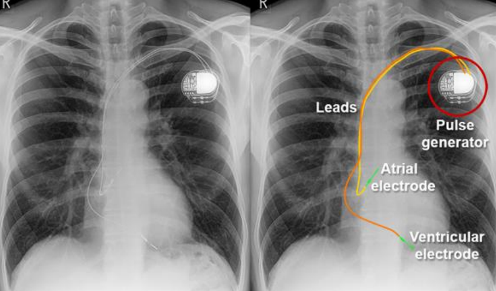
  

## Kuvakysymys: onko vajaatoiminta pahentunut, vähentynyt vai sama?

Ei tietystikään tentissä käytettyä kuvaa saatavilla. Miten tässä (vasemmalla ennen, oikealla jälkeen)? 

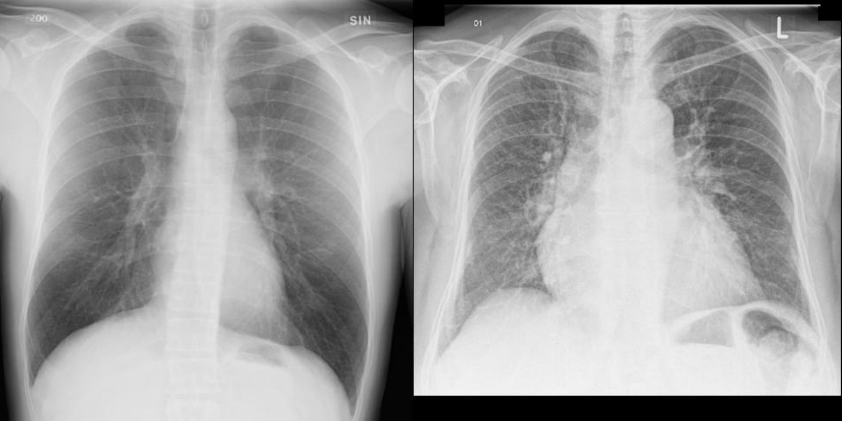

  <button class="solution-button"
          data-label="Vastaus"
          data-hide-label="Piilota vastaus">
    Vastaus
  </button>
  

      Pahentunut

Oikeanpuoleisessa kuvassa keuhkoverekkyys koholla ja sydän suurentunut verrattuna aikaisempaan kuvaan    
  

## Mitä tarkoittaa UÄ:n tekijäriippuvaisuus? {#UA-tekijariippuvaisuus}

  <button class="solution-button"
          data-label="Vastaus"
          data-hide-label="Piilota vastaus">
    Vastaus
  </button>
  

**Eri käyttäjät voivat saada eri arvoja** riippuen omaksumistaan mittaustekniikoista sekä käyttäjien välisestä taitotasosta. 

Jälkikäteen ei myöskään voi olla varma, **tutkiko mittaaja kaikki asiat tarvittavan tarkasti ja huolellisesti.**

  

## Mitä tarkoittaa ”sydän on kompensaatiossa”? {#Sydan-kompensaatiossa}

  <button class="solution-button"
          data-label="Vastaus"
          data-hide-label="Piilota vastaus">
    Vastaus
  </button>
  

  

##  Miltä interstitiaalipneumonia näyttää keuhkokuvassa? {#Interstitiaalipneumonia-keuhkokuvassa}

  <button class="solution-button"
          data-label="Vastaus"
          data-hide-label="Piilota vastaus">
    Vastaus
  </button>
  

  

## TT:n etu verrattuna MRI:hin?

Vaihtoehtoja esim: 

- a. Voi ottaa useita varjoainetehosteisia kuvantamisjaksoja
- b. Parempi paikanerotuskyky
- c. Ei säteilyä

  <button class="solution-button"
          data-label="Vastaus"
          data-hide-label="Piilota vastaus">
    Vastaus
  </button>
  

  

## Polven rtg-kuvassa lateraalisesti luuhippuja, merkki mistä vammasta? {#Polven-rtg-kuvassa-luuhippuja}

  <button class="solution-button"
          data-label="Vastaus"
          data-hide-label="Piilota vastaus">
    Vastaus
  </button>
  

      
  

## Minkä sairauden diagnostiikka onnistuu parhaiten ultraäänellä? {#Minka-sairauden-ualla}

  <button class="solution-button"
          data-label="Vastaus"
          data-hide-label="Piilota vastaus">
    Vastaus
  </button>
  

      
  

## Mikä kuvantamismenetelmä paras imusolmukkeiden kuvantamiseen? {#Mika-kuvantamismenetelma-paras-imusolmukkeiden}

  <button class="solution-button"
          data-label="Vastaus"
          data-hide-label="Piilota vastaus">
    Vastaus
  </button>
  

      
  

## Lead time bias {#Lead-time-bias}

  <button class="solution-button"
          data-label="Vastaus"
          data-hide-label="Piilota vastaus">
    Vastaus
  </button>
  

      
  

## Mammografiasta kysymys: mikä on totta? {#MGssa-kysymys}

  <button class="solution-button"
          data-label="Vastaus"
          data-hide-label="Piilota vastaus">
    Vastaus
  </button>
  

      
  

## Vääntövamma, turvonnut polvi, millä kuvataan {#Vaantovamma-kuvataan}

  <button class="solution-button"
          data-label="Vastaus"
          data-hide-label="Piilota vastaus">
    Vastaus
  </button>
  

      
  

## Mikä kudostyyppi hidastaa röntgensäteilyn kulkua eniten? {#Mika-kudostyyppi-hidastaa}

  <button class="solution-button"
          data-label="Vastaus"
          data-hide-label="Piilota vastaus">
    Vastaus
  </button>
  

      
  

## Mitä mammografian lisäksi voi käyttää rintojen kuvantamiseen? {#MG-lisaksi}

- a. uä
- b. mri
- c. molemmat

  <button class="solution-button"
          data-label="Vastaus"
          data-hide-label="Piilota vastaus">
    Vastaus
  </button>
  

      
  

##Pitkän uran tehnyt maataloustyöntekijä, keuhkolöydöksessä ainakin mattalasitiivistymiä ja jotain muuta, mikä dg todennäköisin? {#Maatalaoustyontekija}

- a. keuhkosyöpä,
- b. sarkoidoosi
- c. homepölykeuhko

  <button class="solution-button"
          data-label="Vastaus"
          data-hide-label="Piilota vastaus">
    Vastaus
  </button>
  

      
  

## Millä löytää vähäisenkin pleuranesteen parhaiten alkuvaiheessa? {#Milla-pleuraneste}

- a. uä
- b. thorax-rtg
- c ja d. ei muistettu

  <button class="solution-button"
          data-label="Vastaus"
          data-hide-label="Piilota vastaus">
    Vastaus
  </button>
  

      
  

## Mikä on paras pneumothoraxin dg:ssa? {#Mika-pneumothoraxissa}

  <button class="solution-button"
          data-label="Vastaus"
          data-hide-label="Piilota vastaus">
    Vastaus
  </button>
  

      
  

## Missä vaiheessa pitää ottaa kuva keuhkovaltimoiden TT-kuvantamisessa? {#Missa-vaiheessa-keuhkovaltimoiden-TT}

  <button class="solution-button"
          data-label="Vastaus"
          data-hide-label="Piilota vastaus">
    Vastaus
  </button>
  

      
  

## Mikä kuvantaminen on paras epäiltäessä selkäytimen infarktia? {#Mika-kuvantaminen-sy-infarktissa}

  <button class="solution-button"
          data-label="Vastaus"
          data-hide-label="Piilota vastaus">
    Vastaus
  </button>
  

      
  

  <button class="solution-button"
          data-label="Vastaus"
          data-hide-label="Piilota vastaus">
    Vastaus
  </button>
  

      
  

  <button class="solution-button"
          data-label="Vastaus"
          data-hide-label="Piilota vastaus">
    Vastaus
  </button>
  

      
<li>Pääkriteerit</li>
  <ul>
    <li>Endokardiitille tyypillinen veriviljelylöydös eli kahdessa 12h välillä otetussa veriviljelyssä tyypillinen endokardiitin aiheuttaja (suun streptokokit, Streptococcus gallolyticus (aikaisemmin S. bovis), HACEK-ryhmä, S. aureus, enterokokki) tai vähintään kolme positiivista neljästä veriviljelynäytteestä (1. ja viimeisen näytteen välillä väh. 1h) tai yksi veriviljely on positiivinen C. burnetiille/faasin I vasta-ainetitterit ovat >1:800</li>
    <li>Endokardiitti jossain kuvantamistutkimuksessa (TTE, TEE, CT, PET, SPECT)</li>
  </ul>

  

