# 2024 

## Mikä luu murtuu orbitan blow out murtumassa? {#Blow-out}

  <button class="solution-button"
          data-label="Vastaus"
          data-hide-label="Piilota vastaus">
    Vastaus
  </button>
  

**Orbitan pohja; yleensä maxilla.** 

Myös periaatteessa jokin muu seinämä voi pettää. Blow out -murtuma siis tarkoittaa, että silmään osunut isku aiheuttaa orbitansisäisen paineen nousun ja silmäkuopan seinämän murtumisen. Yleisimmin murtuu pohja, toiseksi yleisimmin mediaaliseinämä. 

  

## Mitä HU-yksikkö kuvaa? {#HU}

  <button class="solution-button"
          data-label="Vastaus"
          data-hide-label="Piilota vastaus">
    Vastaus
  </button>
  

Kudoksen tiheyttä TT-kuvassa. Tämä TT-luku siis ilmoitetaan HU-yksiköissä eli Hounsfield Unit:eissa.

  

## Miksi TT:ssä potilas saa liikkua vaikka MRI ei? {#TT-liikkua}

  <button class="solution-button"
          data-label="Vastaus"
          data-hide-label="Piilota vastaus">
    Vastaus
  </button>
  

TT on nopea -> liikkuminen ei ehdi vaikuttamaan merkittävästi

Magneettikuva on hidas ja siinä liikkuminen myös häiritsee koko kehon magneettikenttää -> koko kuva häiriintyy (vrt. TT, jossa liikkuminen vaikuttaa vain kuvattavaan tasoon) 
  

## UÄ-tutkimuksen edut MRI verrattuna? {#UAVSMRI}

- a. ei ionisoivaa säteilyä
- b. potilas voi liikkua
- c. parempi pehmytkudoskontrasti
- d. joku

  <button class="solution-button"
          data-label="Vastaus"
          data-hide-label="Piilota vastaus">
    Vastaus
  </button>
  

      b

a: Molemmat ovat ei-ionisoivia tutkimuksia 

c: MRI:ssä on kuvantamismenetelmistä paras pehmytkudoskontrasti
  

## Minkä elimen repeämä on vaikea havaita TT:llä? {#Repeama}

  <button class="solution-button"
          data-label="Vastaus"
          data-hide-label="Piilota vastaus">
    Vastaus
  </button>
  

      

Vaikeita ovat mm. haima (yleensä vaikein parenkyymielimistä), suolisto, pallea, rakko

Taas esim. pernan repeämä useimpien lähteiden mukaan taas helppo nähdä
  

## Minkä luun luutumista TT kuvaa parhaiten?

  <button class="solution-button"
          data-label="Vastaus"
          data-hide-label="Piilota vastaus">
    Vastaus
  </button>
  

      
Jos vaihtoehdoissa on **telaluu (talus),** niin se on todennäköisesti vastaus (TT-kuva on hyvä sen (rasitus)murtumien seurannassa). Yleisesti TT hyvä kortikaalisen luun seurannassa (kuoriluu on tiheää ja sen katkeaminen näkyy selvästi TT:ssä). TT on myös usein käytetty esim. **veneluun** murtuman paranemisen seurannassa.

MK taas hyvä esim. rangan rasitusmurtumien seurannassa
  

## Mihin luuhun Böhlerin kulma liittyy? {#Bohler}

  <button class="solution-button"
          data-label="Vastaus"
          data-hide-label="Piilota vastaus">
    Vastaus
  </button>
  

**Kantaluuhun (calcaneus);** käytetään intra-artikulaaristen kalkaneus-murtumien arvioimisessa.

Normaalisti Böhlerin kulma on 25-40 astetta; pieni kulma liittyy dislokoituneisiin murtumiin. 

  

## Mitä tapahtuu torusmurtumassa? {#Torus}

  <button class="solution-button"
          data-label="Vastaus"
          data-hide-label="Piilota vastaus">
    Vastaus
  </button>
  

Luu taipuu ja **ääriviivaan tulee ryppy** ("vekki", torus) koveralle puolelle. Kohtisuora voima voi aiheuttaa myös pienen kasaan painumisen. 

Lapsille tyypillinen murtuma, ei tarvitse reponoida tai kontrolloida kuvantamalla. Usein esim. ranteen torusmurtumissa hoidoksi riittää kivunhoidoksi 1-3 viikon tarrakiinnitteinen ortoosi tai dorsaalinen kipsilasta. 

  

## Mikä on pajunvitsamurtuma? {#Pajunvitsa}

  <button class="solution-button"
          data-label="Vastaus"
          data-hide-label="Piilota vastaus">
    Vastaus
  </button>
  

**Luu taipuu ja kuperalle puolelle tulee korteksin katkeama (greenstick).** Lapsille tyypillinen murtuma periostin vahvuuden takia. 

Pajunvitsamurtuma samoin kuin poikkimurtumakin voi vaatia asennon korjaamista (vrt. torus), jos spontaani korjautuminen eli remodellaatio ei todennäköisesti tulisi korjaamaan virheasentoa. 

  

## Kummassa UÄ kulkee nopeammin, ilmassa vai kudoksessa? {#UAILMAVSKUDOS}

  <button class="solution-button"
          data-label="Vastaus"
          data-hide-label="Piilota vastaus">
    Vastaus
  </button>
  

**Kudoksessa** (ääni kulkee sitä nopeammin, mitä tiheämpi kudos, koska värähtelyt siirtyvät nopeammin atomien välillä)

Kudoksessa tarkemmin ottaen n. 1540 m/s, ilmassa 340 m/s
  

## Mikä kudos on herkin säteilylle? {#Herkin}

  <button class="solution-button"
          data-label="Vastaus"
          data-hide-label="Piilota vastaus">
    Vastaus
  </button>
  

Herkimpiä: **keuhkot, luuydin, mahalaukku, paksusuoli, rinnat (herkkyyskerroin 0,12) ja sukupuolirauhaset (herkkyyskerroin 0,08).** Yleisesti ottaen jakautuva solukko on herkkää säteilylle. 

  

## Hevonen astunut jalan päälle, turvotusta. mikä kuvantamistutkimus ensisijainen? {#Hevonen}

  <button class="solution-button"
          data-label="Vastaus"
          data-hide-label="Piilota vastaus">
    Vastaus
  </button>
  

      RTG

Voi periaatteessa olla TT, mutta RTG on yleensä ensisijainen kaikissa raajojen traumaattisissa murtumaepäilyssä. Vaikka voisi sinänsä korkean Lisfrancin vamman kliinisen epäilyn takia ottaa suoraan TT:n niin **yleensä kuitenkin otetaan RTG sitä ennen,** jotta voidaan nopeasti nähdä muitakin vammoja ja saadaan baseline-natiivirtg myös otettua. Vaikka rtg:ssä ei todettaisikaan murtumaa, niin TT otetaan silti, koska Lisfrancin vamman epäily niin korkea. 

  

## Epäilet L4-5 nikamamurtumaa. Mikä kuvantamistutkimus? {#L4-5}

  <button class="solution-button"
          data-label="Vastaus"
          data-hide-label="Piilota vastaus">
    Vastaus
  </button>
  

      RTG

Todennäköisesti kyseessä **matalaenerginen murtuma -> lannerangan natiivirtg** ensisijainen (ensisijainen osteoporoottisten murtumien tutkimisessa; TT antaa harvoin lisäinfoa, jos murtuma havaittavissa)

_Jos korkeaenerginen vamma tai monivammapotilas -> TT-kuva._
  

## Mikä thx-rtg:n kuvalöydös on tyypillisin asbestialtistuksessa? {#Asbestithx}

  <button class="solution-button"
          data-label="Vastaus"
          data-hide-label="Piilota vastaus">
    Vastaus
  </button>
  

Tavallisin yksittäinen löydös on **parietaalipleuran plakit.** Ei kuitenkaan ole mitään patognomonisia radiologisia piirteitä asbestoosille eikä esim. plakkien puuttuminen sulje pois asbestoosin mahdollisuutta.

  

## Mitä asbesti aiheuttaa? {#Asbestipneu}

- a. ilmatilapneumonian
- b. keuhkofibroosin
- c. aspiraatiopneumonian 
- d. alveolaarisen pneumonian

  <button class="solution-button"
          data-label="Vastaus"
          data-hide-label="Piilota vastaus">
    Vastaus
  </button>
  

      b

Asbestoosi tarkoittaa keuhkojen **diffuusia interstitiaalista fibroosia** (natiivikuvantamisessa näkyisi mm. hienoja retikulaarisia opasiteetteja). Aiheuttajana on kohtalainen tai runsas asbestialtistus. Muutoksia on yleensä subpleuraali- ja basaalialueilla. HRTT:llä saadaan yleensä selville fibroosin aste. Muut syyt kuin asbesti tulee sulkea pois fibroosin aiheuttajana. 

Asbestipöly voi siis hengitettynä aiheuttaa asbestoosia, parietaalipleuran plakkeja (paksuuntumia), viskeraalipleuran fibroosia ja pleuriitteja. Asbestialtistus lisää myös vaaraa sairastua keuhkosyöpään ja mesotelioomaan. Asbestisairauksilla on pitkä latenssiaika, 20–40 vuotta. 

  

## Missä tutkimuksessa on suurin säteilyannos? {#Sateilyannos}

Ei vaihtoehtoja annettu, mutta tässä esimerkkilista yleisistä tutkimuksista:

## Kuvia, mm. onko potilaalla lymfangitis carcinomatosa?

Ei kuvia tarjolla. Mitä lymfangitis carcinomatosa tarkoittaa? 

  <button class="solution-button"
          data-label="Vastaus"
          data-hide-label="Piilota vastaus">
    Vastaus
  </button>
  

      b

Lymphangitis carcinomatosa tarkoittaa **tuumorin leviämistä keuhkojen imusuonistossa,** mikä voi aiheuttaa keuhkokuvassa interstitiumin korostumista lymfastaasista johtuen. _Muistuttaa kardiogeenistä keuhkopöhöä thx-rtg:ssä._

  

## Kuvia: mitä kämmenen luita nuoli osoittaa? {#Kammenen-luut-nuoli}

Ei kerrottu, mitä luuta tarkalleen kysyttiin, mutta tässä rtg-esimerkki. Nimeä luut päässäsi

  <button class="solution-button"
          data-label="Vastaus"
          data-hide-label="Piilota vastaus">
    Vastaus
  </button>
  

      

  

## Kuvia: mitä nuoli osoittaa? {#Nuolikyynar}

Ei esimerkkiä wikissä, mutta vastaus annettu ja sen perusteella haettu alla oleva esimerkkikuva. 

  <button class="solution-button"
          data-label="Vastaus"
          data-hide-label="Piilota vastaus">
    Vastaus
  </button>
  

      Kyynärnivelen hydrops

Esimerkki rasvapatjojen kohoamisesta, mikä viittaa nivelensisäiseen hydropsiin ja traumapotilaalla tulisi herättää epäilyn nivelensisäisestä murtumasta. Mikäli traumapotilaalla on nivelensisäinen hydrops eikä kuvissa kuitenkaan näy murtumaa, kannattaa herkästi ottaa viistokuvat tai ohjata potilas tietokonetomografiaan tai magneettitutkimukseen. Fat padit voivat olla korostuneita myös atraumaattisista syistä, kunhan vain on kyseessä nivelensisäinen effuusio (esim. artriitit)

Kyynärnivelessä on siis anteriorinen ja posteriorinen rasvapatja (fat pad). Normaalitilanteessa anteriorinen voi olla nähtävissä (olisi suora ja anteriorista humerusta myötäilevä), mutta posteriorinen ei normaalisti koskaan.

  

## Kuvia: Onko potilaalla pneumonia?

Ei esimerkkikuvaa tärpeissä, kannattaa hieman perehtyä siihen, miltä pneumoniat näyttävät thx-rtg-kuvissa ja miten tunnistaa, missä lohkossa muutos sijaitsee. 

## Kuvia aivoista, piti tunnistaa kallonsisäisiä verenvuotoja ja aivoinfarkti {#Aivokuvat}

Ei esimerkkikuvia, mutta nimeä kuvissa näkyvät löydökset

  <button class="solution-button"
          data-label="Vastaus"
          data-hide-label="Piilota vastaus">
    Vastaus
  </button>
  

      

Vasemmalta oikealle: aivoverenvuoto (ICH), subaraknoidaalivuoto (SAV), subduraalivuoto (SDH), epiduraalivuoto. Tunnistaa siitä, että subduraalinen on sirppimäinen, epiduraali linssimäinen, subaraknoidi sulcuksissa ja ICH parenkyymissä. 

Iskeeminen aivoinfarkti taas olisi hypodensi TT-kuvassa (vuodoissa veri taas on vaaleaa); kts. esim. 2. kuva alempaa, jossa laaja infarktialue. 

  

## Mihin luihin artroosi aiheuttaa ekana murtumia?

  <button class="solution-button"
          data-label="Vastaus"
          data-hide-label="Piilota vastaus">
    Vastaus
  </button>
  

      
Artroosi (nivelrikko) ei aiheuta suoraan murtumia itsestään.
  

## Miten atelektaasi näkyy keuhkokuvassa? {#Atelektaasi-keuhkokuvassa}

  <button class="solution-button"
          data-label="Vastaus"
          data-hide-label="Piilota vastaus">
    Vastaus
  </button>
  

      

Näkyy yleensä keuhkoalueen tiivistymäjuosteena (levyatelektaasit)

Lohkorajat voivat vetäytyä kohti atelektaasia

Isompana voi näkyä **vaaleana alueena** keuhkon ollessa kasassa/työntynyt pois siltä alueelta

  

## Salter-harris luokitus

Ei tarkempaa kysymyksenasettelua wikissä. Selitä mikä on ja käy läpi eri luokat päässäsi.

  <button class="solution-button"
          data-label="Vastaus"
          data-hide-label="Piilota vastaus">
    Vastaus
  </button>
  

      
Lasten kasvulevyä affisioivien murtumien luokittelutapa, joka perustuu murtuman morfologiasta suhteessa kasvulevyyn. 

On myös Petersonin luokitus, joka on tarkempi ja on käytössä mm. Helsingissä enemmän; muuten maailmalla SH-luokitus on yleisemmin käytössä.

<li>SH1 = Murtuma on pelkästään kasvulevyn hypertrofisessa vyöhykkeessä; epifyysi erkanee metafyysistä</li>
<li>SH2 = Murtuma kulkee kasvulevyn halki metafyysiin; yleisin tyyppi</li>
<li>SH3 = Murtuma kulkee kasvulevyn kautta epifyysin läpi nivelpintaan</li>
<li>SH4 = Murtuma kulkee metafyysin, kasvulevyn ja epifyysin läpi nivelpintaan</li>
<li>SH5 = Kasvulevyn puristusvamma, jossa kasvulevy murskautuu; ei dislokoitumista tyypillisesti; hyvin harvinainen</li>

  

## Magneettikuvantamisen T1-relaksaatio

Ei suoraa kysymyksenasettelua. Selitä mitä T1-relaksaatio tarkoittaa ja järjestä neste, rasva ja lihas järjestykseen T1-relaksaationopeuden mukaan.

  <button class="solution-button"
          data-label="Vastaus"
          data-hide-label="Piilota vastaus">
    Vastaus
  </button>
  

T1-relaksaatio tarkoittaa sitä aikaa, jossa **longitudinaalinen magnetoituma (nettomagnetoituma) on palautunut 63%:iin alkuperäisestä.**

T1-relaksaationopeuden mukaan kudosten järjestys on seuraava nopeimmasta hitaimpaan: **rasva > lihas > neste* -> tämän takia neste on tummaa T1-kuvassa ja rasva on kirkasta. 

---

Aiheesta:

MRI-kuvantamisessa tietyn vokselin nettomagnetoituma osoittaa aluksi ulkoisen magneettikentän suuntaan, mutta tätä muutetaan virittävän radiotaajuisen (radio frequency, RF) säteilypulssin avulla 

Kun virittävä RF-pulssi päättyy, pyrkii systeemi palautumaan perustilaansa eli minimoimaan sisäisen energiansa

Ytimet alkavat siirtyä suuremmasta energiatilasta takaisin pienempään, ja systeemistä poistuva energia vapautuu sähkömagneettisena säteilynä, jonka taajuus on edelleen ytimien pyörimistaajuus. _Tätä ilmiötä kutsutaan relaksaatioksi._

MRI-signaalin voimakkuus ja kesto riippuvat kudoksen magneettisista ominaisuuksista. Relaksaatio voidaan jakaa kahteen komponenttiin: 

<li>T1-relaksaatio (T1 recovery); määritellään siksi ajaksi, jossa nettomagnetoituma on palautunut 63 %:iin alkuperäisestä</li>
<li>T2-relaksaatio (T2 decay); määritellään ajaksi, jossa poikittainen magnetoituma on vaimennut 63 %:a (37%:iin alkuperäisestä)</li>

---

T1- ja T2-relaksaatiot tapahtuvat samanaikaisesti, mutta toisistaan riippumattomasti ja eri kudoksilla on erilaiset relaksaatioajat. 

Tätä voidaan hyödyntää painottamalla asetuksilla (toistoaika eli TR ja kaikuaika eli TE) eri relaksaatioaikoja -> saadaan parempi kontrasti kuviin sen mukaan mitä halutaan kuvata. 

  

## Mikä on tyypillisin osteoporoottinen murtuma? {#Tyypillisin-osteoporoosimurtuma}

  <button class="solution-button"
          data-label="Vastaus"
          data-hide-label="Piilota vastaus">
    Vastaus
  </button>
  

Nikaman kiilamainen kompressiomurtuma on yleisin osteoporoosin aiheuttama murtuma. 

Muita yleisiä ovat mm. lonkkamurtuma, rannemurtuma ja olkamurtuma

---

70 % nikamamurtumista jää diagnosoimatta, suurin osa ohimeneviä keskiselän kipuja

<li>Seurauksia: Pituuden lyhentyminen, ryhdin kumartuminen, krooniset kivut</li>
<li>Useimmilla potilailla toipuminen (kipu vähenee) 1–2 kuukaudessa, mutta osalla vaikea, kroonistunut kipu ja toimintahaitta</li>
<li>Nikamamurtuma lisää riskiä uusille murtumille</li>

  

## Toiminnallinen MRI-kuvaus

Ei tarkempaa kysymyksenasettelua. Selitä mihin käytetään ja mihin perustuu. 

  <button class="solution-button"
          data-label="Vastaus"
          data-hide-label="Piilota vastaus">
    Vastaus
  </button>
  

Hyödyllistä aivojen kuvantamisessa; perustuu siihen, että aivoalueen aktivoituminen johtaa **oksihemoglobiinin määrän suhteelliseen lisääntymiseen** alueella (oksihemoglobiinilla on erilaiset magneettiset ominaisuudet kuin ei-happea sitovalla hemoglobiinilla) -> aktivoituneelta alueelta saadaan voimakkaampi signaali 

Kuvataan siis epäsuorasti aivojen toimintaa mittaamalla **verenkierron ja veren happipitoisuuden muutosta.** 

**Käytetään useimmiten liikeaivokuoren ja puhealueiden paikantamiseen ja auttaa välttämään kriittisten alueiden leikkausta kasvainten resektiossa.**

Voidaan myös tutkia mm. muistitoimintoja ja aivojen muovautuvuutta aivohalvauksen ja aivovamman jälkeisessä kuntoutuksessa.
  

## Mihin perustuu substraktioangiografiakuvaus?

  <button class="solution-button"
          data-label="Vastaus"
          data-hide-label="Piilota vastaus">
    Vastaus
  </button>
  

Kohteesta kuvataan ensin ns. maskikuva ilman varjoainetta ja varjoaineen ruiskutuksen jälkeen otetaan varjoainekuva. Kuvat vähennetään logaritmisesti, jolloin maskikuvassa esiintyvä muu anatominen tausta poistuu ja jäljelle jää kuva varjoaineesta verisuonissa.

  

##  Miltä näyttää subaraknoidaalivuoto? {#SAV-milta-nayttaa}

  <button class="solution-button"
          data-label="Vastaus"
          data-hide-label="Piilota vastaus">
    Vastaus
  </button>
  

  
SAV näkyy TT-kuvassa aivouurteiden ja basaalisisternojen (interpedunkulaarinen sisterna) hyperdensisenä muutoksena. 

Aivo-selkäydinnesteen virtauksen takia verta kulkeutuu muualle, ja sitä keräytyy painovoiman vaikutuksesta esimerkiksi sulcus Sylviin pohjalle. Verta tuleekin etsiä huolellisesti koko aivojen alueelta. Jos verta vuotaa aivokammioon, voidaan nähdä aivo-selkäydinnesteen ja veren välistä kerrostumista.

  

## Miten akuutti bronkioliitti näkyy keuhkokuvassa? {#Bronkioliitti-keuhkokuva}

  <button class="solution-button"
          data-label="Vastaus"
          data-hide-label="Piilota vastaus">
    Vastaus
  </button>
  

**Ei oikein näy (voi olla normaali) eikä rtg-kuvaa tarvita bronkioliitin diagnostiikassa rutiinisti.** Bronkioliitin diagnoosi on kliininen ja perustuu oireisiin. Keuhkokuva otetaan, mikäli on kliininen epäily komplikaatiosta, kuten sairaalahoitoa vaativasta bakteerin aiheuttamasta keuhkokuumeesta. 

Mahdollisesti epäspesifisiä löydöksiä, kuten atelektaaseja, epätarkkarajaisia ja suttuisia tiivistymiä ja peribronkiaalista paksuuntumista, hyperinflaatiota... Arviointi olisi periaattessa parasta HRTT:llä (nähtäisiin nestetäytteisiä bronkioleja eli tree in bud ilmiö)

---

_Aiheesta tarkemmin (lisää lastentautien kurssilla):_

**Bronkioliitti = Alle 1-vuotiaan ensimmäinen uloshengitysvaikeus;** klassisesti yleisin aiheuttaja on RSV, tosin sen määrät ovat laskeneet huomattavasti Nirsevimabi-estohoidon tultua käyttöön. Myös esim. rino-, entero-, metapneumo- ja parainfluenssavirukset voivat aiheuttaa samanlaisen taudinkuvan. Yleisin sairastumisikä on 1–6 kuukautta, jolloin RSV on tärkein aiheuttaja. RSV ja rinovirus ovat yhtä yleisiä 6–12 kuukauden iässä (ainakin klassisesti). 

Keskeisin ero rinoviruksen ja RSV:n välillä patogeneettisesti tiivistyy siihen, että rinovirus on pääasiassa sytokineettisesti vaikuttava virus, kun taas RSV on enemmän sytopaattinen. RSV siis aiheuttaa obstruktiota pääasiassa liman ja solutuhon aiheuttaman tukoksen kautta, kun taas rinovirus aiheuttaa tulehduksellisesti bronkuksen sileän lihaksen supistumista. Myöhemmän astman riski on merkittävästi suurempi rinovirusbronkioliittien jälkeen. Bronkioliitin jälkeen astman prevalenssi on noin 10 %, mikäli bronkioliitti on ollut RSV:n aiheuttama, ja 25–50 %, mikäli bronkioliitti on ollut rinoviruksen aiheuttama, kun samanikäisen väestön prevalenssi on noin 5 %.

Obstruktiivinen bronkiitti taas tarkoittaa yli 1-vuotiaan (12-36kk) ensimmäistä uloshengitysvaikeutta tai alle 1-vuotiaalla toistuvaa uloshengitysvaikeutta. Yleisin aiheuttaja on rinovirus. 

---

Bronkioliitti alkaa ylempien hengitysteiden oireilla. Kun infektio leviää alempiin hengitysteihin, esiintyy kuumetta, yskää ja limaisuutta vaihtelevassa määrin.

Tyypillinen bronkioliittipotilas on siis pieni imeväinen, jolla on hengitysvaikeus (voi olla kylkiluuväliretraktioita), ja auskultoiden kuullaan ritinää/rohinaa (ritinät syntyvät, kun kasassa olevat keuhkorakkulat avautuvat sisäänhengityksen aikana, ja kuuluvat parhaiten sisäänhengityksen lopussa) ja mahdollisesti hentoa uloshengityksen vinkunaa. Syöminen on usein vaikeutunut, ja lapsi väsähtää helposti. Auskultaatiolöydös voi olla normaali. Tärkeä oire on lisääntynyt hengitystiheys (> 50/min).

Bronkioliitin diagnoosi on kliininen ja perustuu lapsen ikään, oireisiin ja edellä mainittuihin löydöksiin, kuten tihentyneeseen hengitykseen, auskultaatiossa kuultaviin vinkunoihin tai hienojakoisiin rahinoihin (ritinöihin) ja rintakehällä todettuihin vetäytymiin. Ilmasalpaus on kliinisesti vaikea arvioida, ja hypoksia voidaan todeta vain mittaamalla happisaturaatio. Hengitystyön määrä päätellään kliinisesti hengitystiheydestä, uloshengityksen pituudesta ja vetäytymien asteesta.

Bronkioliittiin ei ole parantavaa lääkehoitoa. Tärkeintä on, että riskipotilaat (taulukko alimmassa kuvassa) tunnistetaan ja lähetetään sairaalaseurantaan.

Bronkioliitin hoidoksi klassisesti suositellaan hapensaannin (lisähappea esimerkiksi suurivirtauksinen nenäkanyylin (optiflow) avulla, jos <92%), nesteytyksen ja ravitsemuksen varmistamista; ns. “minimal handling”-hoitoperiaate eli merkittäviä toimenpiteitä pyritään välttämään. Jos limaa erittyy runsaasti, sen imeminen nenänielusta voi helpottaa hengitystä ja syömistä. Mikäli syöminen onnistuu huonosti, annetaan nesteytystä ja ravitsemusta yleensä nenämahaletkulla tai joskus suonensisäisesti. Käypä hoito- tai kansainväliset bronkioliitin hoitosuositukset eivät suosittele beeta2-agonististia, adrenaliinia, systeemistä tai inhaloitua kortikosteroidia, antibioottia tai antiviraalista lääkitystä bronkioliitin hoitoon.

Lasten astman Käypä hoito -suositus ei kuitenkaan ota kantaa pienen lapsen ensimmäisen rinoviruksen aiheuttaman vinkukohtauksen hoitoon. On kuitenkin esitetty asiantuntijanäkemyksiä hoitolinjoista. Vaikka kontrolloituja tutkimuksia on vielä vähän, on viitteitä, että niiden akuuttiin hoitoon tulee suhtautua eri tavoin. Ensimmäinen rinovirusvinkuna vaikuttaa olevan tällä hetkellä tehokkain aikapiste astman sekundaaripreventioon.

<li>RSV-Bronkioliitti:</li>
  <ul>
    <li>Potilas: Tyypillinen ikä alle 6 kuukautta, osastohoitoa vaativa tauti, runsaasti limaa hengitysteissä, työläs hengitys, ei atooppista ekseemaa, vanhemmilla ei astmaa ja he tupakoivat.</li>
    <li>Hoitolinja: Pidättäydy lääkkeistä. Oireenmukaisena hoitona hapensaannin ja ravitsemuksen turvaaminen. Limaimut vain tarvittaessa.</li>
    <li>Perustelut: Oireiden syynä liman ja solujätteen aiheuttama mekaaninen tukos hengitysteissä, eikä astmariski ole merkittävästi lisääntynyt. Avaavien tai hoitavien lääkkeiden tehosta ei ole näyttöä.</li>
  </ul>
<li>Rinovirusvinkuna:</li>
  <ul>
    <li>Potilas: Tyypillinen ikä yli 6-12 kuukautta, osastohoitoa vaativa tauti, taustalla pitkittynyt yskä, auskultoiden selkeät ekspiratoriset vinkunat molemman puolin, hengitysapulihakset käytössä, atooppista ihottumaa, toisella vanhemmista on allerginen astma, kotona 2 kissaa.</li>
    <li>Hoitolinja: Kokeillaan avaavaa lääkettä (esim. salbutamoli). Jos hyötyy ja vinkuna toistuu, harkitse kolmen päivän systeemistä kortikosteroidikuuria ja määritä pöly- ja ruokaryhmän allergiatestit.</li>
    <li>Perustelut: Astman kaltainen taudinkuva ja merkittävästi lisääntynyt astmariski. Hieman näyttöä sekä avaavan lääkkeen että kortikosteroidin hyödystä tässä potilasryhmässä.</li>
  </ul>

---

Käytännön elämässä virusdiagnostiikkaa tehdään suhteellisen harvoin. Siksi voitaisiin puhua RSV-bronkioliitista, kun RSV-virus on osoitettu tai alle 6 kuukauden ikäinen vauva sairastaa tyypillisen taudinkuvan RSV-epidemian aikana. Tällöin keuhkoputkia avaavaa lääkettä (beeta2-agonistia) ei kannata edes kokeilla. Jos taas ikä on yli 6 kuukautta ja lapsi sairastaa RSV-epidemian ulkopuolella, voitaisiin avaavaa lääkettä kokeilla sitä herkemmin, mitä vaikeampi tauti on, mitä voimakkaammin uloshengitys vinkuu ja mitä enemmän on atopiapiirteitä. Hoitovasteen, riskitekijöiden ja iän (mielellään yli 12 kk) mukaan voidaan harkita 3 päivän systeemistä kortikosteroidikuuria.

  

## Millä suoli täytetään MR-enterografiassa? {#Milla-enterografiassa}

  <button class="solution-button"
          data-label="Vastaus"
          data-hide-label="Piilota vastaus">
    Vastaus
  </button>
  

Potilaalle juotetaan (jos kyseessä olisi enteroklyysi, niin varjoaine annettaisiin nasojejunaaliletkun kautta) **suolivarjoainetta** (ei ole gadoliniumia kuten i.v-annostelussa; käytetään yleensä niin sanottuja **bifaasisia varjoaineita,** jotka näkyvät T1- gradienttikaikusekvensseissä niukkasignaalisina ja T2-painotteisissa sekvensseissä runsassignaalisina)

---

Voidaan antaa myös samalla i.v.-varjoainetta, jotta suolen seinämä ja sen muutokset näkyisivät paremmin

Tutkimuksen aikana suoli lamataan spasmolyytilla liikkeen aiheuttamien artefaktien välttämiseksi

  

## Mihin löydökseen viittaa hunajakennokuvioitus HRTT-kuvassa? {#Hunajakennokuvioitus-HRTT}

  <button class="solution-button"
          data-label="Vastaus"
          data-hide-label="Piilota vastaus">
    Vastaus
  </button>
  

Interstitiaaliseen fibroosiin, yleisin on IPF (idiopaattinen pulmonaalinen fibroosi). 

  

## Mikä on lasten yleisin Salter-Harris-luokituksen mukainen murtuma {#SH-yleisin}

  <button class="solution-button"
          data-label="Vastaus"
          data-hide-label="Piilota vastaus">
    Vastaus
  </button>
  

SH2 (n. 75%) 

---

Salter-Harris-luokitus on lasten kasvulevyä affisioivien murtumien luokittelutapa, joka perustuu murtuman morfologiasta suhteessa kasvulevyyn. 

On myös Petersonin luokitus, joka on tarkempi ja on käytössä mm. Helsingissä enemmän; muuten maailmalla SH-luokitus on yleisemmin käytössä.

<li>SH1 = Murtuma on pelkästään kasvulevyn hypertrofisessa vyöhykkeessä; epifyysi erkanee metafyysistä</li>
<li>SH2 = Murtuma kulkee kasvulevyn halki metafyysiin; yleisin tyyppi</li>
<li>SH3 = Murtuma kulkee kasvulevyn kautta epifyysin läpi nivelpintaan</li>
<li>SH4 = Murtuma kulkee metafyysin, kasvulevyn ja epifyysin läpi nivelpintaan</li>
<li>SH5 = Kasvulevyn puristusvamma, jossa kasvulevy murskautuu; ei dislokoitumista tyypillisesti; hyvin harvinainen</li>

  

## L5-murtuman luutumisen kontrolliin paras tutkimus? 

  <button class="solution-button"
          data-label="Vastaus"
          data-hide-label="Piilota vastaus">
    Vastaus
  </button>
  

Natiivirtg on ensisijainen; tehdään yleensä seistessä      
  

## Epiduraali- ja subduraalihematooman etiologia, laskimo- vai valtimoperäinen? {#EDH-etiologia}

  <button class="solution-button"
          data-label="Vastaus"
          data-hide-label="Piilota vastaus">
    Vastaus
  </button>
  

  
Epiduraalivuoto on valtimoperäinen, subduraali laskimoperäinen (tämän takia epiduraali laajenee nopeammin ja hoidon tarvitsee olla kiireisempää). 

  

## Millä kuvantamistutkimuksella akuutti appendisiitti diagnosoidaan? {#Milla-kuvantamistutkimuksella-appendisiitti}

  <button class="solution-button"
          data-label="Vastaus"
          data-hide-label="Piilota vastaus">
    Vastaus
  </button>
  

TT ensisijaisesti, kuten muutenkin useimmiten aikuisten akuuteissa vatsoissa.

Lapsilla ja raskaana olevilla UÄ (ei kuitenkaan pysty poissulkemaan appendisiittia) ja tarvittaessa MRI. 
  

##  Mikä kudos herkin säteilylle (iho, luu, rintarauhaskudos, lihas)? {#Mika-kudos-herkin}

  <button class="solution-button"
          data-label="Vastaus"
          data-hide-label="Piilota vastaus">
    Vastaus
  </button>
  

      Rintarauhaskudos

Herkimpiä säteilylle ovat: keuhkot, luuydin, mahalaukku, paksusuoli, rinnat (herkkyyskerroin 0,12) ja sukupuolirauhaset (herkkyyskerroin 0,08)
      
  

## Kuvakysymys: missä sydämen osassa tahdistinjohto on? {#Missa-sydamen-osassa-tahdistinjohto}

Ei esimerkkikuvaa, mutta mieti minne tahdistinjohdot yleensä sijoitetaan sydämessä. 

  <button class="solution-button"
          data-label="Vastaus"
          data-hide-label="Piilota vastaus">
    Vastaus
  </button>
  

Useimmiten tahdistimissa on kaksi johtoa: **oikeassa eteisessä ja oikeassa kammiossa;** yksijohtoisia eteistahdistimia tehdään nykyään todella harvoin (jos tarvittaisiin vain yhtä johtoa, niin kaksijohtoisessa tahdistimessa voidaan asetuksissa säätää tahdistin tarvittavan mukaiseksi) Joskus on myös vasemmassa kammiossa (jos vajaatoimintatahdistin eli CRT).

  

## Kuvakysymys: onko vajaatoiminta pahentunut, vähentynyt vai sama?

Ei tietystikään tentissä käytettyä kuvaa saatavilla. Miten tässä (vasemmalla ennen, oikealla jälkeen)? 

  <button class="solution-button"
          data-label="Vastaus"
          data-hide-label="Piilota vastaus">
    Vastaus
  </button>
  

      Pahentunut

Oikeanpuoleisessa kuvassa keuhkoverekkyys koholla ja sydän suurentunut verrattuna aikaisempaan kuvaan. 

On myös eräs tärppi kerätty, jossa taas vajaatoiminta on parantunut 2vk kontrollikuvassa (kuvissa sydän pienentynyt ja keuhkoverekkyys laskenut).
  

## Mitä tarkoittaa UÄ:n tekijäriippuvaisuus? {#UA-tekijariippuvaisuus}

  <button class="solution-button"
          data-label="Vastaus"
          data-hide-label="Piilota vastaus">
    Vastaus
  </button>
  

**Eri käyttäjät voivat saada eri arvoja** riippuen omaksumistaan mittaustekniikoista sekä käyttäjien välisestä taitotasosta. 

Jälkikäteen ei myöskään voi olla varma, **tutkiko mittaaja kaikki asiat tarvittavan tarkasti ja huolellisesti.**

  

## Thx-rtg lausunto, jossa lukee “sydän kompensaatiossa”. Mitä kompensaatio tarkoittaa? {#Sydan-kompensaatiossa}

- a. Sydän normaalia suurempi 
- b. yms muita sydämen vajaatoiminnan löydöksiä
- c. keuhkoverekkyys normaali

  <button class="solution-button"
          data-label="Vastaus"
          data-hide-label="Piilota vastaus">
    Vastaus
  </button>
  

      c
      
Simppelisti sanottuna kompensaatio tarkoittaa sitä, että thx-kuvassa ei ole havaittavissa sydämen vajaatoiminnan aiheuttaman kongestion tai nestekertymien piirteitä eli keuhkoverekkyys on normaali ja pleuranestettä ei ole todettavissa. 

  

## Miltä interstitiaalipneumonia näyttää keuhkokuvassa? {#Interstitiaalipneumonia-keuhkokuvassa}

  <button class="solution-button"
          data-label="Vastaus"
          data-hide-label="Piilota vastaus">
    Vastaus
  </button>
  

Keuhkokuvassa nähdään peribronkiaalisten rakenteiden paksuuntumista, epätarkkarajaisia retikulonodulatiivisia tiivistymiä ja levyatelektaaseja (ohuita juosteisia tiivistymiä pienen keuhkoalueen kasaan painumisen seurauksena). 

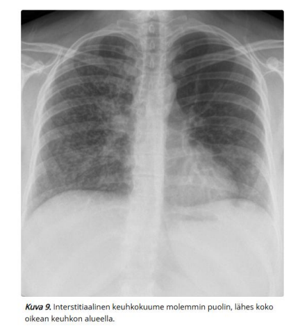

  

## TT:n etu verrattuna MRI:hin?

Vaihtoehtoja esim: 

- a. Voi ottaa useita varjoainetehosteisia kuvantamisjaksoja
- b. Parempi paikanerotuskyky
- c. Ei säteilyä

  <button class="solution-button"
          data-label="Vastaus"
          data-hide-label="Piilota vastaus">
    Vastaus
  </button>
  

      b
      
Parempi spatiaalinen resoluutio eli erotuskyky viereisten rakenteiden välillä (MRI:llä taas parempi pehmytkudoskontrasti). 

---

Muita ovat mm.: 

<li>Nopeampi</li>
<li>Parempi kortikaaliluu- ja kalkkikudosten kuvantamisessa</li>
<li>Vähemmän herkkä liike-artefaktoille</li>
<li>Sopii potilaille, joilla MRI ei sovi (esim. ahtaanpaikankammo, tietyt metalli-implantit ja tietyt pacemakerit; nykyään kylläkin vierasesineet yleensä MRI-sopivia)</li>

  

## Polven rtg-kuvassa lateraalisesti luuhippuja, merkki mistä vammasta? {#Polven-rtg-kuvassa-luuhippuja}

- a. Kertoo nivelkierukan sijoiltaanmenosta
- b. Kertoo ligamentin repeämästä
- c. ei muistettu

  <button class="solution-button"
          data-label="Vastaus"
          data-hide-label="Piilota vastaus">
    Vastaus
  </button>
  

      b
  
Jos esim. on kyseessä avulsiofragmentti sääriluun lateraalikondyylin reunasta, niin kyseessä on Segondin murtuma ja on merkki eturistisiteen ja nivelkierukan repeämästä. 

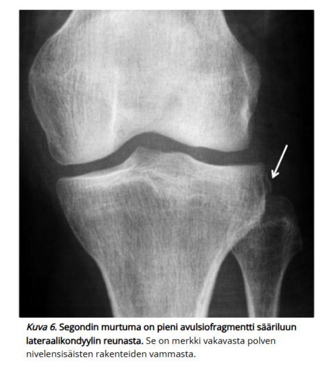
  

## Minkä sairauden diagnostiikka onnistuu parhaiten ultraäänellä? {#Minka-sairauden-ualla}

- a. perforaatio
- b. appendisiitti
- c. divertikuloosi/-liitti
- d. kolekystiitti

  <button class="solution-button"
          data-label="Vastaus"
          data-hide-label="Piilota vastaus">
    Vastaus
  </button>
  

      d

UÄ on ensisijainen kolekystiitin kuvantamiskeino

---

a: Vapaa ilma vatsaontelossa näkyy parhaiten tietokonekerroskuvauksella (TT) (tai natiivi-rtg:llä)

b: Appendisiitissa ultraääntä käytetään paljon etenkin lapsilla ja raskaana olevilla, mutta TT on parempi osuvuutensa suhteen ja onkin ei-raskaana-olevilla aikuisilla yleensä ensisijainen. 

c: TT-kuvaus on huomattavasti ultraääntä tarkempi ja ensisijainen menetelmä suolen umpipussitulehduksen ja sen komplikaatioiden todentamiseen

  

## Mikä kuvantamismenetelmä paras imusolmukkeiden kuvantamiseen? {#Mika-kuvantamismenetelma-paras-imusolmukkeiden}

Tärpissä ei vaihtoehtoja

  <button class="solution-button"
          data-label="Vastaus"
          data-hide-label="Piilota vastaus">
    Vastaus
  </button>
  

Riippuu tilanteesta ja sijainnista. Todennäköisesti vastaus on UÄ.

<li>UÄ on yleensä hyvä ensisijainen varsinkin suhteellisen pinnallisilla alueilla, kuten kaulassa. Toimii myös syvemmissäkin tapauksissa; esim. mesenteriaalinen lymfadeniitti lapsilla on UÄ-diagnoosi</li>
<li>MRI hyvä yleisesti, TT myös</li>
<li>PET/TT hyvä arvioidessa metastasointia imusolmukkeisiin</li>

  

## Lead time bias {#Lead-time-bias}

Ei vaihtoehtoja. Mitä termi tarkoittaa? 

  <button class="solution-button"
          data-label="Vastaus"
          data-hide-label="Piilota vastaus">
    Vastaus
  </button>
  

Lead time bias = Taudin aikainen toteaminen seulonnassa johtaa väärin parantuneeseen ennusteeseen. 

Esim. Yleinen harha eturauhassyöpäseuloissa

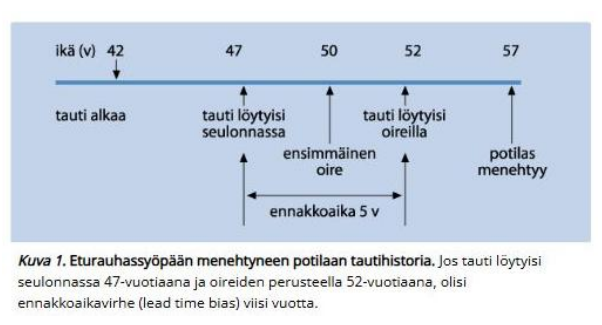
  

## Mammografiasta kysymys: mikä on totta? {#MGssa-kysymys}

- a. Mammografiaseulonta on johtanut siihen, että rinnoista poistetaan vähemmän hyvänlaatuisia muutoksia 
- b. Mammografiaseulonnassa voidaan todeta rintasyöpiä, joista ei olisi potilaalle ollut haittaa hänen elämänsä aikana
- c. ei muistettu

  <button class="solution-button"
          data-label="Vastaus"
          data-hide-label="Piilota vastaus">
    Vastaus
  </button>
  

      b

Sama ongelma on mm. eturauhassyövässä ja PSA-seulonnassa
  

## Vääntövamma, turvonnut polvi, millä kuvataan {#Vaantovamma-kuvataan}

Ei vaihtoehtoja, koita vastata ilman.

  <button class="solution-button"
          data-label="Vastaus"
          data-hide-label="Piilota vastaus">
    Vastaus
  </button>
  

RTG heti (poissuljetaan murtumat), MRI myöhemmin kiireellisesti     
  

## Mikä kudostyyppi hidastaa röntgensäteilyn kulkua eniten? {#Mika-kudostyyppi-hidastaa}

Ei vaihtoehtoja, koita vastata ilman.

  <button class="solution-button"
          data-label="Vastaus"
          data-hide-label="Piilota vastaus">
    Vastaus
  </button>
  

Luu (kortikaaliluu on hyvin tiheää ja siten näkyy lähes valkoisena rtg-kuvissa) 
  

## Mitä mammografian lisäksi voi käyttää rintojen kuvantamiseen? {#MG-lisaksi}

- a. uä
- b. mri
- c. molemmat

  <button class="solution-button"
          data-label="Vastaus"
          data-hide-label="Piilota vastaus">
    Vastaus
  </button>
  

      c

Molempia voidaan käyttää

<li>MRI on hyvä tiheiden rintojen tutkimisessa</li>
<li>UÄ yleensä seuraava jatkotutkimus mammografian jälkeen tai jopa ensisijainen raskaana olevilla tai alle 35-vuotiailla.</li>

  

## Pitkän uran tehnyt maataloustyöntekijä, keuhkolöydöksessä ainakin mattalasitiivistymiä ja jotain muuta, mikä dg todennäköisin? {#Maatalaoustyontekija}

- a. keuhkosyöpä
- b. sarkoidoosi
- c. homepölykeuhko

  <button class="solution-button"
          data-label="Vastaus"
          data-hide-label="Piilota vastaus">
    Vastaus
  </button>
  

Homepölykeuhko on toiselta nimeltään hypersensitiivinen alveoliitti eli farmer’s lung. Maataloustyöntekijät (kuten maanviljelijät ja karjanhoitajat) altistuvat työssään pitkäaikaisesti ja toistuvasti orgaaniselle pölylle, kuten homeisille heinille, oljille ja viljoille, joille altistuminen voi aiheuttaa ongelmia. 

Ohutleiketietokonetomografiassa (HRTT) näkyvät mattalasitiivistymät (ground-glass opacities) yhdessä muiden tyypillisten muutosten (kuten pienten sentrilobulaaristen nodulusten tai ilmasalpausten) kanssa ovat allergisen alveoliitin tyypillisimpiä aktiivisen vaiheen kuvantamislöydöksiä.

a: Keuhkosyöpä näkyy kuvantamisessa tyypillisesti selkeämpänä, kiinteänä kasvainmassana tai paikallisena konsolidaationa, ei niinkään laajamittaisina tai diffuuseina mattalasitiivistyminä

b: Sarkoidoosin klassinen kuvantamislöydös on molemminpuolinen keuhkoporttien ja välikarsinan imusolmukkeiden suureneminen sekä imuteitä noudattelevat pienet solmut. Mattalasimuutokset eivät ole sen tyypillisin ilmenemismuoto, vaikka ovatkin mahdollisia. 

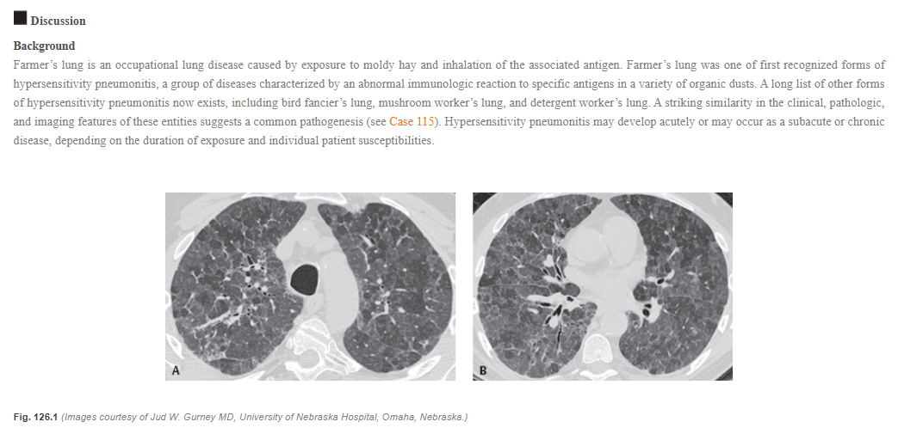
  

## Millä löytää vähäisenkin pleuranesteen parhaiten alkuvaiheessa? {#Milla-pleuraneste}

- a. uä
- b. thorax-rtg
- c ja d. ei muistettu

  <button class="solution-button"
          data-label="Vastaus"
          data-hide-label="Piilota vastaus">
    Vastaus
  </button>
  

      a

Ultraääni on herkempi pleuranesteen osoittaja kuin thx-rtg; osoittaa jopa juuri yli 20ml kertymät (thx-rtg vaatii tyypillisesti >200ml frontaalikuvassa ja >75ml lateraalikuvassa). Jopa TT on vähemmän herkkä kuin ultra. 

Ultraäänellä pleuranesteen olemassaolon tarkistaminen on myös hyvin helppoa ja nopeasti opeteltavissa. Onkin siis hyvin järkevää oppia tarkistamaan pleurasopet UÄ:llä, jotta ei tarvitse kuivatella potilaita sokkona osastolla. 

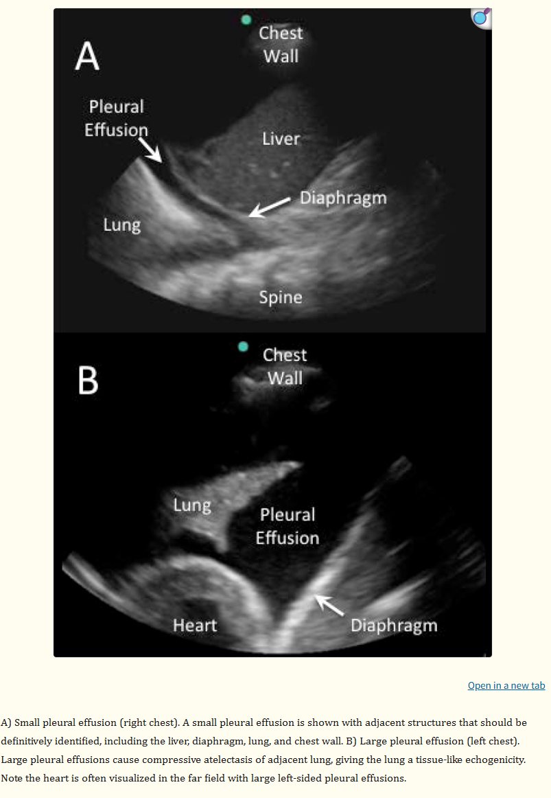
  

## Mikä on paras pneumothoraxin dg:ssa? {#Mika-pneumothoraxissa}

- a. auskultaatio
- b. mri
- c. uä
- d. tt
- e. thorax-rtg

  <button class="solution-button"
          data-label="Vastaus"
          data-hide-label="Piilota vastaus">
    Vastaus
  </button>
  

      d/e
      
_TT herkin ja tarkin,_ mutta **thx-rtg tyypillinen ensilinjan kuvantaminen.** UÄ on myös toimiva hätätilanteissa. 

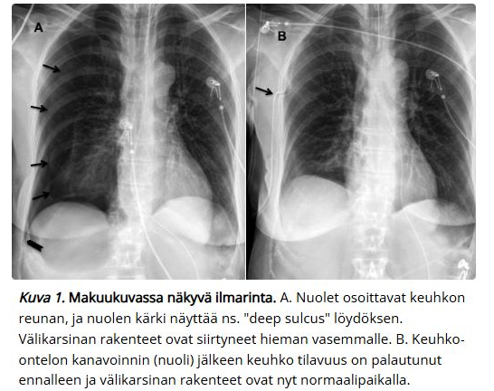
  

## Missä vaiheessa pitää ottaa kuva keuhkovaltimoiden TT-kuvantamisessa? {#Missa-vaiheessa-keuhkovaltimoiden-TT}

- a. kun varjoaine alaonttolaskimossa
- b. kun varjoaine vasemmassa eteisessä
- c. kun varjoaineen pitoisuuden havaitaan nousevan merkittävästi truncus pulmonaliksessa

  <button class="solution-button"
          data-label="Vastaus"
          data-hide-label="Piilota vastaus">
    Vastaus
  </button>
  

      c

Kuvataan silloin, kun keuhkovaltimot ovat täynnä kontrastia; ei voida aloittaa kuvantamista liian myöhään (eli ei siis silloin kun varjoaine on jo kulkenut keuhkojen läpi ja on vasemmassa eteisessä tai aortassa). 

---

Keuhkovaltimoiden tietokonekerroskuvauksessa (sekä keuhkoembolia- että CT-angiografiadiagnostiikassa) käytetään niin kutsuttua bolus tracking -tekniikkaa. Mittausalue (ROI, region of interest) asetetaan truncus pulmonaliksen kohdalle, ja varsinainen kuvaus käynnistyy automaattisesti silloin, kun varjoainepitoisuus saavuttaa tietyn kynnysarvon. Näin varmistetaan, että keuhkovaltimopuustossa on paras mahdollinen varjoainetäyttö eli kontrasti.

  

## Mikä kuvantaminen on paras epäiltäessä selkäytimen infarktia? {#Mika-kuvantaminen-sy-infarktissa}

Ei vaihtoehtoja, koita vastata ilman. 

  <button class="solution-button"
          data-label="Vastaus"
          data-hide-label="Piilota vastaus">
    Vastaus
  </button>
  

MRI: magneetti on käytännössä ainoa kuvantaminen, jolla voidaan tarkastella itse selkäydintä.   

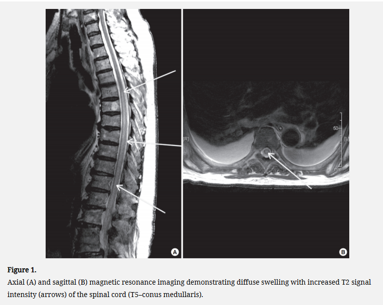
  

## Mitä tarkoittaa pseudoartroosi? {#Pseudoartroosi}

  <button class="solution-button"
          data-label="Vastaus"
          data-hide-label="Piilota vastaus">
    Vastaus
  </button>
  

Luunmurtuman paranemisen epäonnistuminen (non-union), jossa samalla todetaan fibroottinen kapseli luutumattoman kohdan ympärillä. 

Muodostuu siis ns. valenivel, kun viskoosi neste (emuloi synoviaalinestettä) täyttää fibroottisen pseudosynoviaalisen kapselin. 

  

## HIFU syöpähoidossa, mitä kasvaimeen ohjataan? {#HIFU-syopahoidossa}

- a. UÄ
- b. radioaallot
- c. mikroaallot
- d. laser

  <button class="solution-button"
          data-label="Vastaus"
          data-hide-label="Piilota vastaus">
    Vastaus
  </button>
  

      a

HIFU = high-intensity focused ultrasound. Ultraääniaallot fokusoidaan kudokseen, jossa ne kuumentavat sen ja aiheuttavat alueen kuolion. Ympäröivä kudos säästyy, koska energia keskittyy vain polttopisteeseen. Hoitoa ohjataan UÄ- tai MRI-kuvantamisella, eikä se vaadi viiltoa.

Käytetään monien erilaisten muutosten hoidossa, esim. monien solidien tuumoreiden (maksa, osteoidi osteooma yms) hoidossa. Käytetään myös mm. Parkinsonin taudin ja essentiaalisen tremorin hoidossa aivoihin kohdistettuna; Suomessa erityisesti TYKS on tällaisen neuro-HIFU:n toteuttaja. 

---

b: Radioaaltoja käytetään RFA:ssa (radiotaajuusablaatio)

c: mikroaaltoja MWA:ssa (mikroaaltoablaatio)

d: Lasereita käytetään monissa tapauksissa: LITT (laser-indusoitu terminen terapia), eturauhasen viherlaserhoito (BPH:n hoito)...
  

## Mistä on kyse, kun lapselle käytetään mahdollisimman pientä säteilyannosta kuitenkin niin, että diagnostiikka ei kärsi? {#Mahd-pieni-annos}

Ei vaihtoehtoja, koita vastata ilman

  <button class="solution-button"
          data-label="Vastaus"
          data-hide-label="Piilota vastaus">
    Vastaus
  </button>
  

      
Optimointiperiaate = käytetään mahdollisimman pientä sädeannosta, jolla kuvantaminen kuitenkin pystytään järkevästi suorittamaan; ALARA = as low as reasonably achievable

Radiologisten tutkimusten periaatteet = **oikeutusperiaate** (ionisoivan säteilyn käyttöön perustuvasta radiologisesta tutkimuksesta saatavan hyödyn tulee olla suurempi kuin haitta), **optimointiperiaate** (ALARA) ja **yksilönsuojaperiaate** (säteilyaltistusta aiheuttava toiminta on järjestettävä ja toteutettava niin että säteilylle altistuvan henkilön – tässä yhteydessä työntekijän – altistus ei ylitä annosrajoja). 
  

## Minkä diagnostiikkaan matala-annos TT sopii? {#Matala-annos-TT}

- a. kolekystiitti
- b. sappikivi
- c. virtsatiekivi

  <button class="solution-button"
          data-label="Vastaus"
          data-hide-label="Piilota vastaus">
    Vastaus
  </button>
  

      c  

Tehdään ilman kontrastia, kun yritetään kuvata virtsatiekiviä. Matalan annoksen vuoksi säderasitus on pieni, mikä on tärkeää, koska potilaat ovat usein nuoria ja kivet uusiutuvia.

---

Kolekystiitin ja sappirakkokivien kuvantamisessa paras kuvantamiskeino on UÄ; monet sappikivet eivät näy TT:ssä (tyypilliset kolesterolikivet ovat TT:ssä isodenssejä sapen kanssa).

  

## Minkä diagnostiikassa on hyötyä varjoaine-TT:stä? {#Minka-diagnostiikassa-va-tt}

- a. perforaatio
- b. vapaata nestettä
- c. vatsaontelossa,
- d. maksan repeämä

  <button class="solution-button"
          data-label="Vastaus"
          data-hide-label="Piilota vastaus">
    Vastaus
  </button>
  

      d
      
Voidaan nähdä verisuoniperäiset vauriot ja aktiivinen verenvuoto paremmin. 

---

Perforaatio näkyy usein ilman varjoainetta (vapaa ilma); vapaa neste näkyy myös (tosin voi olla verta, jolloin varjoaine-TT auttaa paikantamisessa)
  

## Mikä pitää paikkansa askiteksen UÄ? {#Mika-pitaa-paikkansa-askiteksen-ua}

- a. askites näyttää samalta kuin sappineste
- b. vahvempi kaiku kuin maksakudoksessa
- c. askites näkyy pystykuvissa nestevaakapintoina

  <button class="solution-button"
          data-label="Vastaus"
          data-hide-label="Piilota vastaus">
    Vastaus
  </button>
  

      a

Molemmat ovat vesimäisiä nesteitä -> näyttävät mustalta ultraäänellä kuvattaessa. 

---

b: askiteksen kaiku on heikompi kuin maksakudoksen. Neste on mustaa, ja vain mahdolliset väliseinät tai paksu sisältö lisäävät kaikua

c: Nestevaakapinnat (neste–ilma-rajat) kuuluvat pääasiassa röntgen- ja TT-kuviin, ja UÄ ei kuvaa ilmaa samalla tavalla
  

## Mikä on ongelma rasvamaksan UÄ verrattuna TT? {#Ongelma-rasvamaksan-ua}

- a. ei ionisoivaa säteilyä
- b. obesiteetti voi vaikeuttaa kuvantamista
- c. ei muistettu

  <button class="solution-button"
          data-label="Vastaus"
          data-hide-label="Piilota vastaus">
    Vastaus
  </button>
  

      b

Rasvamaksa liittyy usein ylipainoon ja paksu ihonalainen ja vatsaontelon rasvakerros heikentää ultraäänen läpäisyä ja kuvanlaatua. Tämä on UÄ:n ongelma verrattuna TT:hen, jossa kuvanlaatu ei heikkene samalla tavalla

  

## Miten tunnistaa atelektaasin thx-rtg:ssa? 

- a. lohkorajan siirtyminen
- b. b-viivat
- c. ei muistettu 

  <button class="solution-button"
          data-label="Vastaus"
          data-hide-label="Piilota vastaus">
    Vastaus
  </button>
  

      a

Romahtanut lohko vetää lohkorajaa, välikarsinaa ja henkitorvea itseään kohti

---

Atelektaasissa voi olla mm. seuraavia piirteitä:  keuhkoalueen tiivistymäjuoste (levyatelektaasit), lohkorajat voivat vetäytyä kohti atelektaasia ja isommassa atelektaasissa voi näkyä **vaaleana alueena** keuhkon ollessa kasassa/työntynyt pois siltä alueelta.

  

## Radiologin lausunto: polvessa nivelrako mahdollisesti hieman kaventunut ja vähäisiä osteofyyttejä. Mikä Kellgren-Lawrence luokka? {#KL-luokkka-mika}

  <button class="solution-button"
          data-label="Vastaus"
          data-hide-label="Piilota vastaus">
    Vastaus
  </button>
  

      
Hieman epätyypillinen sanoitus, mutta jos mahdollisesti kaventunut ja mahdollisesti osteofyyttejä -> K-L-luokka 1

Jos mahdollinen kaventuminen ja selvästi osteofyyttejä (vaikka olisi pieniä) -> K-Lluokka 2

  

## Missä yleisimmin reumaeroosioita? {#Missa-reumaeroosioita}

- a. sormien kärjet
- b. metatarsaalien distaalipäät
- c. solisluun distaalipäät
- d. polven luut

  <button class="solution-button"
          data-label="Vastaus"
          data-hide-label="Piilota vastaus">
    Vastaus
  </button>
  

      b

Sormien kärjet säästyvät yleensä; nivelreuma affisioi kädessä tyypillisesti PIP-, MCP- ja ranneniveliä. Jaloissa yleisimpiä paikkoja ovat jalkaterän metatarsofalangeaalinivelet. 

a: DIP-nivelet kuuluvat pikemminkin nivelrikkoon 

c: Mahdollinen, mutta harvinaisempi kohta

d: Mahdollisia, mutta suuri nivel ja niissä eroosiot ovat harvinaisempia varhaisessa vaiheessa

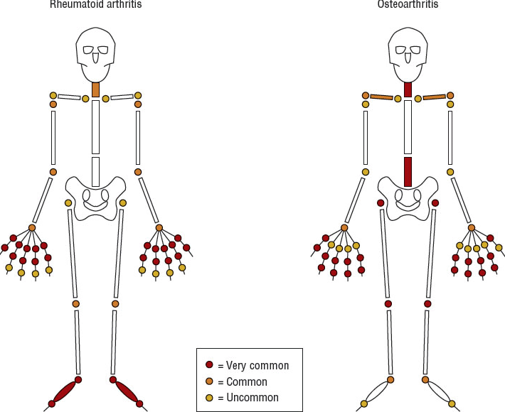
  

## Radiusmurtuma kuva: onko dorsaalista vai volaarista kallistusta vaiko hyväasentoinen {#Radmurt}

Tärpissä ei esimerkkikuvaa, mutta mieti, miten kallistus mitataan ja mitkä ovat hyväasentoisen radiusmurtuman kriteerit aikuisilla.

  <button class="solution-button"
          data-label="Vastaus"
          data-hide-label="Piilota vastaus">
    Vastaus
  </button>
  

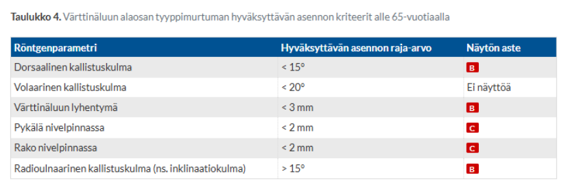
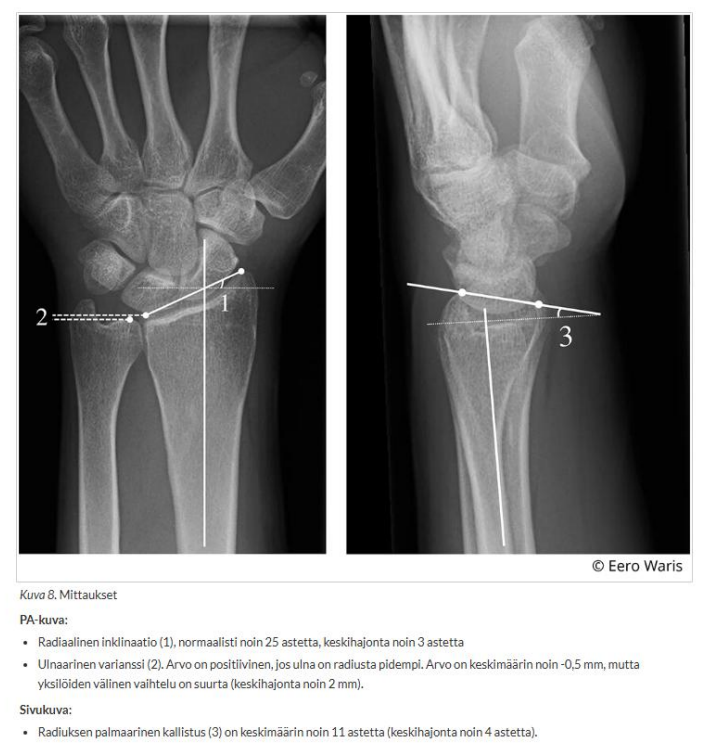
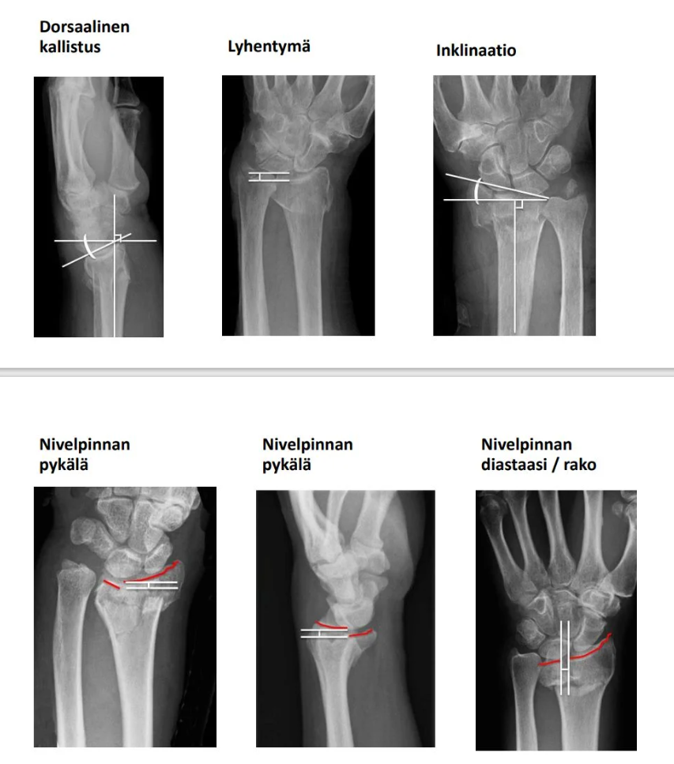
  

## Lonkkamurtuma: onko varussuuntainen siirtymä {#Varusta-lonkassa}

Ei esimerkkikuvaa tärpissä. Mieti, millainen on varussuuntainen reisiluun pään asento ja millainen on valgussuuntainen?

  <button class="solution-button"
          data-label="Vastaus"
          data-hide-label="Piilota vastaus">
    Vastaus
  </button>
  

   
Varussuuntaisessa reisiluun murtumassa (tai ihan asennossa ilman murtumaakin) on reisiluun kaulan ja diafyysin välisen kulma normaalia pienempi (eli n. alle 125 astetta). Valgusasennossa taas kulma nousee normaalia suuremmiksi (n. yli 140 astetta). 
   
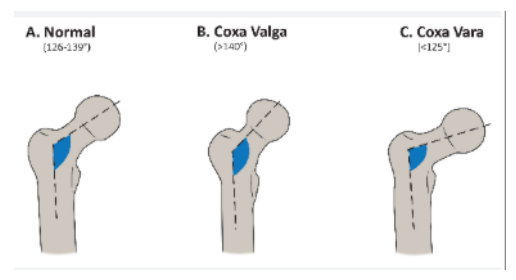
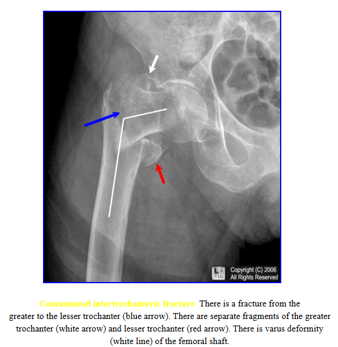
  

## Ilmatilapneumonia, mikä pitää paikkaansa? {#Ilmatilapneumonia-ov}

- a. bakteerin aiheuttama yleensä
- b. ilmabronkogrammi johtuu ilmateiden täyttymisestä tulehdusnesteellä
- c. pallean raja nousee basaalisessa tulehduksessa
- d. kliininen taudinkuva jatkuu pidempään kuin keuhkomuutokset ovat nähtävissä thx-rtg:ssa

  <button class="solution-button"
          data-label="Vastaus"
          data-hide-label="Piilota vastaus">
    Vastaus
  </button>
  

      a
      
Ilmatilapneumonia = lobaaripneumonia

Ilmatilapneumoniaa ja bronkopneumoniaa aiheuttavat useimmiten bakteerit. Suomessa aikuisilla **yleisin lohkokeuhkokuumeen aiheuttajabakteeri on pneumokokki** (Streptococcus pneumoniae), joka aiheuttaa taudeista noin puolet. Tavallisimpia bronkopneumonian aiheuttajia ovat Staphylococcus aureus, Mycoplasma pneumoniae, Chlamydia pneumoniae, Haemophilus influenzae, Moraxella catarrhalis, Eshericia coli, Pseudomonas aeruginosa ja Francisella tularensis sekä adenovirukset. 

---

b: Ilmabronkogrammi syntyy, kun ympäröivät alveolit täyttyvät nesteellä mutta keuhkoputket pysyvät ilmaa sisältävinä ja erottuvat tummina tiivistymän sisällä. Ilmatiet eivät siis täyty tulehdusnesteellä. 

c: Basaalisessa tulehduksessa pallean raja häviää (siluettimerkki) tai kuva muuttuu epäselväksi, ei nouse. Pallean nousu liittyy esim. atelektaasiin tai pallean halvaukseen. 

d: Kuvantamislöydökset (tiivistymä) pysyvät yleensä näkyvissä pidempään kuin oireet. Kliininen paraneminen tapahtuu päivissä tai viikoissa, mutta röntgenmuutokset voivat hävitä vasta 4–12 viikossa

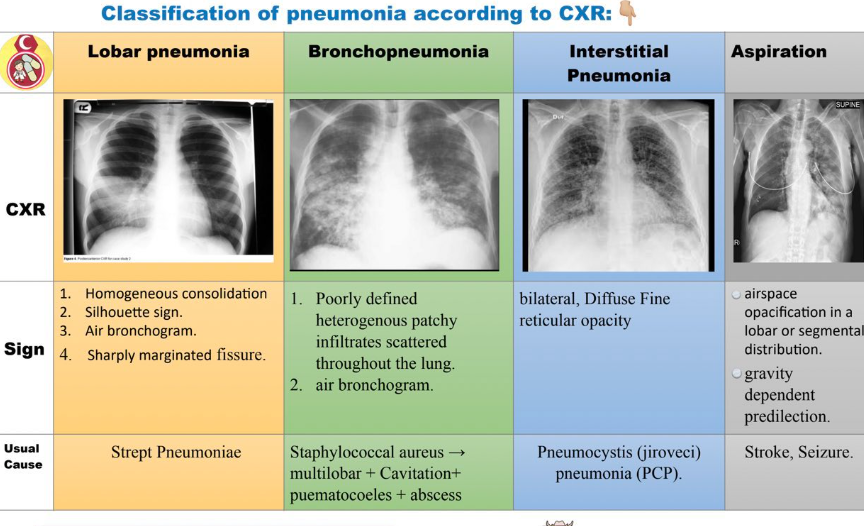
  

## Millä luotettavimmin voi todeta lihasrepeämän? {#Milla-luotettavimmin}

- a. TT 
- b. MRI 
- c. UÄ

  <button class="solution-button"
          data-label="Vastaus"
          data-hide-label="Piilota vastaus">
    Vastaus
  </button>
  

      
MRI on parhaan pehmytkudosten erottelukyvynsä ansiosta luotettavin menetelmä lihasrepeämän toteamiseen: se näyttää repeämän laajuuden, asteen, verenvuodon ja turvotuksen sekä muut vammat.

Myös UÄ on usein ihan hyvä ja nopea, mutta MRI on luotettavin. TT ei erottele pehmytkudoksia riittävän hyvin.
  

## Mikä TT:ssä käytetty varjoaine? {#Mika-TTssa-varjoaine}

Ei vaihtoehtoja, yritä vastata ilman. Mikä taas olisi MRI:ssä?

  <button class="solution-button"
          data-label="Vastaus"
          data-hide-label="Piilota vastaus">
    Vastaus
  </button>
  

      
**Jodi**

MRI:ssä taas gadolinium.
  

## Mikä luu voi murtua Salter-Harris luokituksen mukaisesti? {#Mika-luu-SH}

- a. pohjeluu
- b. patella 
- c. ei muistettu

  <button class="solution-button"
          data-label="Vastaus"
          data-hide-label="Piilota vastaus">
    Vastaus
  </button>
  

      a

SH-luokitusta voidaan käyttää luissa, joissa on **kasvulevy** lapsilla; tämän takia patella, lantion luut ja kallon luut eivät sovellu. Pohjeluussa on kasvulevy lapsilla -> voidaan käyttää. Muita yleisiä SH-murtumien luita ovat mm. sääriluu ja värttinäluu. 

---

SH-luokitus on lasten kasvulevyä affisioivien murtumien luokittelutapa, joka perustuu murtuman morfologiasta suhteessa kasvulevyyn. 

On myös Petersonin luokitus, joka on tarkempi ja on käytössä mm. Helsingissä enemmän; muuten maailmalla SH-luokitus on yleisemmin käytössä.

<li>SH1 = Murtuma on pelkästään kasvulevyn hypertrofisessa vyöhykkeessä; epifyysi erkanee metafyysistä</li>
<li>SH2 = Murtuma kulkee kasvulevyn halki metafyysiin; yleisin tyyppi</li>
<li>SH3 = Murtuma kulkee kasvulevyn kautta epifyysin läpi nivelpintaan</li>
<li>SH4 = Murtuma kulkee metafyysin, kasvulevyn ja epifyysin läpi nivelpintaan</li>
<li>SH5 = Kasvulevyn puristusvamma, jossa kasvulevy murskautuu; ei dislokoitumista tyypillisesti; hyvin harvinainen</li>

  

## Mikä on apofyysi? {#Apofyysi-mika}

Ei vaihtoehtoja, koita vastata ilman apua.

  <button class="solution-button"
          data-label="Vastaus"
          data-hide-label="Piilota vastaus">
    Vastaus
  </button>
  

      
Kehittyvässä luussa oleva kasvualue (luukyhmy, luutumake), joka toimii jänteiden kiinnityskohtana. 

---

On kiinni fyysissä eikä sillä ole yleensä nivelpintaa toiseen luuhun. 

Luutuu yleensä murrosiän lopussa eikä aikuisilla enää ole todettavissa. Joskus apofyysi voi säilyä aikuisikään, mutta tyypillisesti nähdään vain lapsilla (esim. polvessa säilyessään on nimeltään patella bipartita). 

On kasvuvaiheessa luun heikoin kohta, koska rustoinen kasvulevy on lihasvedon kohteena. Yleinen ongelma on ns. apofysiitti, jossa toistuvasta rasituksesta johtuva tulehdus aiheuttaa kipua alueella, esim. Osgood-Schlatterin tauti (sääriluun kyhmy, tuberositas tibiae) ja Severin tauti (kantaluu). Äkillisessä voimakkaassa lihassupistuksessa (esim. urheilussa) apofyysi voi myös irrota (avulsiomurtuma), tyypillisesti lantiossa (spina iliaca anterior inferior ja superior, istuinkyhmy) ja kyynärvarressa. 

**Apofyysi on hyvä osata tunnistaa, koska sen voi helposti väärin tulkita muuten murtumaksi.**

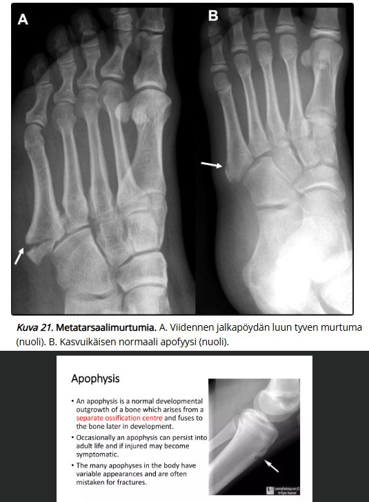
  

##  HU -100 on mitä kudosta? {#Hu100}

- a. veri
- b. rasva
- c. luu

  <button class="solution-button"
          data-label="Vastaus"
          data-hide-label="Piilota vastaus">
    Vastaus
  </button>
  

      b

Vesi 0 ja kortikaalinen luu >1000.

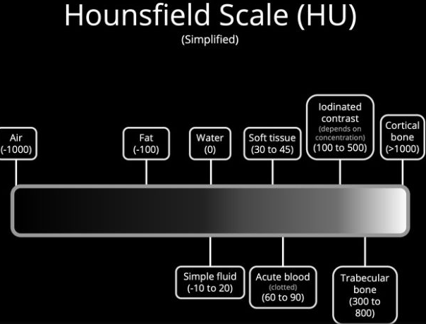
  

## Kuvatunnistus: onko varpaiden luita murtunut tai lisfrancin nivel sijoiltaan

Ei esimerkkikuvaa tärpissä. Mieti mikä on lisfrancin nivel ja ligamentti, mikä on lisfrancin vamma ja miltä se näyttää?  

  <button class="solution-button"
          data-label="Vastaus"
          data-hide-label="Piilota vastaus">
    Vastaus
  </button>
  

      
Lisfrancin nivelet ovat latinaksi articulationes tarsometatarsales. **Lisfrancin nivelen muodostavat proksimaaliosassa vaaja- ja kuutioluut (cuneiforme-luut ja cuboideum), jotka niveltyvät metatarsaaliluihin -> tarsometatarsaalinivel (TMT).** Chopartin nivel on proksimaalisempi jalkapöydän nivelistä. 

Lisfrancin niveltasossa cuneiforme medialen ja MT II (ja III) tyven välissä on ns. Lisfrancin ligamentti. Pitää I ja II säteen yhdessä ja kannattelee poikittaista holvia.

**Lisfrancin vammassa ligamentin rikkoutuessa cuneiforme mediale ja metatarsaali 2 tyvi pääsevät erkaantumaan, jolloin myös MT1 ja MT2 erkanevat toisistaan.**
  
Vammamekanismina on suoran iskun lisäksi joko aksiaalisuunnan voima, joka kohdistuu plantaarifleksiossa olevaan jalkaan (esim. putoaminen), tai etummaiseen jalkaan kohdistuva abduktio silloin kun takimmainen jalka on fiksoituneessa asennossa. Jälkimmäinen vammamekanismi tapahtuu esimerkiksi silloin, jos ratsastaessa jää jalastaan roikkumaan jalustimen varaan

Lisfrancin niveltason vamma voi olla vaikeaa tunnistaa, sillä rtg ja kliiniset löydökset voivat olla vähäisiä. Tärkeä statuslöydös kuitenkin voi olla aristus/mustelma jalkaterässä/jalkapohjassa. Matalaenergiaisessakin vammassa päkiälle nousu on usein mahdotonta kivun vuoksi. Korkeaenergisessä vammassa varaus ei usein onnistu. Hoitamattomana vammat voivat aiheuttaa jalan biomekaniikan häiriön ja nivelrikon.
 
Dislokoituneen tai epävakaan Lisfrancin niveltason murtumaluksaation tai luksaation hoito on kirurginen.

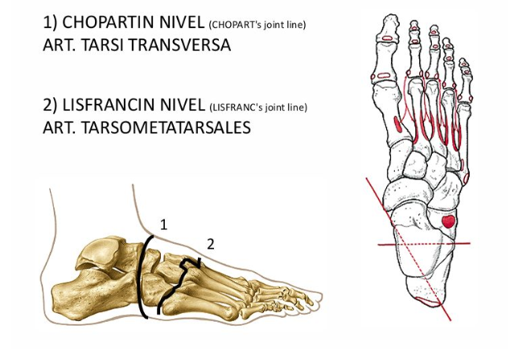
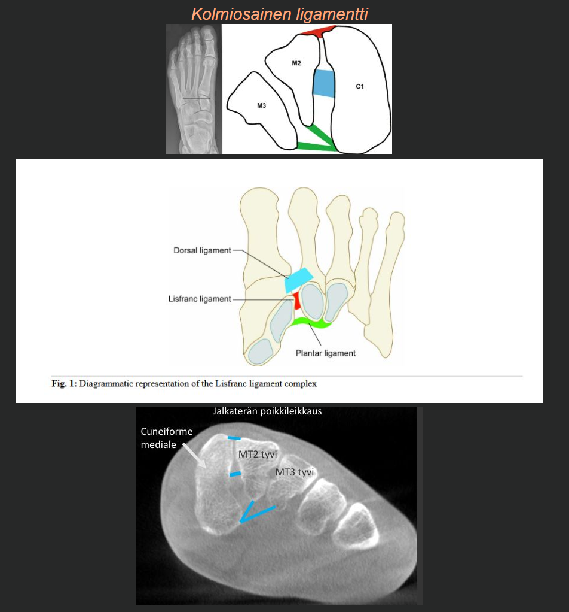
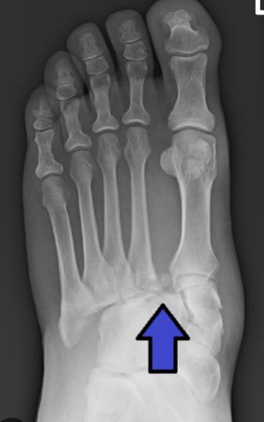
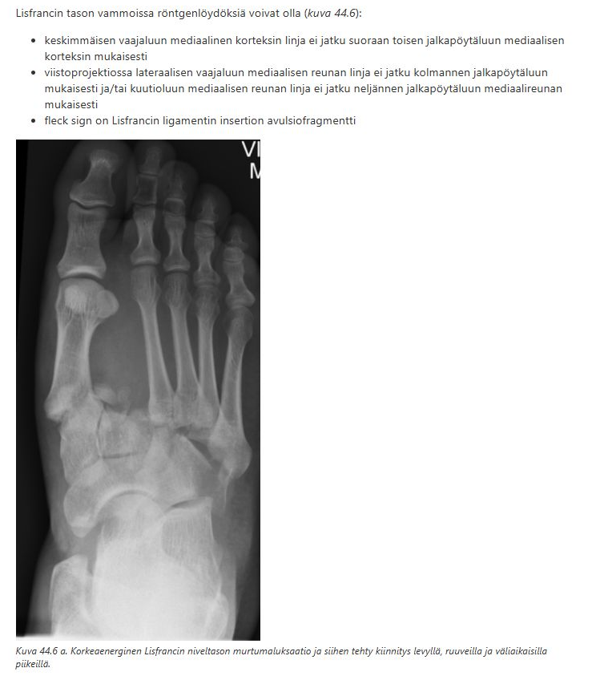
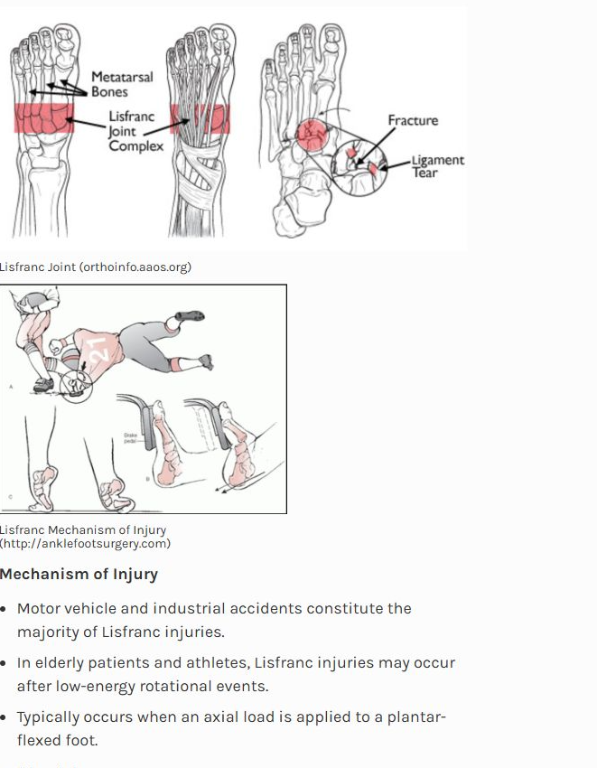

  

## Oikeutusperiaate, mitä tarkoittaa {#Oikeutus-tarkoittaa}

Ei vaihtoehtoja, koita vastata ilman apuja

  <button class="solution-button"
          data-label="Vastaus"
          data-hide-label="Piilota vastaus">
    Vastaus
  </button>
  

      
Ionisoivan säteilyn käyttöön perustuvasta tutkimuksesta saatavan hyödyn tulee olla suurempi kuin haitta 

---

Radiologisten tutkimusten periaatteet = **oikeutusperiaate** (ionisoivan säteilyn käyttöön perustuvasta radiologisesta tutkimuksesta saatavan hyödyn tulee olla suurempi kuin haitta), **optimointiperiaate** (ALARA) ja **yksilönsuojaperiaate** (säteilyaltistusta aiheuttava toiminta on järjestettävä ja toteutettava niin että säteilylle altistuvan henkilön – tässä yhteydessä työntekijän – altistus ei ylitä annosrajoja). 

  

## Mikä kuvantaminen Alzheimerissa atrofian todentamiseen {#Alzheimerin-atrofia-mika-kuvantaminen}

- a. TT
- b. magneetti 
- c. molemmat

  <button class="solution-button"
          data-label="Vastaus"
          data-hide-label="Piilota vastaus">
    Vastaus
  </button>
  

      
Molemmat pystyvät tähän, mutta MK on herkempi ja tarkempi. TT kuitenkin usein riittää varsinkin, jos se on jo otettu jostain muusta syystä akuuttitutkimuksena (tällöin voidaan pyytää ns. lisälausunto kuvasta muisti-indikaatiolla).   

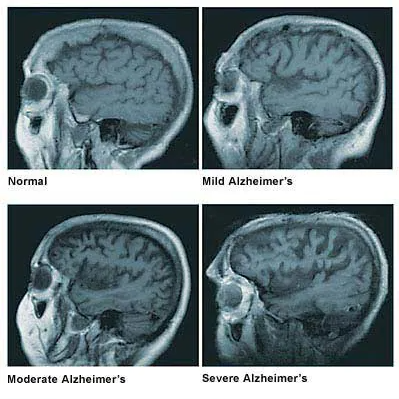
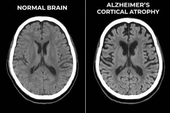
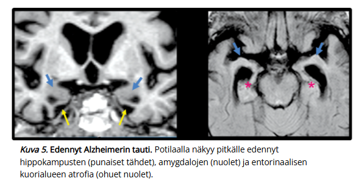
  

## Thorax-rtg-kuva, josta piti arvioda nesteen määrä {#Nesteenmaara}

Ei esimerkkikuvaa tärpissä. Koita arvioida tästä kuvasta

- a. pari dl
- b. pari litraa
- c. viisi litraa

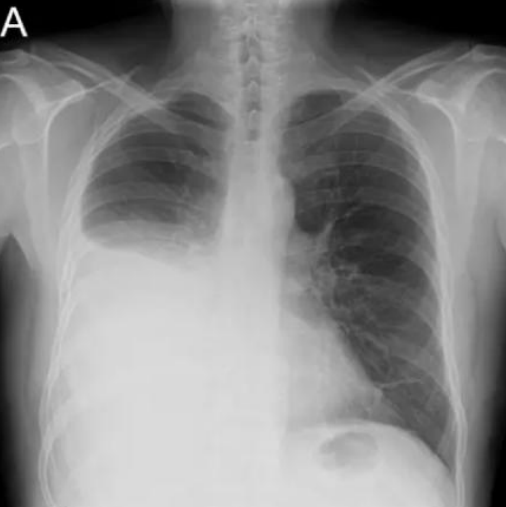

  <button class="solution-button"
          data-label="Vastaus"
          data-hide-label="Piilota vastaus">
    Vastaus
  </button>
  

      b (oikealla)

Nyrkkisääntönä voi miettiä, että jos pleurasopit lievästi pyöristyneet -> pari dl; jos keuhkossa puoleen väliin nestettä (n. hilustasolla) -> pari litraa. 
  

## Kuvantamisen sensitiivisyys 90%, mitä tarkoittaa? {#Kuvantamisen-sensitiivisyys-mita}

Ei vaihtoehtoja, vastaa ilman apuja.

  <button class="solution-button"
          data-label="Vastaus"
          data-hide-label="Piilota vastaus">
    Vastaus
  </button>
  

      

Testi löytää 90% potilaista, joilla on oikeasti tauti; loput 10% jäävät vääriksi negatiivisiksi.

  

## Mikä kuvantaminen avuksi pleurapunktiossa? {#Mika-kuvantaminen-pleurapunktiossa}

  <button class="solution-button"
          data-label="Vastaus"
          data-hide-label="Piilota vastaus">
    Vastaus
  </button>
  

      UÄ
      
UÄ:llä voidaan nähdä reaaliaikaisesti pleuranesteen määrä ja sijainti, väliseinät (septat) sekä sopiva pistokohta. Neula voidaan ohjata nesteeseen turvallisesti, mikä pienentää komplikaatioiden riskiä; samoin usein askitespunktiot voi tehdä UÄ-ohjauksessa. 

  

## Millä indikaatiolla voitaisiin ottaa 25v miehen lannerangan rtg {#Milla-indikaatiolla-25}

Ei vaihtoehtoja, koita vastata ilman

  <button class="solution-button"
          data-label="Vastaus"
          data-hide-label="Piilota vastaus">
    Vastaus
  </button>
  

      

Nuorella aikuisella lannerangan natiivikuva ei kuulu rutiinitutkimuksiin tavallisessa selkäkivussa. Muut kuvantamiset (MRI tai akuuteissa traumoissa TT) ovat yleensä parempia ja ensisijaisempia. 

Perusteltuja indikaatioita on aika harvoin, ehkä luutumisen kontrolloinnissa murtuman jälkeen. Tietysti lapsilla ja nuorilla otetaan usein, jos on epäily spondylolyysistä tai spondylolisteesistä (urheilijoilla, jatkuva rasituskipu), skolioosista tai synnynnäisistä nikamapoikkeavuuksista -> näillä indikaatioilla voi ottaa periaatteessa 25-vuotiaaltakin. 

  

## Suolen kuvantaminen millä? Varjoaineella/ilman mri/tt/rtg?

Ei vaihtoehtoja, koita vastata ilman ja tietysti riippuu tilanteesta.

<li>Jos esim. ohutsuolen kuvantaminen Crohnin tautia epäiltäessä niin varjoaine ja mri ensisijaisesti.</li>
<li>Jos paksusuolen tutkiminen (TT-kolonografia) niin suoli täytetään ilmalla tai hiilidioksidilla ja tehdään yleensä TT-varjoaineen kanssa</li>
<li>Akuutissa vatsassa yleensä vatsa-TT varjoaineella (vain virtsatiekivet ei iv varjoainetta) </li>
<li>UÄ voidaan käyttää mm. lapsilla usein akuutin vatsan tai monien muidenkin ongelmien yhteydessä (intussusseptio, appendisiitti, pylorusstenoosi).</li>

## Miten varjoaine urografiassa

- a. iv
- b. munuaisvaltimo
- c. ei muistettu

  <button class="solution-button"
          data-label="Vastaus"
          data-hide-label="Piilota vastaus">
    Vastaus
  </button>
  

      a
      
TT-urografiassa virtsatiet kuvataan eritysvaiheessa suonensisäisen varjoaineen annon jälkeen.

**Virtsatiekiviepäilyissä natiivi-TT on pääosin syrjäyttänyt urografian,** jossa tarvitaan suonensisäistä jodivarjoainetta. 

MK-urografiassa virtsateiden näkymiseen ei tarvita välttämättä varjoainetta, vaan niiden erottuminen perustuu nesteisiä rakenteita kuvaavaan tekniikkaan

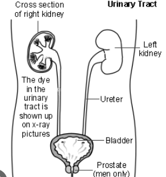
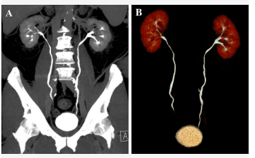
  

## Mikä deterministinen {#Mika-deterministinen}

- a. syöpä
- b. mutaatio
- c. DNA-vaurio
- d. harmaakaihi

  <button class="solution-button"
          data-label="Vastaus"
          data-hide-label="Piilota vastaus">
    Vastaus
  </button>
  

      d

Säteilyn deterministiset haitat ovat kynnysarvollisia: haitta ilmenee vasta tietyn kynnysannoksen ylittyessä, ja sen vaikeus kasvaa annoksen mukana. Harmaakaihi (silmän mykiön samentuma) on tyypillinen deterministinen haitta, jonka muita esimerkkejä ovat ihon punoitus, hiusten lähtö ja hedelmättömyys.   

**Syöpä, mutaatio ja DNA-vaurio ovat stokastisia haittoja:** todennäköisyys kasvaa annoksen mukana, mutta kynnysarvoa ei ole, ja haitan vaikeus ei riipu annoksesta.

  

## Miksi sydän on THX-RTG:ssä makuukuvassa suurempi kuin pystykuvassa? {#Miksi-sydan-suurempi}

Ei vaihtoehtoja, mutta koita vastata ilman.

  <button class="solution-button"
          data-label="Vastaus"
          data-hide-label="Piilota vastaus">
    Vastaus
  </button>
  

      
Makuukuva on AP-kuva (pystykuva on PA), jolloin sydän on kauempana detektorista -> piirtyy isompana. 

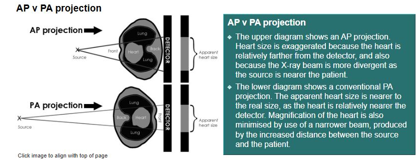
  

## Miltä maksan kysta näyttää ultraäänellä? {#Kysta-uassa}

Ei vaihtoehtoja, koita vastata ilman. 

  <button class="solution-button"
          data-label="Vastaus"
          data-hide-label="Piilota vastaus">
    Vastaus
  </button>
  

      
Tummalta nestetäytteiseltä rakenteelta, joka jättää taakseen kaikuvahvistuman. Mahdollisesti kystan seinämä hieman muuta maksaa tiiviimpi. 

---

Tavallisin hyvänlaatuisista fokaalisista maksamuutoksista on (biliaarinen) kysta. Kystia todetaan noin 2–7 %:lla väestöstä. Ne voivat olla yksittäisiä tai multippeleita, ja kooltaan ne voivat vaihdella muutamasta millimetristä useisiin senttimetreihin.

**Kystat löytyvät tyypillisesti sattumalta, eikä niihin liity pahanlaatuisuuspotentiaalia.**

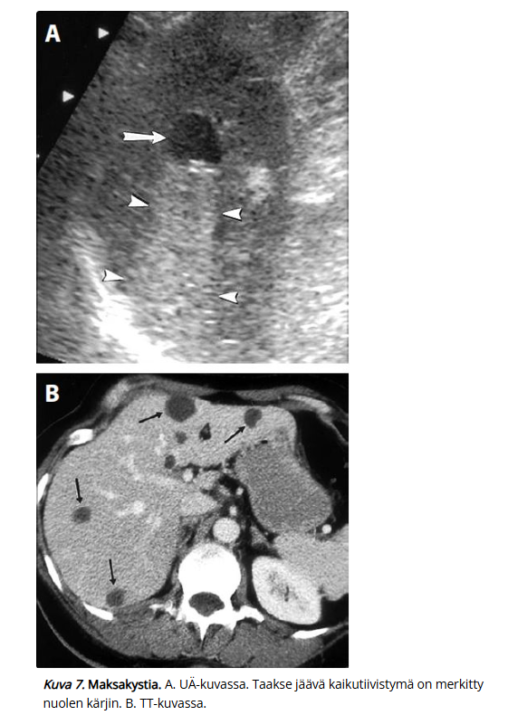
  

## Kuva: keuhkotuumori vai aortan aneurysma 

Ei esimerkkikuvaa tärpissä, mutta omassa tentissäni oli selkeä tuumori eikä aortan aneurysma. 

Kannattaa arvioida, onko muutos aortan kanssa yhtenäinen ja siten voi nähdä, onko aorta laajentunut vai onko tuumorimuutos erillinen; sivukuva auttaa. 

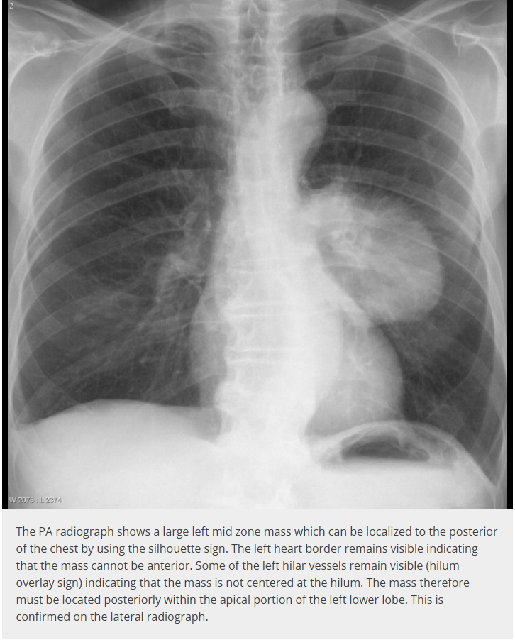
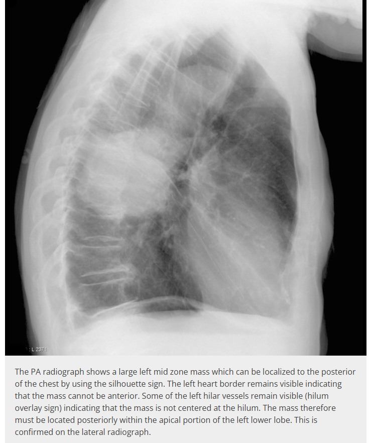

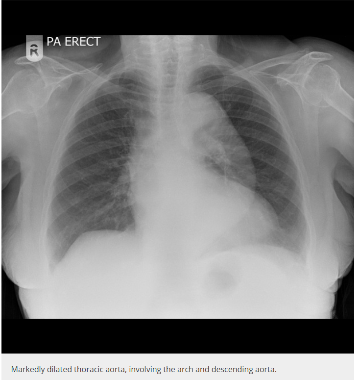

## Mikä on generaattorin rooli röntgenkuvassa? {#Generaattorin-rooli}

  <button class="solution-button"
          data-label="Vastaus"
          data-hide-label="Piilota vastaus">
    Vastaus
  </button>
  

      
**Rtg-generaattorilla tuotetaan suurjännite, jolla elektronit kiihdytetään röntgenputkessa.**

---

Kiihdytysjännite vaihtelee sovelluksen mukaan n. 26 kV:sta (mammografia) aina 125 kV:iin (keuhkokuvaus). Jotta kiihdytysjännite olisi mahdollisimman tasainen, laitteen käyttöjännite muunnetaan ensin röntgengeneraattorilla suurtaajuiseksi ja sen jälkeen jännite muunnetaan suurjännitteeksi. Fotonien määrää säädetään kuvauksen sähkömäärää muuttamalla.

Kun kiihdytetyt elektronit törmäävät anodimateriaaliin, syntyy jarrutussäteilyä ja karakteristista röntgensäteilyä. Hyötysuhteeltaan röntgensäteiden tuotto röntgenputkessa on huono: elektronisuihkun energiasta vain 1 % muuntuu röntgensäteiksi ja loppu muuntuu lämmöksi ja valoksi. Röntgenputkelta edellytetään tehokasta säteilytuottoa mutta samalla hyvää lämmönjohtokykyä, jotta anodimateriaali ei lämpene liikaa ja vaurioidu.

Syntyvästä röntgenfotonikeilasta suodatetaan pois pienimmän energian fotonit. Pienienergiaisimmat fotonit eivät saavuttaisi ilmaisinta, ja ne aiheuttaisivat potilaalle turhaa säteilyrasitusta. Siksi pienienergiaiset fotonit on syytä suodattaa fotonikeilasta pois. Suodatinmateriaalina käytetään muutaman millimetrin paksuista alumiinilevyä tai millimetrin kymmenesosien paksuista kuparilevyä. Kuparia käytetään suodatinmateriaalina suurilla kiihdytysjännitteillä, ts. kun fotonien energia on suuri. Käytettäessä suodatusta fotonikeilan efektiivinen energia kasvaa.

Säteilykeila rajataan kaihtimilla juuri sen kokoiseksi kuin on tarpeellista. Liian suureksi rajattu kuva aiheuttaa potilaalle ylimääräistä säteilyrasitusta ja kasvattaa sirontaa kohteen sisällä, mikä heikentää kuvan laatua. Kaihdinkoppaan on usein kiinnitetty pinta-ala-annosmittari (nk. DAP-mittari, dose area product), joka rekisteröi kuvauksesta potilaalle aiheutuneen säteilyaltistuksen. Laite saattaa määrittää säteilyaltistuksen myös laskennallisesti. Muussa tapauksessa altistus määritetään röntgenputken säteilytuotannon avulla. Röntgensäteet läpäisevät kuvattavan kohteen vain osittain. Säteiden intensiteetti vaimenee kuvausjännitteen, kudosten vaimenemiskertoimen ja kudoksen paksuuden mukaan. Kuvausjännite valitaan kuvattavan kohteen mukaan, jotta kudoskontrasti kuvassa on optimaalinen ja ilmaisin rekisteröi riittävästi fotoneja.

Kiihdytysjännitteen kasvaessa kuvakontrasti heikkenee. Toisaalta liian pienellä kuvausjännitteellä kuvauskohde absorboi fotoneja liikaa eikä niitä saada riittävästi ilmaisimelle kuvanmuodostusta varten.

Röntgenfotonit voivat muuttaa suuntaansa kuvattavassa kohteessa. Ilmiötä kutsutaan Comptonin sironnaksi. Comptonin sironta on sitä todennäköisempää, mitä suurempi on kohdeatomin elektronitiheys ja mitä pienempi on fotonien energia. Sironta on myös voimakkaampaa paksummassa kohteessa. Kohteessa sironnut fotoni poikkeaa primaarisen fotonikeilan suunnasta ja näin ollen ilmaisimelle päästyään heikentää kuvan laatua. Sironneiden fotonien pääsyä ilmaisimelle voidaan rajoittaa käyttämällä hilaa.

Hila koostuu primaarisäteilyn suuntaisista metallilamelleista, joiden välissä on vähän säteilyä absorboivaa ainetta. Hila poistaa noin viidenneksen keilan fotoneista, mitä joudutaan kompensoimaan sähkömäärää kasvattamalla. Hila voi olla fokusoitu tietylle kuvausetäisyydelle tai fokusoimaton suuria kuvausetäisyyksiä varten. Fokusoitu hila poistaa tehokkaasti hajasäteilyä, mutta on herkempi keskitysvirheille kuin fokusoimaton hila. Hila voi myös olla liikkuva, jolloin vältytään hilalamellien aiheuttamilta raitamaisilta kuvavääristymiltä. Staattisen hilan aiheuttamia vääristymiä voidaan vähentää valitsemalla riittävän tiheälamellinen hila tai suodattamalla hilaraidat kuvasta digitaalisen kuvankäsittelyn keinoin. Sirontaa voidaan vähentää myös kasvattamalla potilaan ja ilmaisimen välistä etäisyyttä, jolloin sironneet fotonit ohittavat ilmaisimen. Ratkaisua kutsutaan ilmahilaksi.

Jotta riittävä määrä fotoneita saavuttaisi ilmaisimen, käytetään röntgenkuvauksessa valotusautomatiikkaa. Valotusautomaatin kammiot mittaavat ilmaisimen takapuolelle saapuvien fotonien määrää ja katkaisevat valotuksen, kun riittävä määrä fotoneita on saavuttanut kammion. Näin fotoneita saadaan ilmaisimelle riittävästi kuvauskohteen paksuudesta riippumatta. Kuvausjännite säädetään tyypillisesti manuaalisesti.

Ilmaisin kiinnitetään kuvaustelineeseen, johon potilas on tuettu. Digitaalisissa kuvausjärjestelmissä erilliset telineet voidaan korvata motoroitujen varsien päässä olevalla röntgenputkella ja ilmaisimella, jonka tukipinta toimii telineenä esim. keuhkokuvauksissa. Tarvittaessa ilmaisin siirtyy automaattisesti pöytätason alle, jos halutaan kuvata makuulla olevaa potilasta.

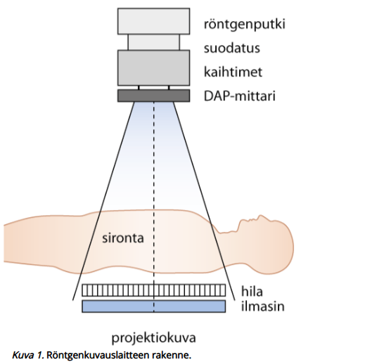

  

## Bankarin murtumassa vaurioituu 

- a. humerus 
- b. lapaluu 
- c. solisuu 
- d. joku neljäs

  <button class="solution-button"
          data-label="Vastaus"
          data-hide-label="Piilota vastaus">
    Vastaus
  </button>
  

      b

Glenoideum tarkalleen ottaen. Bankartin vaurio tarkoittaa olkanivelen etualaosan rustoisen renkaan (labrum) irtoamista/repeämää tyypillisesti oolkanivelen sijoiltaanmenon yhteydessä. Repeämä tapahtuu joko lapaluun etureunan luukappaleen kera (bony bankart -> Bankartin murtuma) tai ilman.

---

a: Humeruksessa usein Bankartiin liittyvä vamma on Hill-Sachsin vaurio, eli olkaluun pään takaosan painuma, joka syntyy, kun humeruksen posterolateraalinen pää osuu nivelkuopan reunaan anteriorisessa sijoiltaanmenossa. Kun Hill-Sachs vaurio havaitaan, tulisi huolellisesti arvioida, onko anteriorisessa glenoidissa Bankartin leesiota

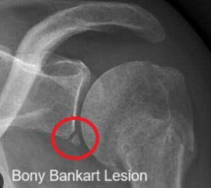
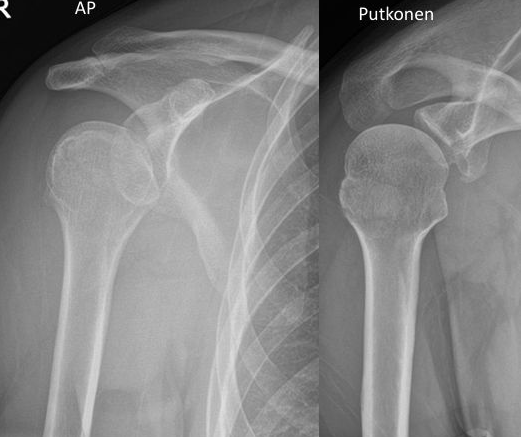
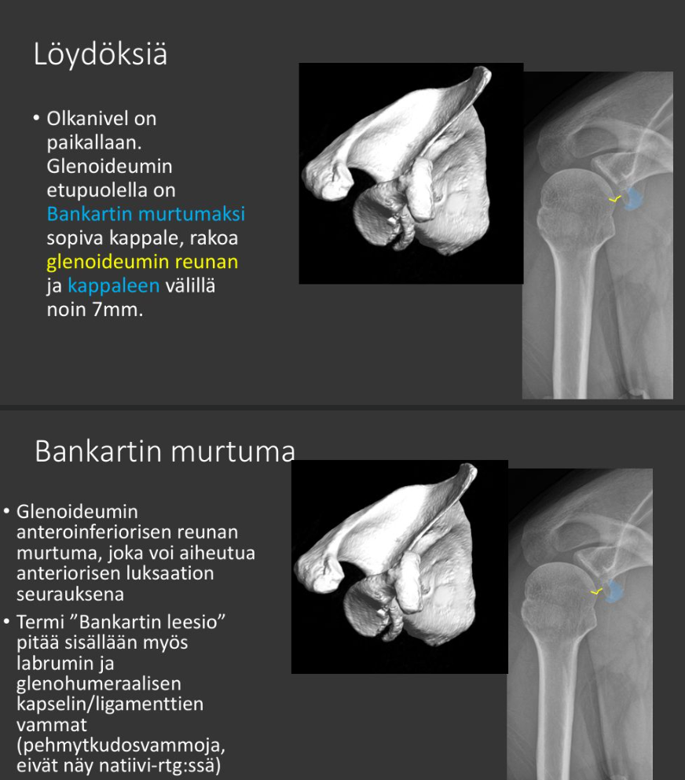
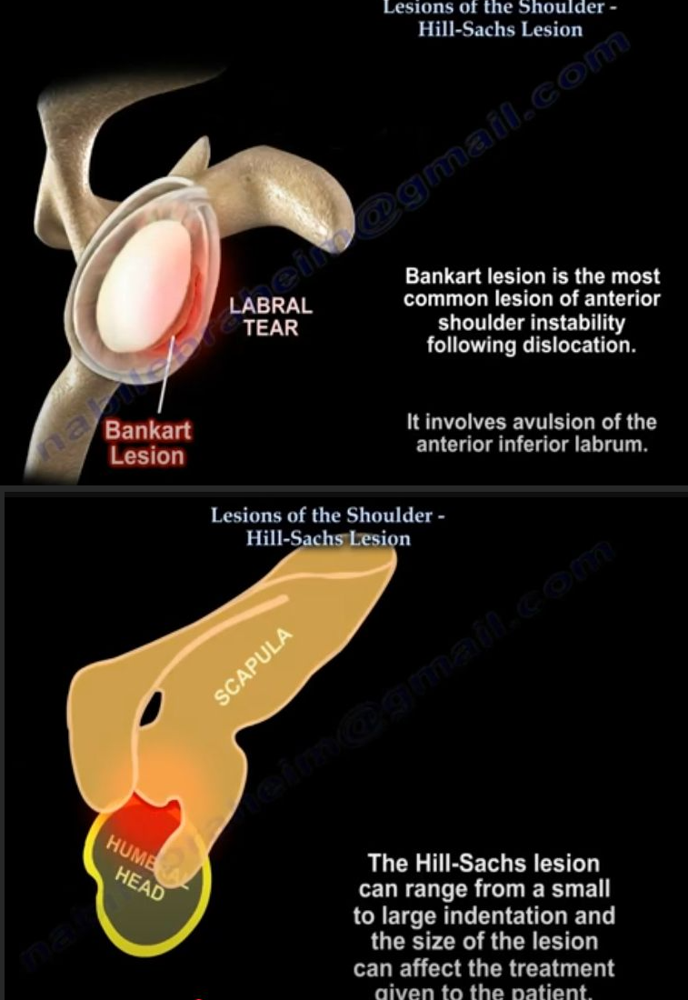

  

## MRCP mitä sillä kuvataan? {#MRCP-mita}

- a. haima 
- b. sappitiet 
- c. maksa 
- d. selkäydin

  <button class="solution-button"
          data-label="Vastaus"
          data-hide-label="Piilota vastaus">
    Vastaus
  </button>
  

      b

MRCP = Magnetic Resonance Cholangiopancreatography = magneettikolangiopankreatikografia = MRI-tekniikka, joka kuvaa sappitiet ja haimatiehyen ilman varjoainetta tai säteilyä. Nestepitoiset rakenteet erottuvat kirkkaina. 

Sappiteiden magneettikuvaus (magneettikolangiografia, MRCP) on paras kajoamaton diagnostinen tutkimusmenetelmä, jos epäillään sappitiekiviä. Otetaankin preoperatiivisesti, jos epäillään sappitiekiviä; esim. jos sappiarvot koholla tai UÄ:ssä sappitiet dilatoituneet. Koska MRCP:ssä ei käytetä mitään varjoaineita, se on potilaalle riskitön.

Haimatiehyt näkyy myös, joten vaihtoehto a on osittain oikein, mutta itse haimaa ei sinänsä kuvanneta. 

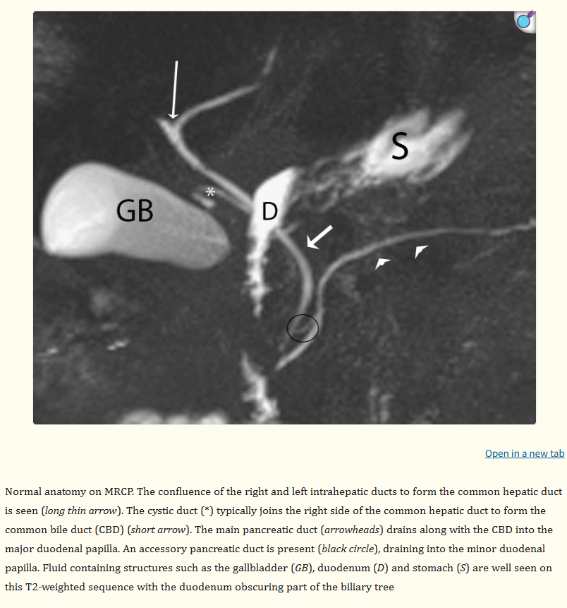
  

## Kuva: onko olkanivel luksoitunut?

Ei esimerkkikuvia, mutta ilmeisesti piti vertailla kahta kuvaa ja toisessa kuvassa oli humerusmurtuma, toisessa ei. Kummassakaan ei ollut itse nivelen luksoitumista. 

## Pleuranesteen määränarvio. Toinen pleurasoppi oli vähän pyöristynyt {#Pyoristynyt-paljon}

- a. alle 20 ml
- b. 20-50ml 
- c. 100-200ml 
- d. joku neljäs vaihtoehto

  <button class="solution-button"
          data-label="Vastaus"
          data-hide-label="Piilota vastaus">
    Vastaus
  </button>
  

      c (tai d riippuu mitä oli)

N. 200ml vaaditaan yleensä pleurasopin pyöristymiseen (n. 75ml lateraalikuvassa); jos taas hilustasolle asti nestettä, niin määrä on pari litraa. 

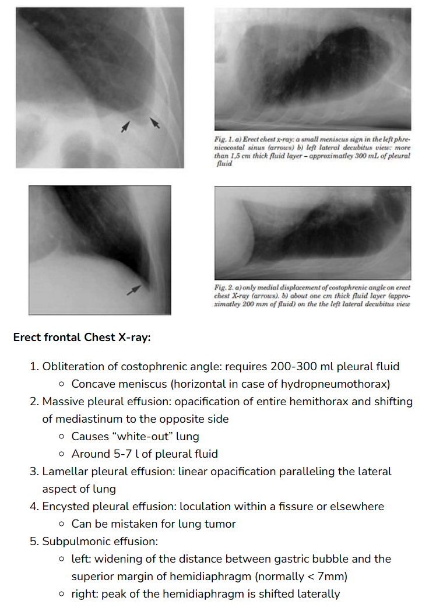
  

## Tupakoitsijapotilas. Kuvaus, että potilaalla retrosternaalinen tila laajentunut, palleat litistyneet, pieni sydän. Onko {#Retrolaajentuma}

- a. sarkoidoosi 
- b. emfyseema 
- c. sydämen vajaatoiminta 
- d. joku neljäs vaihtoehto

  <button class="solution-button"
          data-label="Vastaus"
          data-hide-label="Piilota vastaus">
    Vastaus
  </button>
  

      b

Keuhkoahtaumatauti (COPD) käsittää terminä sekä kroonisen bronkiitin että emfyseeman. **Emfyseema = keuhkolaajentuma;** terminaalisesta bronkiolista distaalisten osien palautumattoman tuhoutumisen aiheuttamaa laajentumista. 

Emfyseeman tärkeimpiä keuhkokuvalöydöksiä ovat: 

<li>Tynnyrimäinen rintakehä</li>
<li>Palleat normaalia alempana ja tasoittuneet</li>
<li>Keuhkojen keski- ja periferiaosien verisuoniniukkuus</li>
<li>Hilusten verisuonirungot ovat kookkaat</li>
<li>Retrosternaalitila on laajentunut</li>
<li>Interkostaalivälit ovat leventyneet</li>
<li>Voi näkyä ilmabullia</li>
<li>Sydän on tyypillisesti pienikokoinen</li>

---

a: Sarkoidoosissa nähdään tyypillisesti varsinkin hilusten imusolmukkeiden suurentumista ja keuhkomuutoksia

c: Sydämen vajaatoiminnassa sydänvarjo on usein suurentunut ja keuhkoissa on kongestiota. 

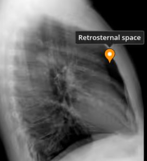
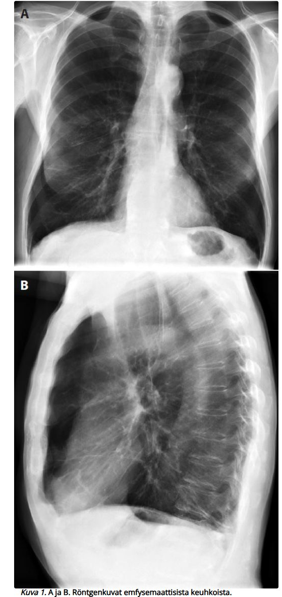

  

## Kuva: Potilasta närästää usein, mikä kuvassa selittää asiaa {#Narastaa-usein}

Ei esimerkkikuvaa, tähän valittu wikin vastaukseen sopiva kuva.

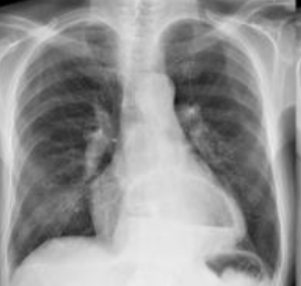

  <button class="solution-button"
          data-label="Vastaus"
          data-hide-label="Piilota vastaus">
    Vastaus
  </button>
  

      Hiatushernia

Tyypillistä on kaasu-ilma-pinta pallean yläpuolella. 

---

Hiatushernia, yleisimmin vielä liukutyrä (90%), on yleinen refluksitaudille (GERD) altistava anatominen poikkeavuus. Hiatusherniassa mahalaukun osa luisuu pallean ruokatorvihiatuksen läpi. Liukutyrässä GE-junktio sekä mahalaukun yläosa luisuu thoraxonteloon -> Terävä Hisin kulma ei enää toimi refluksia estävänä läppäsysteeminä, mikä altistaa refluksitaudille.

Hiatushernia diagnosoidaan yleensä tähystyksellä, mutta tarvittaessa voidaan käyttää tietokonetomografiaa tai ruokatorven ja mahalaukun perinteistä varjoainekuvausta lähinnä anatomian selvittämiseen. Hiatushernia voi näkyä myös tavanomaisessa keuhkokuvauksessa sydämen takana näkyvänä tiivistymänä, jossa on ilma-nestepinta

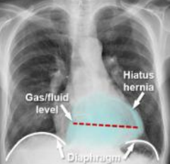
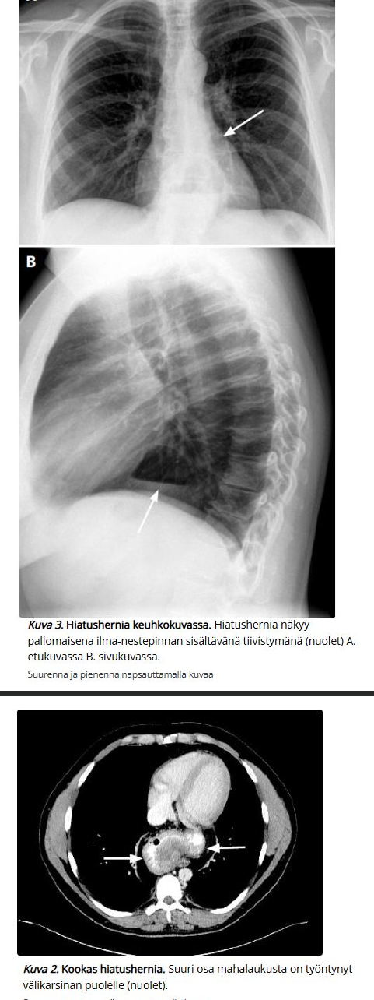

  

## Mikä seuraavista stokastinen {#Mika-stokastinen}

- a. syöpä
- b. harmaakaihi
- c. hiusten lähtö
- d. joku

  <button class="solution-button"
          data-label="Vastaus"
          data-hide-label="Piilota vastaus">
    Vastaus
  </button>
  

      a

Stokastinen haitta: Todennäköisyysperusteinen. Annoksen kasvaessa haitan todennäköisyys kasvaa, mutta vaikeusaste ei riipu annoksesta. Kynnysannosta ei oleteta olevan, eli pienikin annos voi teoriassa aiheuttaa haittaa. Esimerkkejä ovat syöpä ja perinnölliset vauriot (mutaatiot).

Deterministinen haitta: Ilmenee varmasti, kun annos ylittää tietyn kynnysarvon, ja haitan vaikeusaste kasvaa annoksen mukana. Esimerkkejä ovat harmaakaihi, hiusten lähtö, ihon punoitus ja hedelmättömyys.

---

b ja c: deterministisiä

  

## IV-varjoaineen käyttöön liittyen pitää paikkaansa {#IV-varjoaineeseen-paikkansa}

- a. varjoaineen puoliintumisaika on 1vrk
- b. pulmonaaliangiografiassa kuvan ottaminen ajastetaan niin, että nousevan aortan varjoainepitoisuus on suurimmillaan
- c. ja d. jotain

  <button class="solution-button"
          data-label="Vastaus"
          data-hide-label="Piilota vastaus">
    Vastaus
  </button>
  

      c tai d

a:  Jodivarjoaineen puoliintumisaika yleensä joku 1-2h (ja gadoliniumin n. puoli tuntia)

b: Pulmonaaliangiografiassa kuva silloin kun keuhkovaltimot optimaalisessa kontrastissa. 
  

## Polvessa kipua ja turvotusta, vetolaatikkotestissä löysä, rtg ei löydöstä. Miksi kuvaat seuraavaksi MRI? {#Miksi-mri-seuraavaksi}

Ei vaihtoehtoja, koita vastata ilman apuja.

  <button class="solution-button"
          data-label="Vastaus"
          data-hide-label="Piilota vastaus">
    Vastaus
  </button>
  

      Epäilet nivelsidevammaa (ACL tai PCL)

Löysä vetolaatikkotesti viittaa ristisiteen (etummaisen tai takimmaisen) vaurioon, ja röntgen ei näytä pehmytkudoksia. MRI on paras tutkimus ristisiteiden ja muiden pehmytkudosrakenteiden arvioinnissa.

  

## Vuosittainen taustasäteilyn määrä {#Vuosittainen-taustasateily-maara}

- a. 3 mSv 
- b. 12 mSv 
- c. 36 mSv
- d. 20 mSv

  <button class="solution-button"
          data-label="Vastaus"
          data-hide-label="Piilota vastaus">
    Vastaus
  </button>
  

5.9 mSv on keskimääräinen vuosittainen efektiivinen annos suomalaisella; tämä laskee mukaan myös lääketieteelliset tutkimukset keskivertoihmisellä.

  

## Ultraäänen nopeus kudoksessa vs. äänen nopeus ilmassa {#UA-ilmassa-v-kudoksessa}

- a. yhtä nopeita
- b. UÄ kudoksessa nopeampi
- c. ääni ilmassa nopeampi
- d. ei voi verrata, riippuu käytetystä taajuudesta

  <button class="solution-button"
          data-label="Vastaus"
          data-hide-label="Piilota vastaus">
    Vastaus
  </button>
  

      b

Ääni etenee kudoksessa noin 1540 m/s (pehmytkudos keskimäärin), kun taas ilmassa se etenee noin 343 m/s.

---

d: Äänen nopeus riippuu väliaineesta (tiheys ja kimmoisuus), ei taajuudesta, joten ultraääni ja kuuluva ääni etenevät samalla nopeudella samassa väliaineessa.

  

## Mikä rtg-löydös viittaa lonkan artroosiin? {#Mika-viittaa-artroosiin}

Tärpissä ei vaihtoehtoja, mutta mieti mitä löydöksiä voisi olla mainittu oikeassa vastauksessa

  <button class="solution-button"
          data-label="Vastaus"
          data-hide-label="Piilota vastaus">
    Vastaus
  </button>
  

      

Nivelraon kaventuminen, reunaosteofyytit, skleroosi, subkondraaliset kystat -> eli siis tyypilliset artroosin piirteet (LOSS = Loss of joint space, osteophytes, subchondral sclerosis, subchondral cysts)

  

## Tmp radiologi voi tehdä verisuonen embolisaation, mitä tämä tarkoittaa? {Mita-embolisaatio-tarkoittaa}

Ei vaihtoehtoja tärpissä, koita vastata ilman apuja. 

  <button class="solution-button"
          data-label="Vastaus"
          data-hide-label="Piilota vastaus">
    Vastaus
  </button>
  

      
**Embolisaatiossa vuotava valtimo tukitaan viemällä valtimoteitse (useimmiten nivusvaltimo) suoneen materaalia (valintaan vaikuttaa vuotopaikka ja anatomia), joka tukkii vuotokohdan.**

Ennen embolisaatiohoitoa on olennaista määrittää vuotopaikka (tässä paras on vuoto-TT); jos ei näy aktiivista vuotoa, ei ole järkeä embolisoidakaan. 

  

## Atelektaasin yleisin aiheuttaja? 

- a. keuhkovaltimon stenoosi
- b. keuhkolaskimon supistuminen
- c. keuhkoputken ahtauma
- d. joku

  <button class="solution-button"
          data-label="Vastaus"
          data-hide-label="Piilota vastaus">
    Vastaus
  </button>
  

      c

Keuhkoputken ahtauma; voi myös johtua arpimuutoksista, ulkopuolisesta puristuksesta… Kun ilma ei pääse tukoksen taakse, jäljelle jäänyt ilma imeytyy ja keuhkokudos luhistuu.

  

## Kaulan ekstensio- ja fleksiomurtumissa, mikä on oikein? {#Ext-flx-murtumissa-ov}

- a. molemmissa murtuu ylimpiä nikamia
- b. molemmissa murtuu alimpia
- c. ekstensio murtaa ylimpiä ja fleksio alimpia
- d. toisinpäin

  <button class="solution-button"
          data-label="Vastaus"
          data-hide-label="Piilota vastaus">
    Vastaus
  </button>
  

      c

Ekstensiovammat (kaulan ylitaivutus taakse): vauriot painottuvat yläkaulan nikamiin. Tyypillinen on hirttäjän murtuma (C2:n kaarien murtuma), ja kaularangan ekstensiovammoissa osuu myös C1–C2-alue. 

Fleksiovammat (kaulan taivutus eteen): vauriot painottuvat alakaulan nikamiin (C5–C7), esimerkiksi kiilamainen nikamamurtuma, kyynelmurtuma (flexion teardrop) ja nikamien sijoiltaanmeno. 

---

Poikkeuksiakin on, mutta tämä on yleinen periaate

  

## Spondylolisteesi, mitä tarkoittaa? {#Mita-spondylolisteesi-tarkoittaa}

Ei vaihtoehtoja, koita vastata ilman apuja. 

  <button class="solution-button"
          data-label="Vastaus"
          data-hide-label="Piilota vastaus">
    Vastaus
  </button>
  

      Nikamansiirtymää

Spondylolyysi tarkoittaa nikamankaaren höltymää, joka johtuu tyypillisesti pars interarticulariksen häiriöstä (yleensä rasitusmurtuma). Taustalla on useimmiten toistuvat hyperekstensiot ja rotaatiot (useimmiten kyseessä siis nikamakaaren takarakenteen rasitusmurtuma), perinnöllinen taipumus (kaaren ohuus) ja kasvuvaiheen suuri kuormitus urheilussa. 

Taas nikamansiirtymä eli spondylolisteesi syntyy useimmiten joko nikamankaaren höltymän (spondylolyysi) tai välilevyrappeuman seurauksena. Spondylolyysi on tavallisin L5-nikamassa, ja spondylolyyttinen nikamasiirtymä nähdään tavallisimmin presakraalivälissä; vrt. degeneratiivinen spondylolisteesi, joka johtuu nivelten ja välilevyjen kulumisesta -> vanhemmilla potilailla taas L4-L5-välissä. 

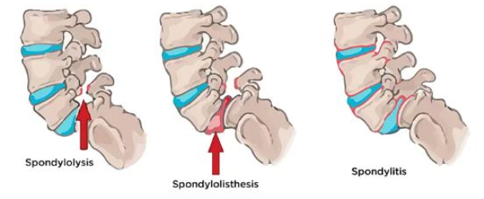
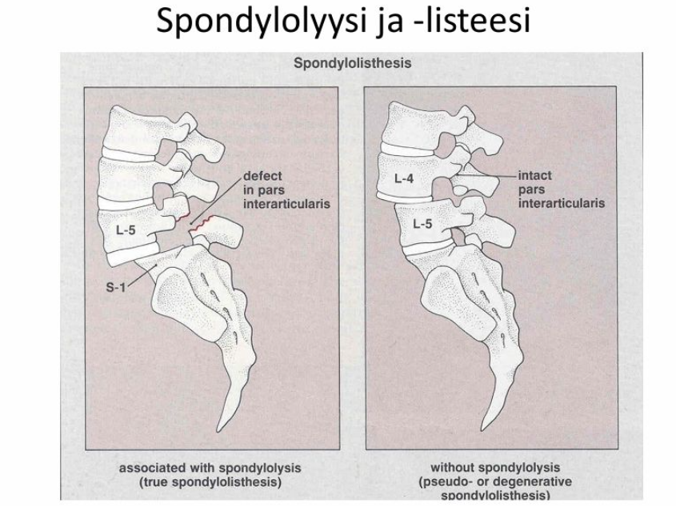
  

## Virtsatiekiviepäily, Kivi-TT, miten kuvaat? {#kivi-tt-miten}

- a. natiivina
- b. arteriavaiheen kuva,
- c. venavaiheen
- d. joku

  <button class="solution-button"
          data-label="Vastaus"
          data-hide-label="Piilota vastaus">
    Vastaus
  </button>
  

      a

Kivi-TT eli matala-annos-TT otetaan ilman suonensisäistä varjoainetta. Kalkkikivet ovat natiivi-TT:ssä selvästi tiheämpiä kuin ympäröivä kudos ja näkyvät hyvin. Varjoaine voisi peittää kiven tai vaikeuttaa sen erottamista virtsan varjoainepitoisuudesta. 

  

## Mihin doppler perustuu?

Ei vaihtoehtoja wikissä, koita vastata ilman apuja. 

  <button class="solution-button"
          data-label="Vastaus"
          data-hide-label="Piilota vastaus">
    Vastaus
  </button>
  

      a

Kudoksen liike aiheuttaa muutoksen siitä heijastuvan ääniaallon taajuuteen
 
Jos molekyyli liikkuu kohti mittaria, niin havaittu taajuus on lähettyä korkeampi ja jos siirtyy poispäin, niin taajuus on matalampi.

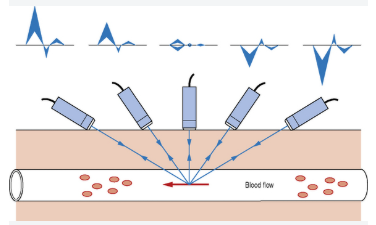
  

## Päivystyksessa iäkäs potilas loukannut lonkkansa, epäilet murtumaa mutta röntgenissä ei murtumaa {#Paivystyksessa-iakas-lonkkapotilas}

- a) otan potilaan osastolle ja kontrollin röntgenin lähipäivinä 
- b) päivystyksellinen TT 
- c) kiireellinen MRI
- d) jotain

  <button class="solution-button"
          data-label="Vastaus"
          data-hide-label="Piilota vastaus">
    Vastaus
  </button>
  

      b

Päivystyksellinen TT, koska lonkkamurtumissa hoito halutaan toteuttaa nopeasti -> saadaan potilas nopeasti liikkeelle eikä jäädä sängyn pohjalle kuolemaan.

Periaatteessa kiireellinen MRI on myös hyvä vastaus, koska se on herkin metodi piilevän murtuman toteamiseen, mutta sitä ei usein saada tarvittavan nopeasti. 

  

## Milloin lannerangan rtg indisoitu?

Tärpissä ei vaihtoehtoja, mutta mm:

- Todetun rankamurtuman kontrolli potilaan seistessä
- Hyväkuntoisen potilaan kompressiomurtuman poissulku
- Taivutuskuvat instabiliteettia epäiltäessä
- Lapsilla spondylolyysin/spondylolisteesin epäily; lannerangan sivukuva seisten on usein riittävä radiologinen tutkimus

## Miten sappineste näkyy kirkkaana MRCP:ssä? {#Miten-sappineste-kirkas-mrcp}

- a. jodi 
- b. barium 
- c. gadolinium
- d. sappi näkyy itsestään kirkkaana

  <button class="solution-button"
          data-label="Vastaus"
          data-hide-label="Piilota vastaus">
    Vastaus
  </button>
  

      d

MRCP:ssä ei käytetä varjoainetta. 

---

MRCP = Magnetic Resonance Cholangiopancreatography = magneettikolangiopankreatikografia = MRI-tekniikka, joka kuvaa sappitiet ja haimatiehyen ilman varjoainetta tai säteilyä. Nestepitoiset rakenteet erottuvat kirkkaina. 

Sappiteiden magneettikuvaus (magneettikolangiografia, MRCP) on paras kajoamaton diagnostinen tutkimusmenetelmä, jos epäillään sappitiekiviä. Otetaankin preoperatiivisesti, jos epäillään sappitiekiviä; esim. jos sappiarvot koholla tai UÄ:ssä sappitiet dilatoituneet. Koska MRCP:ssä ei käytetä mitään varjoaineita, se on potilaalle riskitön.

  

## Mikä kuvaa rtg-säteilyä parhaiten {#Mika-kuvaa-rtg-parhaiten}

- a. Comptonin sironta
- b. vaimenee eksponentiaalisesti kudoksen paksuuden kasvaessa
- c. pienempi allonpituus kuin valolla
- d. joku

  <button class="solution-button"
          data-label="Vastaus"
          data-hide-label="Piilota vastaus">
    Vastaus
  </button>
  

      d?

Kaikki ovat sinänsä totta, joten jos d oli "kaikki totta", niin se voisi olla hyvä vaihtoehto. 

a: Comptonin sironta (fotonin ja väliaineen elektronin välinen vuorovaikutusmekanismi, jossa fotoni siroaa epäelastisesti väliaineen elektroneista; fotoni vuorovaikuttaa elektronin kanssa luovuttaen osan energiastaan elektronille ja muuttaen kulkusuuntaansa) on yksi röntgensäteilyn vuorovaikutustavoista aineen kanssa (muita ovat fotosähköinen ilmiö ja koherentti sironta). Ei tosin ole koko rtg-säteilyn kuvaus, vaikka onkin yksi sen piirteistä.

b: Pitää paikkansa, tosin kuvailee säteilyn vaimenemista aineessa (Beerin-Lambertin laki), ja sama pätee muillekin fotonisäteilyn lajeille, kuten gammasäteilylle

c: Röntgensäteily on sähkömagneettista säteilyä, jonka aallonpituus (noin 0,01–10 nm) on huomattavasti lyhyempi kuin näkyvän valon (noin 400–700 nm). Sen fotonienergia on korkea, minkä vuoksi se läpäisee kudoksia ja on ionisoivaa. 
  

## Aivokuvat, jossa aivokudoksen keskikohdassa kirkas pyöreä muutos ja toisessa tumma pyöreä muutos {#Kirkas-pyorea}

Ei kuvaa, mutta mikä voisi olla vastaus pelkästään kuvauksen perusteella. 

- a. molemilla infarkti
- b. molemmilla vuoto
- c. toisella infarkti ja toisella vuoto

  <button class="solution-button"
          data-label="Vastaus"
          data-hide-label="Piilota vastaus">
    Vastaus
  </button>
  

      c

**Aivojen natiivi-TT:ssä kirkas on tuoretta verta ja tumma on infarkti** -> tumma pyöreä muutos on infarkti ja keskikohdan kirkas muutos on intraparenkymaalinen vuoto. 
  

