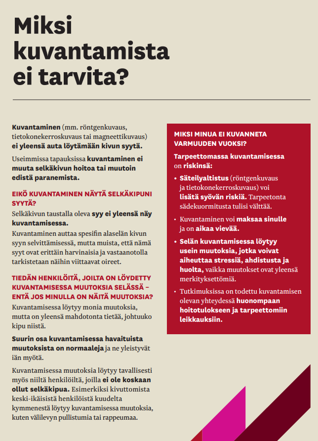
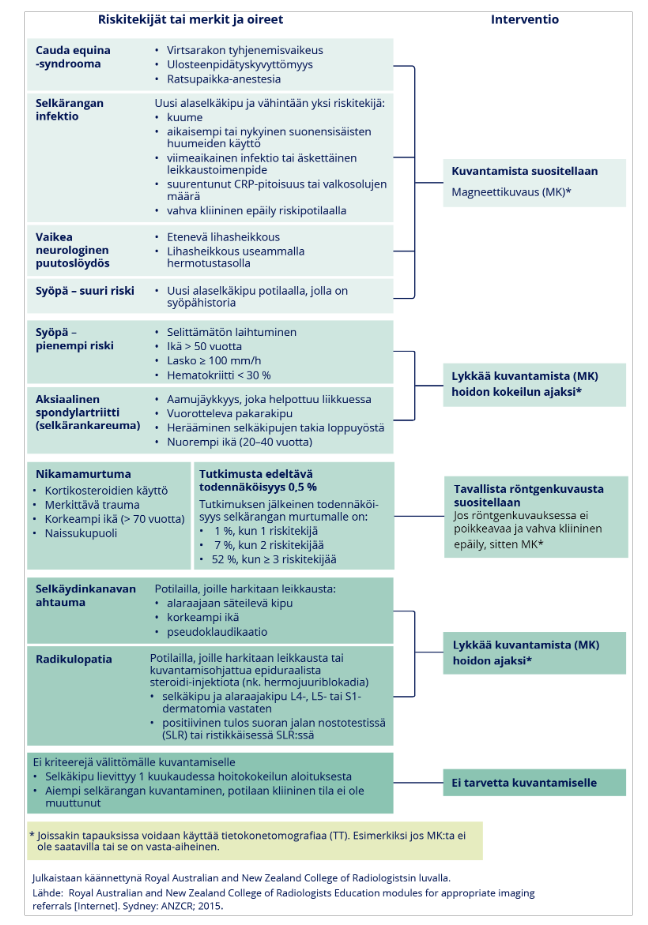
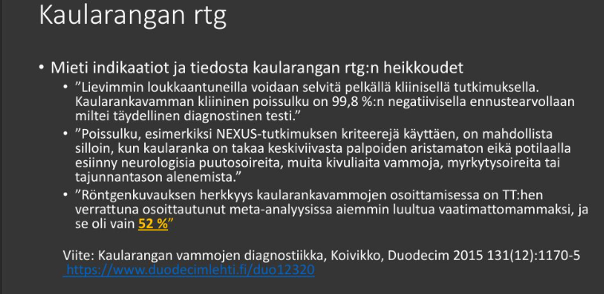
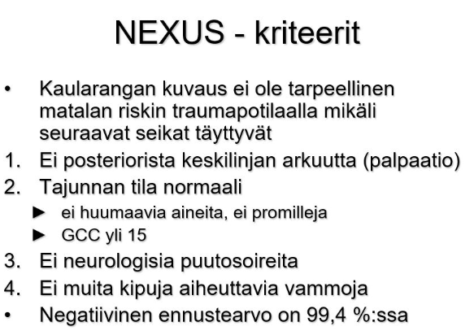

# 2022 

Vuonna 2023 vain jo käytyjä tärppejä, ei niitä uudestaan. Vuoden 2022 kysymyksistä myös suurin osa jo käyty, tässä muutamia vielä läpikäymättömiä.

## Haimatulehduksen kuvaus: tarvitaanko varjoainetta, mikä kuvantaminen näyttää kudoksen voinnin? {#Haimatulehduksen-kuvaus}

Ei vaihtoehtoja, vastaa ilman apuja. 

  <button class="solution-button"
          data-label="Vastaus"
          data-hide-label="Piilota vastaus">
    Vastaus
  </button>
  

Paras kuvantaminen saadaan kontrastilla.

UÄ ei näytä haimakudoksen vointia; TT ja MRI toimii (TT paras; MRI hyvä tiehytrakenteiden tutkimisessa) 
  

## Vanhuksen aivot. MRI vs TT

- a. MRI:ssä valkoinen aine näkyy paremmin 
- b. MRI:ssä parempi paikannus

  <button class="solution-button"
          data-label="Vastaus"
          data-hide-label="Piilota vastaus">
    Vastaus
  </button>
  

      a

Aivojen kuvantamisessa MRI on paras kuvantamiskeino kudoksen tarkastelussa. Magneettikuvaus (MRI) näyttää valkean aineen muutokset huomattavasti paremmin kuin tietokonetomografia (TT). Erityisesti T2- ja FLAIR-sekvensseissä näkyvät hyvin pienten suonten taudin aiheuttamat muutokset (leukoaraioosi, lakunainfarktit), mikrovuodot ja demyelinaatio. 

MRI:n pehmytkudoskontrasti on parempi, joten muutokset erottuvat ja rajautuvat tarkemmin. Siinä mielessä myös paikannus on parempi. Paikannus sinänsä ei kuitenkaan ole MRI:n ensisijainen etu, koska nykyaikaisesta TT:stäkin saadaan tarkat leikekuvat eri suuntiin. 

---

TT on parempi akuuttitilanteissa (aivoinfarkti, aivoverenvuoto, pään vamma...)
  

## Alle 3kk selkäkipu miksi ei kuvata? {#Alle-3kk-ei}

Ei vaihtoehtoja, koita vastata ilman apuja. 

  <button class="solution-button"
          data-label="Vastaus"
          data-hide-label="Piilota vastaus">
    Vastaus
  </button>
  

      

Ei vaikuta hoitosuunnitelmaan. 

---

Akuutilla alaselkäkivulla tarkoitetaan alle 6 viikkoa 1 kestänyttä kipua. Pitkittyneellä (kroonisella) alaselkäkivulla tarkoitetaan yli 12 viikkoa kestänyttä kipua. 

Kuvantamisesta epäspesifisessä akuutissa alaselkäkivussa ei ilmeisesti ole hyötyä, mutta siitä ilmeisesti on haittaa ja se lisää kustannuksia. Kuvantaminen tilanteissa, joissa ei ole vakavan syyn merkkejä, lisää kustannuksia, terveydenhuollon palveluiden käyttöä ja työkyvyttömyyttä. **Avoterveydenhuollossa tuleekin pääsääntöisesti pidättäytyä kuvantamistutkimuksista alle 3 kuukautta kestäneessä epäspesifisessä alaselkäkivussa.**Apuna sen perusteluun, miksi kuvantamista ei tarvita, voi hyödyntää [alaselkäkivun opasta](https://www.terveyskirjasto.fi/xmedia/dlk/dlk00326_alaselkakipuopas.pdf).

<li>Ennuste on hyvä ilman kuvantamista. Kuvantaminen ei paranna hoitotuloksia.</li>
<li>Löydökset ovat yleisiä myös oireettomilla</li>
<li>Löydökset ovat yleisiä myös oireettomilla</li>

---

Kuvantaminen (MRI) tehdään vasta jos leikkaushoitoa harkitaan, yleensä kun kipu on jatkunut noin 6–12 viikkoa konservatiivisesta hoidosta huolimatta tai jos on hälyttäviä merkkejä (silloin tietysti kiireellisemmin; esim. cauda equina, infektioepäily, neurologiset puutosoireet). 

  

## Paksusuolisyövän diagnosointi {#pksyopa}

- a. tt-kolografia
- b. mri
- c. tähystys

  <button class="solution-button"
          data-label="Vastaus"
          data-hide-label="Piilota vastaus">
    Vastaus
  </button>
  

      c

Kolonoskopia on paksusuolisyövän ensisijainen diagnostinen tutkimus ja kultainen standardi. Siinä voidaan nähdä limakalvo suoraan, ottaa koepaloja, poistaa polyyppejä yms. 

---

a: Vaihtoehto, jos kolonoskopia jää vajaaksi tai potilas absoluuttisesti kieltäytyy kolonoskopiasta 

b: MRI ei ole oikein käytössä paksusuolisyövän diagnosoinnissa
  

## Crohnin taudin kuvantaminen TT vai MK, varjoainetta vai ei? 

  <button class="solution-button"
          data-label="Vastaus"
          data-hide-label="Piilota vastaus">
    Vastaus
  </button>
  

      MK ja varjoaineella 
      
Crohnin taudissa ensisijainen tutkimus on yleensä magneettikuvaus (MK), tarkemmin MR-enterografia. Siinä käytetään sekä suun kautta otettavaa nestettä että suonensisäistä varjoainetta

  

## Meniscivammaepäily, mikä kuvantamistutkimus? {#Menisci}

  <button class="solution-button"
          data-label="Vastaus"
          data-hide-label="Piilota vastaus">
    Vastaus
  </button>
  

      MK
      
Magneettikuva on ensisijainen polven sidekudosvammojen diagnostiikassa (usein kyllä vammapotilailla päivystysvaiheessa natiivi-rtg murtuman poissulkemiseen). 
  

## Millä kuvantamiskeinolla kasvojen alueen murtumat kannattaa kuvantaa? {#Kasvomurtumat}

  <button class="solution-button"
          data-label="Vastaus"
          data-hide-label="Piilota vastaus">
    Vastaus
  </button>
  

      TT

Kasvomurtumissa TT on paras. Se tehdään ilman varjoainetta ja ohuin leikkein ja siitä tehdään tarvittaessa 3D-rekonstruktiot. Kasvojen luut ovat ohuita ja limittäisiä. Tavallisessa röntgenkuvassa ne peittävät toisiaan, kun taas TT erottaa ne kerroksittain -> Monimutkaiset murtumat näkyvät hyvin, esimerkiksi Le Fort -murtumat, poskiluun murtumat, silmäkuopan murtumat ja otsaontelon murtumat. 3D-rekonstruktiot auttavat leikkauksen suunnittelussa. 

Samalla voidaan tarvittaessa kuvata aivot ja tarvittaessa kaularanka, jos potilaalla on niiden kuvantamista aiheellistava vamma. 

Silmäkuopan murtumissa TT näyttää myös silmälihaksen tai rasvakudoksen pinnistymisen murtumarakoon. Tämä on tärkeää, jos potilaalla on kaksoiskuvia tai silmän liikkeet ovat rajoittuneet.
  

## Kuinka monta prosenttia kaularangan murtumista jää havaitsematta rtg:llä? {#Kuinka-monta-pros}

Ei vaihtoehtoja, koita vastata ilman apuja. 

  <button class="solution-button"
          data-label="Vastaus"
          data-hide-label="Piilota vastaus">
    Vastaus
  </button>
  

      n. (15-)50%

**Ensisijainen kuvantamistutkimus kaularangan vammaepäilyssä on TT** -> Kaularankavammaepäily on aihe lähettää potilas erikoissairaanhoitoon. **Muista: kaularangan murtumat voidaan poissulkea NEXUS-kriteereillä kliinisesti -> aina ei siis tarvita kuvantamista!**

---

Jos TT-tutkimus ei ole saatavilla, voidaan kaularangasta joidenkin lähteiden ohjeiden mukaan ottaa alkuvaiheessa röntgenkuvat selkeimpien vammojen arvioimiseksi (ennen siirtoa erikoissairaanhoitoon), jotta voidaan hieman arvioida siirron kiireellisyyttä. Käytännössä tätä ei kuitenkaan kannata tehdä, koska se hidastaa potilaan siirtoa pakollisiin tutkimuksiin (eli TT), vaan potilas tulee suoraan lähettää ESH

Kaularangan rtg:n käyttö on vähentynyt merkittävästi, koska se on hyvin epäherkkä murtumien tunnistamisessa; primaarivaiheessa jää röntgenkuvista toteamatta 10–25 % murtumista -> Kaularangan murtumaepäilyssä natiiviröntgen ei siis ole riittävä tutkimus!

  

## Mitä potilaan tulee tehdä ennen vatsan alueen TT-kuvausta? {#Ennen-vatsan-TT}

Ei vaihtoehtoja. Vastaa kuitenkin kysymykseen: kuinka kauan tulee olla syömättä? 

  <button class="solution-button"
          data-label="Vastaus"
          data-hide-label="Piilota vastaus">
    Vastaus
  </button>
  

      2h

Vähentää mm. mahdollista varjoaineesta johtuvaa pahoinvointia kuvauksen aikana. Nykyiset jodivarjoaineet aiheuttavat harvoin oksentelua, joten paasto ei ole välttämätön. Osa yksiköistä ei siksi enää edellytä paastoa. Kuvan laatu kylläkin voi joskus parantua, kun maha tai suoli ei ole täynnä ruokaa. 

Akuuttitilanteissa, kuten päivystyspotilailla, kuvausta ei viivytetä paaston vuoksi
  

## Thx-rtg ja TT: jos thx-rtg:ssä näkyy muutos valkoisena, ei voida tietää, näkyykö se tummana vai vaaleana TT:ssä. {#ei-voi-tietaa}

- a. totta 
- b. väärin 

  <button class="solution-button"
          data-label="Vastaus"
          data-hide-label="Piilota vastaus">
    Vastaus
  </button>
  

      b

Kumpikin menetelmä perustuu röntgensäteiden vaimenemiseen. Mitä tiheämpää kudos on, sitä enemmän se vaimentaa säteilyä -> Kudos, joka vaimentaa säteilyä paljon, näkyy vaaleana kummassakin menetelmässä. 

Siksi muutos, joka näkyy thoraxkuvassa vaaleana, näkyy myös TT:ssä vaaleampana kuin ympäröivä ilmapitoinen keuhko. Esimerkkejä tällaisista muutoksista ovat infiltraatti, kasvain, neste ja kalkkeuma.

---

Tietysti TT:n ikkunoinnin myötä harmaasävyt voidaan näyttää eri tavalla. 
  

