# 2020 - 

Tässä vielä wikissä 2020 vuodesta alaspäin olevia tärppejä, joita ei ole tullut tässä kirjassa vielä esille. 

## Kaatuminen, kuvassa nähty ranteessa dorsaalisesti hippu, mikä luu? {#Mika-luu}

Sopiva esimerkkikuva valittu tähän 

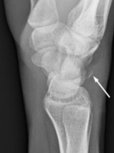

  <button class="solution-button"
          data-label="Vastaus"
          data-hide-label="Piilota vastaus">
    Vastaus
  </button>
  

      Triquetrummurtuma

Kolmioluun murtuman yleisin vammamekanismi on kaatuminen ojennetun+ulnaaridevioidun tai äärimmäisessä fleksiossa+radiaalideviaatiossa olevan käden varaan -> Aiheuttavat dorsaalisia kortikaalisia murtumia; korpusmurtumat taas useimmiten johtuvat anterio-posteriorisista murskaavista vammoista

<li>Kaatuminen ojennetun+ulnaaridevioidun käden varaan -> triquetrumin impaktiomurtuma, jossa ulnan proc. styloideus (PSU) painuu triquetrumia vasten ja aiheuttaa murtuman</li>
<li>Kaatuminen fleksiossa+radiaalideviaatiossa olevan käden varaan -> dorsaalinen avulsiomurtuma johtuen radiotriquetraaliligamentin avulsiosta; aiheuttaa pooping-duck-sign röntgenissä.</li>

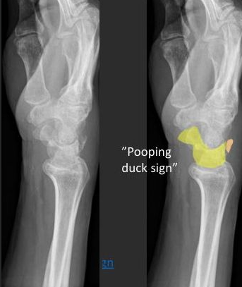
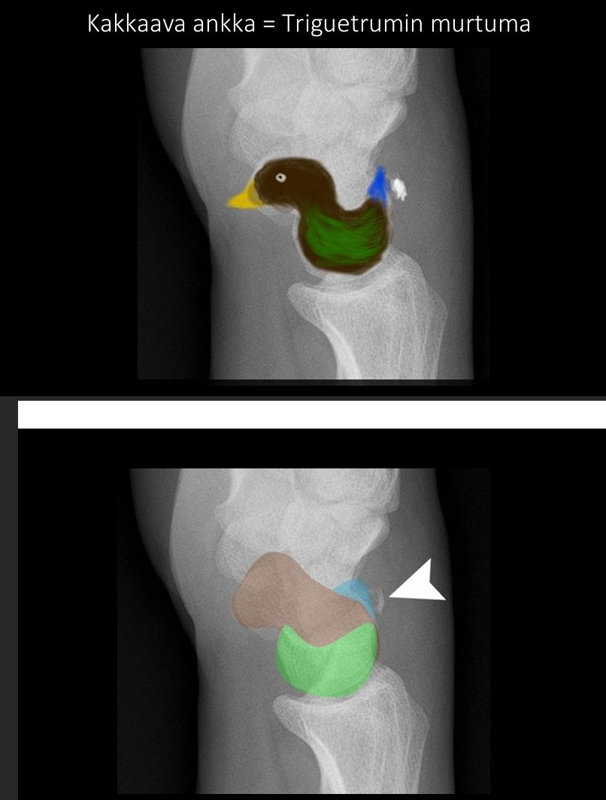
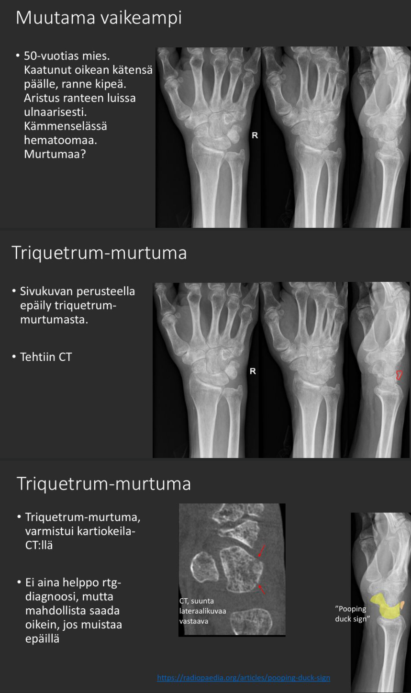

  

## Rasitusmurtuma näkyy rtg-kuvissa kuinka nopeasti? {#Rasitusrtg}

Ei vaihtoehtoja, koita vastata ilman. 

  <button class="solution-button"
          data-label="Vastaus"
          data-hide-label="Piilota vastaus">
    Vastaus
  </button>
  

      2-4vk

Natiivi-rtg näyttää tuoreet rasitusmurtumat huonosti. Joskus muutosten ilmaantuminen kestää jopa 2–3 kuukautta, ja osa rasitusmurtumista ei näy röntgenkuvassa koskaan. 

Muutokset näkyvät vasta, kun luu alkaa parantua: luukalvon reaktio (periostireaktio), kallus, skleroosi eli luun tiivistymä (erityisesti hohkaluussa), joskus murtumalinja...

---

Paras kuvantamismenetelmä rasitusmurtuman osoittamiseen on MRI. Luuytimen turvotus näkyy jo muutamassa päivässä. TT näyttää myös murtumalinjan hyvin. 

Tietyissä tilanteissa, joissa murtuma voi edetä täydelliseksi tai parantua huonosti, MK tehdään varhain (esim. reisiluun kaula). 
  

## Laskimotromboosin ensisijainen kuvantamismenetelmä? {#laskimotromb}

  <button class="solution-button"
          data-label="Vastaus"
          data-hide-label="Piilota vastaus">
    Vastaus
  </button>
  

      UÄ

Syvä laskimotukos (SLT) voidaan usein poissulkea luotettavasti kahden-kolmen pisteen (nivusesta ja polvitaipeesta) kompressioultraaänitutkimuksella. Terve, avoin laskimon osa menee painettaessa täysin kasaan (kolapsi). Jos laskimossa on veritulppa, suoni ei mene kasaan painettaessa. 

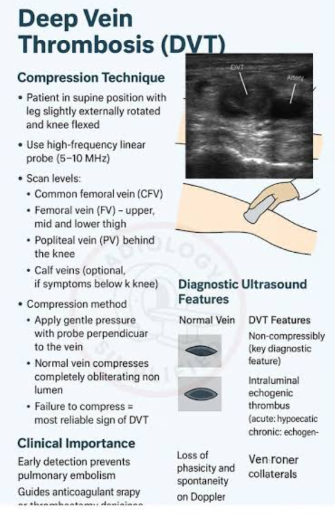
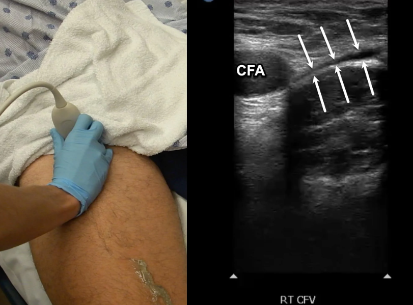

  

## Missä intubaatioputki sijaitsee hyvässä intubaatiossa thx-kuvassa? {#int-putki}

Ei vaihtoehtoja, koita vastata ilman apuja. 

  <button class="solution-button"
          data-label="Vastaus"
          data-hide-label="Piilota vastaus">
    Vastaus
  </button>
  

      Väh 2.5cm karinatason yläpuolella

Henkitorven puolivälin korkeudella eli 3–5 cm carinan yläpuolella. 

Jos carinaa ei pysty suoraan erottamaan kuvasta, niin sen voi arvioida sijaitsevan suunnilleen 4. ja 5. rintanikaman välilevyn korkeudella

---

Thoraxkuvauksella voidaan tarkistaa potilaaseen asetettujen putkien, katetrien ja kanyylien paikka ja saada selville mahdolliset asettamisesta aiheutuneet komplikaatiot. Letkujen optimaalinen sijainti ja sen toleranssit tulee tietää ja suhteuttaa ne anatomisiin rakenteisiin

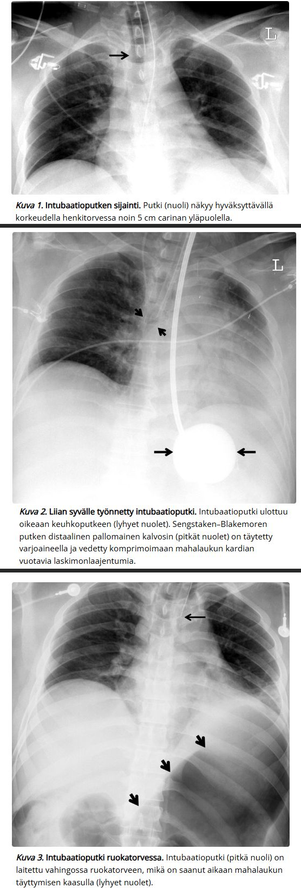
  

## Kyynärpään alueella on kuusi kasvutumaketta {#Kuusi-kasvutum}

- a. oikein 
- b. väärin

  <button class="solution-button"
          data-label="Vastaus"
          data-hide-label="Piilota vastaus">
    Vastaus
  </button>
  

      a

Kyynärnivelen luutumistumakkeet ja niiden esiintymisjärjestys lapsella voidaan muistaa muistisäännöstä CRITOE. 

<li>Capitulum Humeri</li>
<li>Radial head/ Caput radii</li>
<li>Medial/Internal epicondyle</li>
<li>Trochlea Humeri</li>
<li>Olecranon</li>
<li>Lateral/External epicondyle</li>

---

Epätarkasti voi muistaa ilmenemisiät parittomien lukujen avulla (1,3,5,7,9,11). Tarkempi olisi 1,5,7,10,10,11

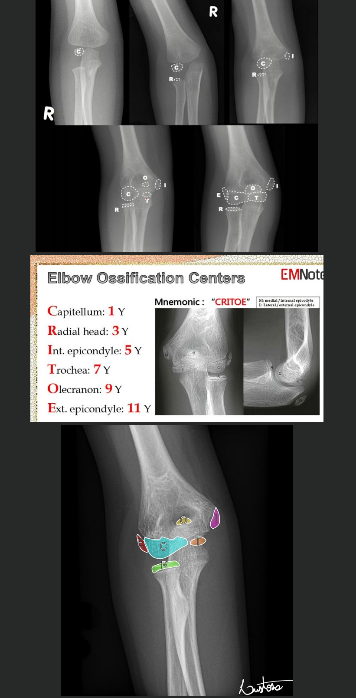
  

## Keuhkoembolian ensisijainen kuvantamistutkimus on?

Ei vaihtoehtoja, koita vastata ilman

  <button class="solution-button"
          data-label="Vastaus"
          data-hide-label="Piilota vastaus">
    Vastaus
  </button>
  

      Keuhkoembolia-TT, KE-TT

On siis keuhkoembolian TT-angiografia; vaihtoehto on ventilaatio-perfuusiotutkimus

---

Normaali löydös KE-TT:ssa sulkee pois KE. KE-TT voi osoittaa myös muiden sairauksien aiheuttamia muutoksia, mikä on eduksi erotusdiagnostiikassa. Kun KE on diagnosoitu, kuvantamistutkimukset eivät tavallisesti ole tarpeen mahdollisen SLT:n osoittamiseksi

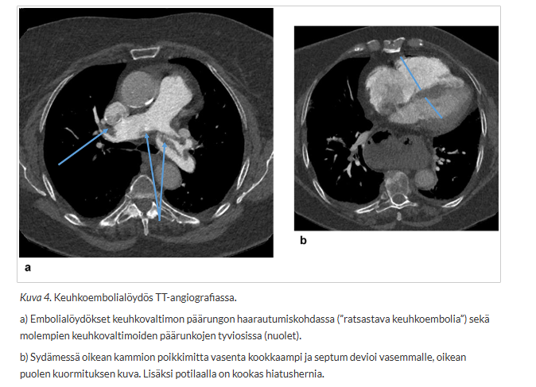

  

## Trimalleolaarimurtumassa mitkä luut murtuvat {#trim}

Ei vaihtoehtoja, koita vastata itse.

  <button class="solution-button"
          data-label="Vastaus"
          data-hide-label="Piilota vastaus">
    Vastaus
  </button>
  

      
Mediaali- ja lateraalimalleoli sekä tibian takaosa eli takakolmio ovat murtuneet. Epästabiili nilkkamurtuma. 

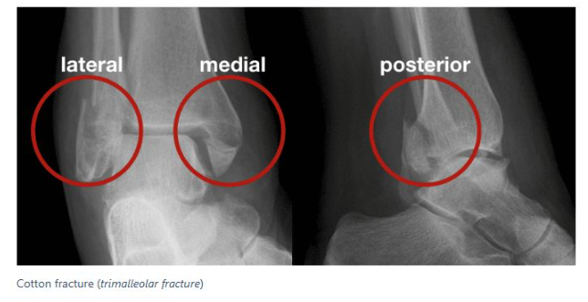
  

## Charcot:n jalka on neuropatia (diabeettinen useimmiten)

- a. totta
- b. väärin 

  <button class="solution-button"
          data-label="Vastaus"
          data-hide-label="Piilota vastaus">
    Vastaus
  </button>
  

      a
      
Charcot'n jalka eli neuro-osteoartropatia (neuropaattinen osteoartropatia) syntyy diabeettisen neuropatian seurauksena. Lyhenteenä usein CNO eli Charcot'n neuropaattinen osteoartropatia. 

---

Akuutti Charcot muistuttaa septistä niveltulehdusta tai ruusua, ja prosessi johtaa nivelten tuhoutumiseen, jalkaholvin romahtamiseen ja epämuodostumiin. Huolimatta runsaasta niveltuhosta oireet ovat usein neuropatian vuoksi vähäisiä. 

Hoitona potilaan jalka immobilisoidaan joko kipsillä tai ortoosilla; alkuvaiheessa jalkaan kohdistuvan kuormituksen täydellinen poistaminen on ensiarvoisen tärkeää

*Ei aivan yksinomaan diabeteksen aiheuttama, mutta lähes aina. Muita mahdollisia alaraajaneuropatiaa aiheuttavia tekijöitä ovat lepra, poliomyeliitti, syringomyelia, alkoholismi, MS-tauti, Parkinsonin tauti, nivelreuma, raskasmetallimyrkytys, synnynnäiset neuropatiat ja vammat

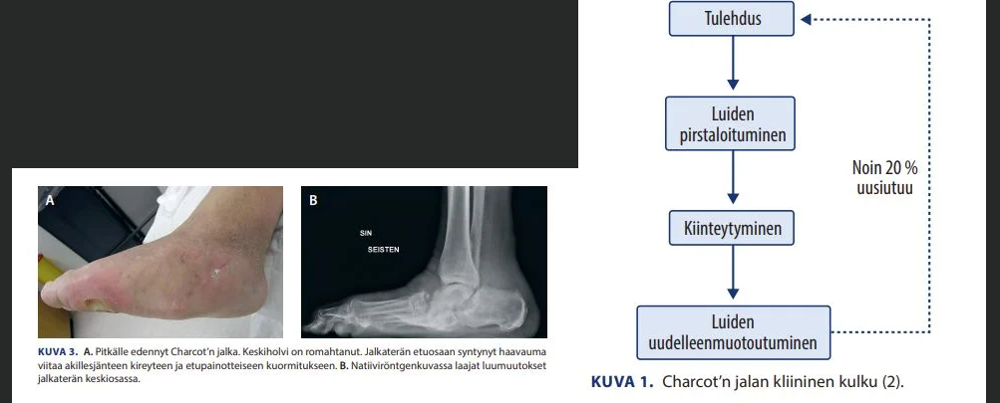
  

## Mitä näkyy {#mita-nakyy}

Ei vaihtoehtoja, koita tunnistaa tästä esimerkkikuvasta tärkein löydös. 

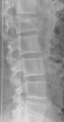

  <button class="solution-button"
          data-label="Vastaus"
          data-hide-label="Piilota vastaus">
    Vastaus
  </button>
  

      
L1 nikaman korpuksen kompressiomurtuma. Yläpäätelevyn kompressiopainaumaa. 

  

## Mitä näkyy {#Mita-nakyy-2}

Ei vaihtoehtoja, koita tunnistaa tästä esimerkkikuvasta tärkein löydös. 

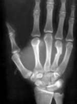

  <button class="solution-button"
          data-label="Vastaus"
          data-hide-label="Piilota vastaus">
    Vastaus
  </button>
  

      
4. metakarpaalin diafyysimurtuma, melko hyväasentoinen.

  

